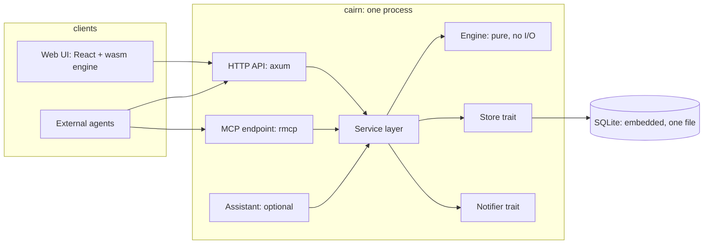
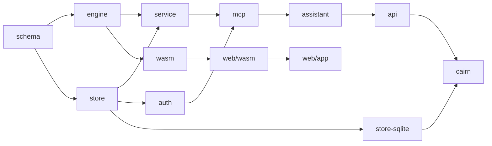

# Cairn: Architecture

How the PRD is built, never what is built. Read `PRD.md` first; requirement ids mark where a requirement forces a design choice.

## Summary

One Rust binary around a pure **engine**: every PRD rule (model, patches, invariants, derive, date network, projections, upgrade merge, file format) as I/O-free functions over in-memory graphs. The **shell** adds storage, HTTP API, MCP, auth, the optional assistant, and the embedded web UI. The engine also compiles to wasm, so the browser derives and projects journeys locally. `cairn demo` runs the binary over an in-memory store seeded with the fixtures, for development, demos, and end-to-end tests.



Load-bearing decisions:

1. **Engine is pure.** No storage, HTTP, or clock in it; today, timezone, rank constants, and the viewer are inputs (D6, J3).
2. **Whole domain in memory.** Every read loads one journey or route whole and derives once; every write validates a full candidate graph.
3. **State and events in one transaction.** The patch applier is the only writer; row deltas and one event per mutation commit together or not at all (A17, J1, J2).
4. **One engine, two places it runs.** Server and browser run the same crate; the browser runs the pure functions locally, against the server's answers.
5. **Pluggable edges.** Storage, auth, notification, and the assistant provider are traits assembled in one composition root per host.
6. **The engine owns every rule and derived value.** Hosts keep only presentation; they read rules from the engine (directly, via wasm, or the generated rule tables) and ask it (a derive, a check, a preview) for anything a table cannot say. No host copies a rule.

## Assumptions and limits

- **Journeys are small** (hundreds of nodes, single-digit MB). Hence whole-domain loads, full in-memory derive, the full journey sent to the browser, no partial-graph writes, no pagination on graph reads except the node list (C9). Validation enforces the node limit (`PRACTICES.md`). Past it the path is incremental derive and paged reads; the schema would not change.
- **One deployment, one trust boundary** (H4): no RBAC or per-journey visibility.
- **One process** over one embedded database file; several instances are `Later`.
- **Calendar days in the deployment timezone** (A9): "today" is computed once per request and passed in, so every user sees the same slack, overdue, and rank. Event timestamps render in the viewer's zone.
- **Rank constants are configuration**; limits are hard-coded (`PRACTICES.md`).

## Terms

PRD terms keep their meaning. Additionally:

| Term | Definition |
|---|---|
| **Domain** | A patch target (A17), loaded and revision-checked as one unit: a journey, a route with its draft (a segment is a route of kind `segment`), or the deployment. Published versions are immutable graphs loaded singly by id, never part of the domain; inserting or upgrading a segment (B13, B14) reads the versions it names as inputs. |
| **Derive inputs** | Today, deployment timezone, rank constants, the viewer's identities (resolved by the host from verified emails, H3), and the deployment context (identities, emails, aliases at a deployment revision) through which ownership, "mine", and the owner factor resolve (E4, E6). Supplied by the host. |
| **Projection** | A read-only view over a derived journey (snapshot, level, trace, decision view, timeline, status summary, next, mine). |
| **Domain document** | A journey's graph and state plus its derive inputs. Nothing derived, no proposals; the browser derives it locally. |
| **Snapshot** | The I3 projection: a journey's facts and counts, for agents. |
| **Change set** | The persistence-neutral result of an accepted patch: identities put and removed by key, events, patch id, next revision. A `schema` type, so stores depend on `schema`, not the engine; only the engine's `apply` produces one (inside `Applied`). |
| **Notifier** | Announces "domain X is at revision N". In-process in both hosts. |
| **Composition root** | The one function per host that picks store, notifier, auth providers, and assistant provider and assembles the service. |
| **Capabilities document** | `GET /api/capabilities`: what the host offers (auth providers, assistant, MCP address and sign-in, SSE) and the server's release. The UI shows features from it. |
| **Host** | The server binary or the browser bundle: something that assembles the engine with a composition root. |

## Repository layout

```
cairn/
  crates/
    engine/        pure domain: model, patch, validate, derive, dates, project, upgrade, format
    wasm/          wasm-bindgen surface for the browser: the engine's projections, checks and previews, run locally
    schema/        serde types shared by engine and shell: document, patch, API payloads; JSON Schema export
    store/         Store and Notifier traits; memory backend; the store conformance test suite. No delta types of its own: it persists the change set from schema
    store-sqlite/  SQLite backend (rusqlite: embedded, WAL mode, one writer)
    service/       service layer: load, call engine, commit; capabilities; composition root types; the wire types the API answers with (`wire`). Runtime-free: no tokio, database driver, or transport dependency, so it builds for wasm32-unknown-unknown
    auth/          AuthProvider trait; dev, oidc, builtin-oauth, tailscale, Google Cloud IAP providers; users and logins
    api/           axum endpoints, the generated OpenAPI document, SSE, the Rust client; the wire types only the API has (assistant, agent tokens)
    mcp/           rmcp server: tools, prompt metadata, instructions
    assistant/     provider trait, tool loop, proposal drafting
    cairn/         the binary: CLI, config, composition root, embedded assets
    tests/         the library crates' integration tests, one test binary, a directory per crate under test
  web/
    app/           React UI (Vite); React Flow canvas; ELK in a worker
    client/        TypeScript client: generated/ plus the hand-written subscription wrapper (H6) and the patch types
    wasm/          wasm package: generated/ bindings plus the hand-written loader and the derive worker
  instructions/    the shipped agent guide (I4), served by MCP and published as SKILL.md
  fixtures/        generic seed routes with a journey scenario each, one journey with no route, one segment
  testbeds/        simulation testbeds (PRACTICES.md, Simulation)
  openapi/         generated OpenAPI document
  schema/          generated JSON Schema for the file format
  decisions/       judgment calls awaiting the user's review (AGENTS.md)
  docs/            the guide to running a deployment, and the README's pictures
  mise-tasks/      tasks, one file each, grouped by directory
  scripts/         helpers the tasks share: the ladder runner and its steps
```

Arrows point from a crate to one that depends on it, direct dependencies only where not implied. `crates/tests/tests/integration/architecture.rs` holds the list and the diagram to the manifests.



## Engine

### Model

- One `Node` struct with shared fields and a per-kind payload enum (A1a), so a field a kind cannot have is unrepresentable. Kinds, states, transitions, guard outcomes, relevance (`Relevant | NotRelevant | Undecided`), provenance, override kinds, and attachment scopes are closed enums matched exhaustively. `Key`, `Id`, `Path`, `Revision`, `PatchId`, `IdentityKey` are newtypes.
- A `Graph` is the tree of nodes plus edges, roles, participation kinds, resources, insertions, retired keys (never reused; tombstones are the upgrade-facing subset), and for a journey its state. Route versions and drafts are graphs with empty state. An insertion (B13) records its segment version, parent, role and kind maps, and members; its local edits are never stored but are its members' differences from the version (B14).
- A `Proposal` is separate from every graph, with its own revision (I6, C14); editing one never changes its destination.
- `Deployment` holds identities (emails unique across identities, H3), aliases, and the deployment revision. Users and logins are auth state.

### Read path: derive

`derive(journey, inputs) -> Derived` runs once per load and is the only place D3 fields are computed. Passes in dependency order, each reading only earlier outputs:

1. **Relevance**: three-valued, combined with ancestors, force-include applied; each value tagged with its producing ancestor or decision (C8); a not-relevant value tagged with the undecided decisions it is pending on (D8), found by re-evaluating with them unknown.
2. **Effective dependencies**: explicit edges plus implicit gates (containment, inherited requirements, condition gates, stage openings), each tagged with its source. The full set (invariants, tracing) is kept beside the pruned one (execution: not-relevant pruned, undecided kept). Effective skip (D1a) and kept work resolve here.
   - Each node has a start and finish (one instant for decisions and milestones); a container also has an internal **entry**, when its work may begin. A requirement waits at a container's entry, else at the start; dependents wait for its finish. Containment is three edges per child: child entry/start after parent entry; parent start after child finish; parent finish after parent start. Ancestor requirements reach descendants through the entry chain, never by copying, keeping the graph O(nodes + explicit edges); a reference test checks it against the copying expansion. Explanations name the ancestor, never the entry.
   - Condition gates travel the entry chain separately and stop at a force-included node, which drops ancestor conditions but keeps their requirements.
   - Edges are gates (block, D1) or date-only (stage openings with `gates: false`). Blocking, acyclicity, trace, and gravity read gates; dates read both, where a date-only cycle is legal unless positive. Only a container's finish completes it.
3. **Participation**: E2 resolution, `unassigned`, membership loss (B10).
4. **Date network** (below).
5. **Auto-done, blocking, actionable**: auto-done (F1), blocking (D1/D1a), frontier, `snoozed` (B6), scheduled (D8, read once here and used by the acting frontier, display state, waits, and the stall diagnostic), acting frontier, `stalled`, `needs_breakdown`.
6. **Gravity and unlocks** (Priority), unlocks for every node in the rank normalization set in one pass over dependents, cascading through derived group completion.
7. **Rank and flags**: rank, overdue, stale (D4), then display state (D8) last.

Every derived value carries its explanation inputs, and `Derived` carries per node what screens show (days overdue, container progress, failing evidence guards, what it waits on, nearest first), so no screen recomputes. Nothing derived is stored (D3, J1). Explanations are complete in the engine; server responses cap each list to its largest entries plus a total and page the rest (date chains cut in chain order), except a rejection's chains, which are whole.

Hosts may memoize `Derived` per (domain revision, deployment revision, inputs), invisibly (D6); today is an input, so caches expire at rollover. The engine has no cache.

### Write path: apply

`apply(domain, patch, inputs) -> Result<Applied, Rejection>` is the only way a graph changes (A17): check base revision, clone a candidate, apply mutations in order, validate the final candidate, and return either every failure or the change set with one event per mutation.

- Only state-machine legality is checked per mutation. An intermediate candidate may be invalid (A18) and is never derived.
- Validation runs once on the final candidate (structure, references, cycles, plan check, limits, relevance on completing transitions, D4) against one derive with this apply's inputs. Violations are collected and reported by path (A15); a bypass records the failures present. So no guard is satisfied temporarily, and order is never a guard.
- `consequences(before, after)` is pure over two `Derived` values and their graphs (D7); the service computes it for every accepted patch and preview and returns it, never stores it.
- Only the validation pipeline constructs `Applied`; the host commits it.
- Proposals (I6, C14) are patches with status; unresolved items may exist until apply, where validation is strict. Removing a node includes its cascade (A18) in the result.

### Date network

One constraint model (F2), rebuilt and solved on every derive.

- **Instants**: start and finish per deliverable, action, and group, entry per container, one per decision and milestone, one for the journey's `created_at`.
- **Constraints** `B >= A + k` from date rules, dependencies, estimates, containment, and stage bounds. Not-relevant nodes' constraints drop; undecided ones stay, labeled conditional; skipped work and a group marked done have zero duration. Pins (including `feeds_milestone` answers, E3, F5) and actuals bound their own instant, never via a shared origin, so they never join components.
- **Plan layer** (F5): no actuals, no today. A contradictory chain is a positive-weight cycle, or a chain between pins needing more days than they allow. Checked when validating any patch changing constraints or pins; the rejection lists chains (capped, saying when cut) with constraints, sources, pins, and shortfall days.
- **Execution layer** (F3, F6): earliest bounds are longest paths forward, seeded by pending pins, actuals, and today for unfinished work someone does (undecided decisions, unstarted work start no earlier than today; started work finishes no earlier than today). Milestones and groups are not seeded with today, so a milestone with no upstream work is not late. Latest bounds are longest paths backward from pending pins and actuals. Each constraint bounds both ends.
  - An actual is a fact: never moved or relaxed through, never reports `shortfall` (shortfall shows on the remaining work it holds). A derived bound is never a fact.
  - A started node is held at its finish by what would hold its start. A non-gating stage opening holds only unstarted non-container nodes. A finished node's own holding constraints are disabled, so a recorded date never warns; other nodes' rules ending at it still bind.
  - Date solving never waits on blocking, and the two passes do not feed each other; both terminate because the plan has no positive cycle and facts are never relaxed.
  - `shortfall`: earliest past latest. `overdue`: due before today. Bounds are null when unreached and carry their chain.
- **Algorithm**: strongly connected components in topological order, Bellman-Ford only inside cyclic ones (plan: positive-cycle detection with every instant at zero; execution: relaxation). O(nodes) instants, O(nodes + explicit edges) plan constraints, at most nodes x depth more for non-gating openings. A cost test at the `PRACTICES.md` limits, counted in operations, is part of acceptance.

### Projections

All projections live in the engine so every host produces the same views (I1, C2). Each takes a `DerivedJourney`, and its inputs and outputs are schema types serialized unchanged by the API and wasm. `level` (C2) owns aggregation entirely: which nodes are visible (step kinds, collapse, display states, Filter and search), hoisting, roll-up, edge re-targeting and collapsing, hidden-prerequisite marks, the hidden counts per display state (C1), and the selected card's date relationships. `answer_effects` (C8) uses three-valued relevance, not a derive. `snapshot` has no node list; its attention counts equal the matching node-list filter totals.

### Conditions

A structured predicate tree with the fixed operators of A5 (`equals`, `not_equals`, `in`, `contains`, `answered`, `all`, `any`, `not`), no parser. References resolve to decision keys at import or edit time and are validated for answer-type compatibility and the no-own-subtree rule. The static reference set is what makes implicit gates, the decision view (C12), and explanations possible. The sentence rendering is display only. New operators are a PRD change.

### Upgrade, save-as-route, re-link, and segments

Pure functions from two graphs to a proposal (B7, B8, B9): a three-way diff by key, local-edit markers deciding merges, conflicts listed with explicit resolutions; orphans, tombstones, participation mapping, and exclusion are reviewer-edited items (C14). The upgrade mutation applies clean outcomes itself from the versions it loads, so a proposal stays within the patch limit. `resolve(proposal)` turns choices into mutations; apply refuses unresolved items; `preview` applies to a copy.

Segment insertion mints keys from the insertion key and each segment key with one pure function, so preview, apply, and upgrade agree. Insertion upgrade translates both segment versions into the graph's keys, uses members' differences from the translated base as local-edit markers, and runs the same merge.

### File format

YAML on disk, JSON on the wire, one schema (A13, A14). Files carry paths and ids for reading, keys for identity, and the route id and version extended; a route file carries `kind`; insertions are never written. Export is deterministic. Round-trip (parse, export, parse, compare) is tested.

### Testing the engine

The J3 replay harness and scenario tests run against the engine with a fixed clock and the memory store. `fixtures/` is shared with `cairn demo` and the server integration tests.

## Storage

### Store trait

Whole-domain; nothing in it walks the graph. Async via `async-trait`, object-safe, no runtime named: every layer above holds `Arc<dyn Store>` (the same for auth and model provider traits). A conformance suite in `crates/store` runs against every backend.

- `load(target)`: one graph per call (`Journey`, `Route` with its draft, immutable `RouteVersion`, `Deployment`); size caps are per graph. History is a separate paged query.
- `commit(target, base revision, preconditions, change_set)`: one transaction on the one writer. It rechecks the patch receipt (H5), verifies every revision precondition the commit depends on (the base; a proposal's revision, I6; for identity merges and deletes, hard deletes, and identity-referencing journey patches, the revisions and reference sets they were checked against, E6, A19), writes rows and events with patch id and ordinal, and bumps the revision.
  - A missing domain is at revision 0; the first commit creates it.
  - A hard delete is a deployment patch removing whole journeys or routes with their proposals and logs and recording their ids, so recreating, proposing, starting on, or inserting a deleted id is rejected (A19).
  - Identity creation in a journey patch (E6) writes in the same transaction without a deployment revision check, is rejected on a key clash with an identity or alias, and bumps and notifies the deployment revision (H6).
- Stale commits report what intervened (the touched set of the commits since the base); the service decides from it (Concurrency).
- Index queries: graphs referencing an identity (E6), graphs using a route (A19), journey index (C16), route detail (C17), events (J5), text search across journeys (within a journey it is the engine's `list`, C9).
- Proposals: records keyed by id, edited through `commit` with their revision as precondition; listed open, newest first, with a stable cursor and each destination's current state.
- Outside any domain and without events: conversations, sessions, transient OAuth state, and the per-user tour record (written with compare-and-swap on the record it replaces, so two tabs share one run). Users, logins, and agent tokens are auth state logged by the auth crate; tokens are stored only as hashes.

### Backends

- **SQLite** (rusqlite, bundled, built without allocation statistics, whose global mutex serializes readers): one file, WAL, STRICT tables, CHECK constraints, deferred foreign keys. One writer connection runs commits and out-of-domain writes one at a time, so transactions never conflict; a small pool of `query_only` readers each see one commit whole and never wait on writes. Each call runs its whole transaction on tokio's blocking pool. One process per database: `unix-excl` VFS holds an exclusive lock and keeps the WAL index in memory. No sqlx: runtime SQL, our own pool, numbered migrations embedded and applied in one transaction.
- **Memory**: the reference the conformance suite is written against; tests, fixtures, `cairn demo`. Nothing persists.

Durability: nothing is answered from a write that may not be on disk (`synchronous = FULL`). A `COMMIT` failing other than by constraint leaves state in doubt, so the backend fails closed (every call errs, `/healthz` 503) and `cairn serve` exits non-zero for its supervisor. Every open first drops the files' cached pages (Linux) so reads come from disk.

### Schema outline

Relational rows, no graph-as-blob (A14); the migrations are the schema. Every content and state row belongs to a `graphs` row (route version, route draft, or journey) and is keyed by (graph_id, key). Structured values (conditions, date rules, event deltas, proposal mutations) are JSON columns validated by the engine schema before write. Timestamps are timezone-free. Uniqueness a patch may pass through ((graph_id, parent_key, id) on nodes, one identity per email) is checked at the end of the commit. Publishing copies a draft's rows into a new `route_version` graph with keys preserved (A11); versions are never updated. `patch_receipts` answer resubmissions; secrets are stored only as SHA-256 digests.

### Concurrency and notification

- Coarse per-domain optimistic locking (H5) on the single writer: a commit waits for one in flight (up to the acquire limit) and then sees it. Reads never wait. A resubmission meets its original's receipt.
- A stale domain patch is applied at the current revisions when what intervened does not overlap what it writes (`cairn_engine::apply_over`), and the answer names what it moved past; otherwise it is stale, with both touched sets taken from real change sets, never predicted from mutations. The service retries a stale commit up to a limit; clients never retry. Proposal operations and route imports are never applied over.
- `Notifier` publishes (domain, revision) after every commit for journeys, routes, proposals, and the deployment. Index views subscribe to a whole kind. Subscribe and reconnect start with a complete set of current revisions, so nothing between fetch and subscribe is missed and deletions show (absent, or revision 0 when watched by name). Subscribers refetch only on a newer revision (H6).

## Service layer and composition

`crates/service` is the only caller of the engine on the server: receipt lookup (H5), load, `derive` or `apply` (over intervening changes for a stale domain patch), commit, notify. API, MCP, and assistant shape their own surfaces over it and never bypass it.

The composition root in `crates/cairn` assembles store (SQLite), auth providers (Dev, OIDC, built-in OAuth, Tailscale, GCP IAP), an optional assistant provider, and the public URL. Optional subsystems are crates contributing a router and service; absence is a `None` at the root, never a flag in handlers. MCP and SSE are always on (a knob exists only when deployments need different values). The UI renders from the capabilities document, which is how it stays usable without the assistant (I5).

## HTTP API

- Every endpoint is under `/api`; the server also keeps `/.well-known/` and `/healthz`, and every other path is the web app's.
- Rust types are the source of truth; the OpenAPI 3.1 document is generated from their schemars schemas. The Rust client in `crates/api` uses the shared types and the router's endpoint table.
- Reads return projections; the UI reads the domain document and derives it, `/derived` serves clients without wasm.
- One write verb: `POST /api/{domain}/patches` with base revision and ordered mutations (A17), answering the new revision or the full rejection. Bulk operations (import, save-as-route, re-link, upgrade, identity merge, status changes, hard delete) are patches or proposals underneath. Proposals live under their destination, and one asked for under another is not found.
- SSE streams revision ticks from the notifier, starting with current revisions; no diffs.
- Each graph serializes with its state to at most 16 MiB; the request body limit is larger, so a capped domain fits an envelope. Explanation lists are capped and continuable.
- Records carry user ids only; screens resolve names in one `GET /api/users` call (identity name, else login name, else email) and never print ids.
- The capabilities' MCP entry is built from the public URL, never the UI's origin. Minting an agent token is refused where no provider accepts tokens.
- `/healthz` needs no credential but stays behind the `Host` allowlist; it reads the store's failed-closed state.
- Errors carry the engine's violation list by path unchanged (A15).

## MCP endpoint

rmcp, Streamable HTTP at `/api/mcp`, mounted inside the API router behind auth and request limits (I2). Stateless: one POST, one JSON body, held to the request duration. Clients discover sign-in from the OAuth metadata of whichever provider owns the OAuth endpoints. The tool set is curated for an agent's loop, not mirrored from HTTP; it shares schema types and the service, and `ToolSet::call(actor, name, arguments)` runs tools in process for the server and assistant alike. Direct writes go through two tools (`update_journey_state` for one journey's state, `apply_patch` for anything), plus the identity and import tools; each lists every op it takes, as an object with an `op` and only the fields some op has. Every tool's arguments are a plain object schema with no union at the root and none of the keywords the model providers refuse, which a test holds each tool to. Outputs are bounded and paginated.

The I4 guide ships in `instructions/`, served as MCP instructions and prompts and published as `SKILL.md`; `get_workflow` returns each workflow's prompt text for clients that only show prompts to people. The assistant's system text carries the guide, not the workflows. Code-mode is not in v1 (the path would be a Monty `run` tool).

## Assistant

Optional (I5): a server-side loop over the in-process MCP tool set, so it differs from an external agent only in transport (I7).

- The model provider is a vendor-neutral trait; v1 implements Anthropic Messages, OpenAI Responses, and generic OpenAI-compatible chat completions. One per deployment, configured with the deployment's credential, never stored in the database or taken from a user.
- State changes the user asks for apply directly as one patch with no node cap and are reported with consequences (D7). Structural changes (every write to a route or draft counts) become proposals, as does anything the user wants reviewed or the assistant judges large or ambiguous. The wrapper drafts the proposal from the patch a tool would submit (`ToolSet::drafted_patch`). The assistant may not apply proposals or import route files. Every mutation records the assistant and its user; applying a proposal records the confirming user (H2).
- Served at `/api/journeys/{id}/assistant` and `/api/routes/{id}/draft/assistant` (POST a turn, GET the conversation), behind auth; a turn is outside the request duration, held instead to provider and turn limits.
- A turn carries only its target's essentials (a journey's snapshot and revision; a draft's name, revision, node count); the assistant reads more through tools. Requests are ordered stable first (tools, system text, conversation, turn context) for provider prefix caching.
- One conversation per target per user keeps the dialogue and Cairn's report of each write, not tool traffic. A write's report says in words what changed, which nodes, and what it caused, each with its journey.

## Auth

`AuthProvider` returns a verified `Login { provider, subject, display, verified_emails }`, a Cairn-issued token's actor, nothing, or a refusal. Every request is put to its session and every provider: any refusal refuses it (a bad credential never falls through), else the session, then the first configured provider with a credential, names the actor.

| Provider | Rules |
|---|---|
| **Dev** | Static token or named dev user (H1). Loopback only unless overridden. |
| **OIDC** | Authorization-code login; session cookie. |
| **Built-in OAuth** | Cairn's own authorization server federating to OIDC, with dynamic client registration and resource metadata for MCP clients. Mints long-lived agent tokens. No scopes. |
| **Tailscale** | `Tailscale-User-*` login headers from `tailscale serve` or an authenticating proxy, accepted only from the listed `trusted_proxies` (required; `tailscale serve` on this machine connects from 127.0.0.1); `Tailscale-*` headers from any other peer are refused. Tagged nodes sign no one in. |
| **Google Cloud IAP** | Verifies every request's `x-goog-iap-jwt-assertion` (ES256) against Google's keys (kept at most an hour, fetched at most once a minute), issuer, configured audience, expiry, and a lifetime of at most ten minutes; refuses several assertions and identities without a verified email (H3). Optionally relays MCP clients' OAuth through Google with PKCE, answering with Google's ID token; it stores nothing, serves local clients only, and holds at most 16 relay requests in flight. An ID-token bearer counts only beside a valid assertion. A blank `Authorization` counts as absent. |

Only one provider may own the OAuth endpoints (built-in or IAP relay); shared OAuth pieces live in the auth crate's `oauth` module.

A user owns many logins keyed by (provider, subject). A login never moves between users: a login no user holds creates a user, and people who sign in two ways meet in their identity, found by verified email. User creation and token mint and revoke are auth-log operations, not patches. Once per request, before any handler, the caller's verified emails are matched to an identity (H3); if none matches, one is created by a deployment patch under a random key (at most three attempts against a concurrent first request). A login with no verified email is refused at sign-in.

## Web UI

React (Vite) with the wasm engine. DESIGN owns how screens look; the PRD owns what they do. This section is the structure.

- **Drafts survive a reload**: typed text and unsent forms are per-tab drafts in session storage, validated on restore and discarded if invalid. A node keeps at most one open form. A form that sent a write watches it by id and closes when it ends unless typed into since. A sent write lives in memory only: an unanswered one is resent with its patch id (H5), and a reload loses it. While any write is out or unconfirmed, leaving or reloading the tab brings up the browser's own "leave site?" prompt, and the app says nothing of it.
- **State** (rule in PRACTICES, Frontend state):
  - The **session root** starts once at boot, outside React, and owns tab-wide state: version skew, recent saves, and its children (tick subscription, deployment context and caller reads, journey manager, edit manager, sync scheduler, toast, conversation manager).
  - **Edits**: the edit manager runs one write actor per patch id. Controls start writes but never own them: unmount drops only the view, and an edit has at most one busy write. Every control write is a patch, a proposal write, or a route import, found by a stable edit key. Stale patches are sent as-is (the server applies them over when safe); stale proposal writes and imports are rejected for review. A pre-send engine preview is the write's first phase. States: `idle`, `sending`, `landed`, `rejected`, `unconfirmed` (resends with the same id and patch on backoff, up to a limit, then asks for Retry), `stopped`, `gone`. Discard and Retry are events to the write. Explicit keyed maps, never XState's registry. Agent token minting is never an edit-manager write (a resend would mint a second secret).
  - Page workflows (edge drawing, import, identity merge, segment insertion) are page-owned machines whose deliveries are manager writes; leaving one never stops its write.
  - The sync chip's state is a pure projection (`summarize`) of facts read from their owners; `settled` (no read, screen load, or scheduled canvas work pending, no write in flight, stream not connecting) is what browser tests wait on. A landed receipt counts as its domain's tick. Time thresholds are delayed transitions in the scheduler, never polling.
  - The conversation manager runs one read and one turn actor per target; a turn ends in its own read, so stale reads never replace an answer and late answers after stop change nothing.
- **Reads**: every read is one keyed-read actor behind one hook. A key names what is shown (`of`), its freshness, and arguments: a new `of` resets and releases; a new freshness keeps the shown answer and rereads; values and failures show only for their own key. One read at a time; ticks and key changes coalesce. Transient failures retry on the shared backoff; auth, engine, skew, and deleted-subject (A19) refusals do not. Each derivation in the worker belongs to the load that made it and to its slot (the journey's, or a preview's `<journey>/proposals/<pid>#<n>`), so no release frees another's.
- **Data flow**: one call fetches the domain document; the worker derives it and answers every projection, preview, and local apply, so a dense journey never blocks input. Writes go to the API. Newer ticks, deployment ticks, and date rollover refetch. Node detail is composed in the tab; only history is read from the host. Node detail's answer effects and unfreed dependents are also API and MCP fields, so agents see what people see.
- **Previews**: the browser applies a draft patch or proposal with the engine's `apply`, re-derives, and shows the diff and frontier before sending (C14); committed state always comes from the server. Authoring previews every edit so each violation shows at its field. Proposals are previewed by the engine (`candidate`, `preview_of`, `destination_after` -> `DestinationAfter`), never replayed in the page; the worker's `preview` refuses with `superseded` when its source derivation was replaced. Proposal listings carry an `outline` computed by `ProposalOutline::of` in the schema crate, never stored.
- **Version skew**: the server hashes its web build at startup and stamps the digest into the page (`<meta name="cairn-build">`) and every response (`Cairn-Build`); it refuses to start with a page it cannot stamp. A document with a different or missing stamp puts the tab in skew until reload: no deriving, previewing, writing, or resending. Any change reaching the browser changes the digest, with nothing to bump. Vite dev pages carry no stamp and compare nothing. A screen whose lazily loaded file is gone asks for a reload.
- **Canvas**: React Flow; two-finger scroll pans, pinch zooms, the wheel alone never zooms. Collapse, shown display states, Filter, and search are part of the level request, never tab-side filters. ELK layered layout in a worker, hinted by the view's previous positions (C15), edges drawn as ELK routes them. Positions are cached per domain and view, never stored.
- **Screens**: screens read engine projections and add no engine concept. A route's graph is derived in the worker as a journey on day 0 with nothing done, so route views use the journey projections. The Summary reads only projections other views already make. Proposal review is a layer over the destination's own page with live writes off. Triage `pass` is client state only.
- **Addresses**: path names the thing and mirrors the API; query says how to look at it, written only off defaults. Every pattern is defined once in `web/app/src/address.ts` (router, links, rail all use it); no redirects or aliases. Selecting a node pushes its address keeping the query, and a selected node is always drawn. Navigations render as urgent updates, never transitions.
- **One host**: the app always talks to the server's API. The binary's embedded build serves it, and a dev server proxies to a running binary (`cairn demo` for development, fixtures in memory); the browser tests start a `cairn demo` for each test. The browser's wasm engine runs only pure functions: derive, form checks, previews.

## Generated artifacts

Generated from Rust types: the OpenAPI document, the TypeScript client types, the rule tables (`web/client/generated/rules.ts`, from `crates/engine`), the wasm bindings, and the file-format JSON Schema. They are the only generated files, and they live only in the generated paths: `openapi/`, `schema/`, `web/client/generated/`, and `web/wasm/generated/`. Each carries a generated header and is never hand-edited. The compiled `.wasm` and web build are build outputs, never checked in. `mise run gen` regenerates; the ladder's generated step fails if regeneration changes, adds, or removes any file. A source change and its generated outputs land in one commit.

## Build, run, deploy

- `cairn serve`: API, MCP, assistant, SSE, and embedded UI on one port over one database file. `cairn demo`: the same over seeded memory with the dev provider, a stub OIDC issuer and scripted assistant under `/demo/`; loopback only, saves nothing.
- Configuration is a file plus environment overrides; deployment-specific values have no defaults, so a missing one fails startup.
- The listener sets `TCP_USER_TIMEOUT` to the SSE write stall, with keepalive. A `Host` allowlist (public URL name, plus loopback names on loopback) fronts the whole router before auth. TLS and supervision are the proxy's and host's.
- The web build is embedded with `rust-embed`; a binary without it refuses to start. Precompressed brotli and gzip forms are served by `Accept-Encoding` with `Vary`. The `web-dir` feature reads `CAIRN_WEB_DIR` at startup instead, so web changes recompile no Rust (the check ladder uses it). Vite dev proxies `/api/`, `/.well-known/`, and `/healthz` to a binary.
- Releases are git tags; nothing committed changes per release. Minor for a change to the API, MCP tools, file format, or stored data, or a feature; patch otherwise. The crate version is frozen at `0.0.0` (wasm-bindgen hashes it into the glue; a `const` assertion enforces it). The build version comes from `CAIRN_VERSION` (`dev` when unset; non-semver fails), reported by `cairn version`, MCP `serverInfo`, and capabilities, never by the web build. The OpenAPI document is unversioned. `gh workflow run release.yml -f bump=<part>` on main picks the next tag (`scripts/next-version`), requires main's check to have passed, and publishes x86_64 and aarch64 Linux binaries with SHA-256 files.

## Observability

Structured tracing logs on API, MCP, and assistant with request and patch ids; metrics for request counts and latencies per endpoint and tool, patch accepts and rejects, engine panics, derive duration, and commit duration. No derived-state metric is stored.
