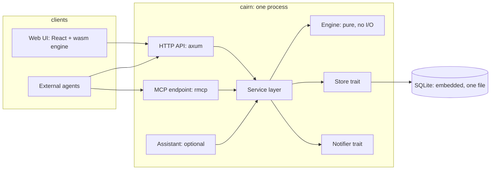
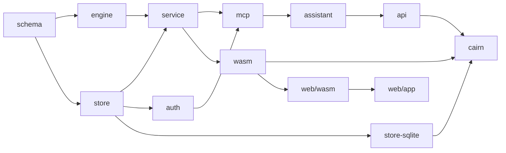
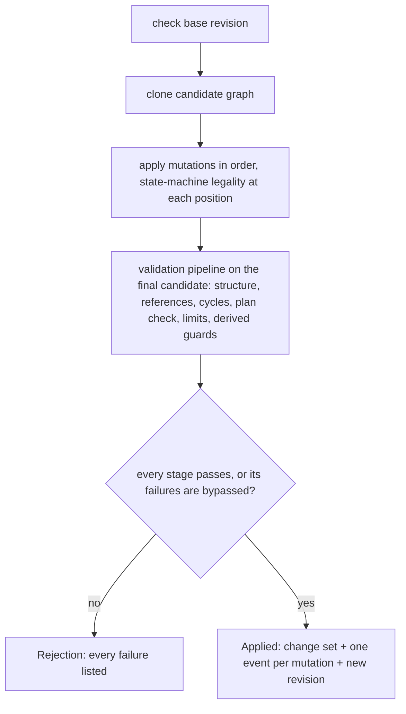

# Cairn: Architecture

Read `PRD.md` first. This document decides *how* the PRD is built and nothing about *what* is built. Where a PRD requirement forces a design choice, the requirement id is cited so the link is checkable.

## Summary

Cairn is one Rust binary around a pure engine. The **engine** holds every rule the PRD states - graph model, patches, invariants, derived state, the date network, projections, upgrade merge, and the file format - as I/O-free functions over in-memory graphs. The **shell** wraps it with storage, an HTTP API, an MCP endpoint, auth, the optional assistant, and the embedded web UI. The same engine compiles to wasm, so the browser holds a full journey and runs zoom, trace, filters, and proposal previews locally, and the UI can run entirely in-browser against an in-memory store for development, demos, and end-to-end tests.



The decisions that shape everything else:

1. **Engine is pure, shell is plumbing.** No storage, HTTP, or clock inside the engine; today, timezone, rank constants, and the viewer are inputs (D6, J3).
2. **Whole domain in memory.** Every read loads one journey or route in full and derives once; every write validates a full candidate graph. This rests on journeys being small and is enforced, not assumed (see Assumptions).
3. **State and events, one transaction.** The patch applier is the only writer. It writes row deltas and one event per mutation together, or nothing (A17, J1, J2).
4. **One engine, two hosts.** The server and the browser run the same crate. The browser is a first-class host, not a mock.
5. **Pluggable edges.** Storage, auth, live-update notification, and the assistant provider are traits assembled once in a composition root; deployments and the browser host differ only there.

## Assumptions and limits

- **Journeys are small.** Tens to a few hundred nodes typically, a deployment of thousands of nodes across hundreds of journeys (non-functional requirements), and single-digit megabytes serialized. Consequences: whole-domain load per read, in-memory derive over the whole graph, the full journey sent to the browser in one response, no partial-graph writes, and no pagination on graph reads other than the agent snapshot (I3). Validation rejects a patch that would take a graph past a hard-coded node limit (2,000; see `PRACTICES.md`) so the assumption is a limit, not a hope. Beyond it, the changes would be incremental derive and paged graph reads; nothing in the storage schema would need to change.
- **One deployment is one trust boundary** (H4). No RBAC, no per-journey visibility; every authenticated user reads and writes everything.
- **One process.** API, MCP, assistant, and UI serve from one binary over one embedded database file. Several instances, and the shared database they would need, are `Later`.
- **Calendar days, deployment timezone** (A9). "Today" is computed once per request in the deployment's timezone and passed into the engine; users see the same slack, overdue, and rank. Timestamps on events render in the viewer's local zone; the day model does not.

## Terms

Architecture-scope terms, in addition to the PRD glossary. PRD terms keep their PRD meaning.

| Term | Definition |
|---|---|
| **Engine** | The pure crate: graph model, patch applier, invariants, derive, date network, projections, upgrade merge, file format. No I/O. |
| **Shell** | Everything around the engine: store, service layer, HTTP, MCP, auth, assistant, embedded UI. |
| **Domain** | A patch target as in A17 (a journey, a route with its draft, or the deployment; a segment is a route of kind `segment`), loaded and revision-checked as one unit. A route's published versions are immutable graphs, loaded one at a time by id and never part of its domain load; inserting or upgrading a segment (B13, B14) reads the one or two segment versions it names as inputs, as an upgrade reads its target route version. |
| **Derive** | The one engine pass that computes every D3 field for a loaded journey from stored state and derive inputs. |
| **Derive inputs** | Today, the deployment timezone, the rank constants, the viewer's identities, if any (resolved by the host from the viewer's verified emails, H3; normally one), and the deployment context: the identities with their emails and the identity aliases at a deployment revision, which ownership, "mine", and the owner factor resolve through (E4, E6). Supplied by the host, never read by the engine. |
| **Projection** | A read-only view over a derived journey: snapshot, aggregation level, trace, decision view, timeline, status summary, next list, mine. |
| **Domain document** | A journey's full graph and state, with the derive inputs to derive it (including the deployment context and its revision). Nothing derived is in it: the browser derives it with the wasm engine and runs every projection locally. Proposals are not part of it. |
| **Snapshot** | The I3 projection: a bounded, scoped, paginated view of a journey for agents. Cut from the same derived journey as the domain document. |
| **Change set** | The persistence-neutral result of an accepted patch: identities put and removed by key, the events, the patch id, and the next revision. A `schema` type, so the store depends on `schema` and not the engine; in production only the engine's `apply` produces one, inside `Applied`. Each store maps it to its own rows or records. |
| **Store** | The trait the service layer uses to load a domain, commit a patch result, and run index queries. Backends: SQLite and memory. |
| **Notifier** | The trait that announces "domain X is now at revision N" to subscribers. In-process in both hosts. |
| **Composition root** | The one function per host that picks a store, a notifier, auth providers, and an assistant provider and assembles the service. |
| **Capabilities document** | `GET /api/capabilities`: what this host offers (auth providers, assistant, MCP, SSE). The server always serves MCP and SSE; the browser host serves neither. The UI shows and hides features from it. |
| **Host** | Something that assembles the engine with a composition root: the server binary or the browser bundle. |
| **Generated artifacts** | Files derived from Rust types and checked in, only under the generated paths (Generated artifacts): the OpenAPI document, the TypeScript client types, the engine's rule tables and limits for the app, the wasm bindings, the JSON Schema for the file format. |

## Repository layout

One repository, one Cargo workspace plus one npm workspace. Crate and package boundaries are the seams feature briefs cut along.

```
cairn/
  crates/
    engine/        pure domain: model, patch, validate, derive, dates, project, upgrade, format
    wasm/          wasm-bindgen surface for the browser: engine projections and preview for every host; service over the memory store for the in-browser host
    schema/        serde types shared by engine and shell: document, patch, API payloads; JSON Schema export
    store/         Store and Notifier traits; memory backend; the store conformance test suite. No delta types of its own: it persists the change set from schema
    store-sqlite/  SQLite backend (rusqlite: embedded, WAL mode, one writer)
    service/       service layer: load, call engine, commit; capabilities; composition root types. Runtime-free: no tokio, database driver, or transport dependency, so it builds for wasm32-unknown-unknown
    auth/          AuthProvider trait; dev, oidc, builtin-oauth, tailscale, Google Cloud IAP providers; users and logins
    api/           axum endpoints, the generated OpenAPI document, SSE, the Rust client
    mcp/           rmcp server: tools, prompt metadata, instructions
    assistant/     provider trait, tool loop, proposal drafting
    cairn/         the binary: CLI, config, composition root, embedded assets
    tests/         the library crates' integration tests, one test binary, a directory per crate under test
  web/
    app/           React UI (Vite); React Flow canvas; ELK in a worker
    client/        TypeScript client: generated/ (openapi-typescript + openapi-fetch) plus the hand-written safe-retry and subscription wrapper (H5, H6)
    wasm/          wasm package: generated/ (bindings from crates/wasm) plus the hand-written loader and the derive worker
  instructions/    the shipped agent guide (I4), served by MCP and published as SKILL.md
  fixtures/        2-3 generic seed routes with a journey scenario each (eg: vendor evaluation, hiring loop, product launch), plus one journey with no route and one segment
  testbeds/        simulation testbeds (PRACTICES.md, Simulation)
  openapi/         generated OpenAPI document
  schema/          generated JSON Schema for the file format
  decisions/       judgment calls awaiting the user's review, one file each (AGENTS.md)
  docs/            the guide to running a deployment, and the README's pictures
  mise.toml        pinned tools
  mise-tasks/      tasks, one file each, in a directory per group (`mise tasks` lists them)
  scripts/         helpers the tasks share: the ladder runner and its steps (scripts/steps/)
```

Each arrow points from a crate to a crate that depends on it. Only direct dependencies the others do not already imply are drawn, and a test holds the diagram to the crates' manifests (`crates/tests/tests/integration/architecture.rs`), so a changed dependency fails until the diagram says it.



Engineering practices (assertion style, fault injection, simulation testing, the local validation ladder) live in a separate document, `PRACTICES.md`, and are referenced from here where they shape a design choice.

## Engine

### Model

- One `Node` struct holding the fields every kind shares, with a kind-specific payload enum for the rest (A1a), so a field a kind cannot have is unrepresentable. Node kinds, per-kind states, transitions, guard outcomes, relevance (`Relevant | NotRelevant | Undecided`), provenance, override kinds, and attachment scopes are closed enums; matching on them is exhaustive.
- Newtypes for `Key`, `Id`, `Path`, `Revision`, `PatchId`, `IdentityKey`. Keys and ids cannot be confused at compile time (Keys and references).
- A `Graph` holds nodes (tree by parent key plus an index by key and by path), explicit edges, roles, participation kinds, resources, and, for a journey, state: node states, answers, role fills, pins, snoozes, overrides, tombstones, attachments. Every graph also keeps the keys it has retired, so no key is ever reused (Invariants); tombstones are the upgrade-facing subset of these. Route versions and drafts are the same `Graph` with empty state. Every graph also holds its insertions (B13): each with its key, the segment version it is on, its parent, its role and kind maps, and its members by key with their segment keys. An insertion's local edits are never stored; they are its members' differences from its version (B14).
- A `Proposal` is separate from every graph: a client-generated id, a destination (a journey, a route, the deployment, or a journey or route the proposal creates), the destination base revision, its own editing revision, status, and its review items (I6, C14). Editing one never changes its destination's document or revision.
- `Deployment` holds identities (with their emails, unique across identities, H3), identity aliases, and the deployment revision. Users and their logins are auth state, not deployment state (Auth).

### Read path: derive

`derive(journey, inputs) -> Derived` runs once per load and is the only place D3 fields are computed. Passes, in dependency order:

1. **Relevance**: three-valued evaluation of each node's condition over answers (Gating), combined with ancestors; force-include applied; each value tagged with the ancestor or decision that produced it (C8), and a not-relevant value tagged with the undecided decisions it is pending on (D8), found by re-evaluating its conditions with those decisions read as unknown.
2. **Effective dependencies**: explicit edges plus implicit gates (containment, inherited requirements, condition gates, stage openings), each tagged with its source. The full structural edge set is kept beside the pruned one (not-relevant branches pruned; undecided kept): invariants and tracing read the full set, execution reads the pruned set. Effective skip (D1a) and kept work resolved here.
   Every node in the effective graph has a start and a finish, the instants the date network uses (a decision or milestone has one instant, so both are it). A container also has an **entry**, the moment its work may begin, distinct from its start, which is when its own work begins after its children (PRD Containment). A requirement on a node waits at its entry if it is a container and at its start otherwise; its dependents wait for its finish. Containment is three edges per child: the child's entry or start waits for the parent's entry, the parent's start waits for the child's finish, and the parent's finish waits for its own start. An ancestor's requirement thus reaches every descendant through the chain of entries instead of being copied onto each one (copying is up to nodes x depth x 64 edges). Entry is internal: it is never shown, and explanations name the ancestor whose requirement applies. Condition gates travel the entry chain apart from explicit and stage requirements and stop at a force-included node, which drops its ancestors' conditions (Gating) but keeps their requirements. Every edge is typed as a gate (it blocks, D1) or date-only (a stage opening with `gates: false`); blocking, the acyclicity invariant, trace, and gravity read gates, and the date network reads both, where a date-only cycle is legal unless its weight is positive. Reaching a container's entry or start never completes it; only its own finish does. A reference test checks the entry chain against the plain expansion that copies each inherited requirement onto every descendant, on generated trees. Blocking, dates, gravity, and unlocks all read this one graph, which stays O(nodes + explicit edges).
3. **Participation**: E2 resolution order per node and kind; `unassigned`; the membership-loss flag (B10).
4. **Date network**: bounds, chains, shortfall (next section).
5. **Auto-done, blocking, and actionable**: auto-done (F1) from effective dates; `deps_done` over effective dependencies under D1/D1a; frontier; `snoozed` (B6, from current state); acting frontier; `stalled`; `needs_breakdown`.
6. **Gravity and unlocks**: over the effective dependency graph, with effective weight and owner factor (Priority). Unlocks is computed for every node in the rank normalization set, not only the frontier: one pass over dependents counts, for each unfinished node, how many dependencies remain, and credits a node whose completion would leave none (cascading through derived group completion).
7. **Rank and flags**: rank, overdue, stale (D4, checked against the transition each terminal node used), and last the display state (D8), composed from relevance, stored state, and the flags and blocking above, which it leaves in place.

Each pass reads only the outputs of earlier passes. The types passed between them live in the engine crate.

`Derived` is per node plus journey-level values, and every derived value carries its explanation inputs (contributing nodes, producing chain, producing decision). Per node it carries what every screen shows, so none recomputes it: days overdue, a container's progress (done of in-scope work beneath it, counted once), the guards a completing transition would fail now, whether active work started before its gates were met, and what the node waits on (its own unsatisfied dependencies and those its ancestors hold for it, nearest first), the last cut like the other explanations. Nothing in `Derived` is ever stored (D3, J1). Explanations are the "why" behind each derived value on a node: the chain of rules and pins behind a due date, the downstream nodes that make up its gravity, the dependencies that block it. Inside the engine they are complete. The browser derives locally, so it has them all and nothing is sent. Server responses that include them (node detail for agents and the API) carry each list's largest entries up to the limit plus a total, and page the rest.

Hosts may memoize `Derived` per (domain revision, deployment revision, inputs); today is an input, so a cached value expires at date rollover. D6 requires this to be invisible; the engine has no cache of its own.

### Write path: apply

`apply(domain, patch, inputs) -> Result<Applied, Rejection>` is the only way a graph changes (A17).



- Mutations apply in order to a candidate, and state-machine legality is checked at each mutation's position. Nothing else looks at an intermediate candidate, which may legally be invalid (A18 lets a later mutation repair a dangling reference), and derive never runs on one.
- The validation pipeline runs once on the final candidate: structural invariants (Invariants), the plan check, limits, and the guards that need derived state (`deps_done`, relevance, D4), evaluated against one derive of that candidate with the inputs captured for this apply. A bypass records the specific failures present in that candidate. Violations are collected, not short-circuited, and reported by path (A15). Consequence: a guard cannot be satisfied only temporarily, and bulk transitions are accepted in any order.
- `consequences(before, after)` is a pure engine function over two `Derived` values with the same inputs (D7), warnings and the informational half (unlocked, out of scope, into scope) alike, and the two graphs they were derived from, since stale reasons and inherited blockers are listed on demand rather than stored per descendant. The service calls it for every accepted patch and every proposal preview; the result rides in the response and is never stored.
- `Applied` is a value holding the change set: identities put and removed by key, the events (J1), and the next revision. It can only be constructed by the validation pipeline. The pipeline's stage list grows as the engine is built; nothing outside the engine's own tests commits an `Applied` until every stage exists. The host commits it; the engine never touches storage and knows nothing of rows.
- Proposals (I6, C14) are patches with status. `apply` accepts a proposal's mutations the same way; a proposal document may hold unresolved items until apply, where strict validation runs.
- Removing a node computes the cascade (A18) and includes it in the result so review can show it.

### Date network

One constraint model (F2). The engine builds a network on every derive:

- **Instants**: start and finish for each deliverable, action, and group (a group's from its contents and stage bounds), plus an entry for each container (Read path); one instant per decision (when it is decided) and per milestone; one for the journey's `created_at` (F2).
- **Constraints**: `B >= A + k` edges from date rules, dependencies (dependent entry or start after requirement finish), estimates (finish >= start + estimate), containment (child entry or start >= parent entry; child finish <= parent start; parent finish >= parent start + parent estimate), and stage bounds (contents' entries after `opens_at`; the group's finish before `closes_at`). Constraints from not-relevant nodes are dropped; through undecided nodes kept and labeled conditional; effective-skipped work has zero duration. The network may contain cycles: two rules that each place a milestone no earlier than a day before the other are a legal zero- or negative-weight cycle. Only a positive-weight cycle is a contradiction.
- **Pins** fix an instant; a `feeds_milestone` answer is a pin (E3, F5). Pins and actuals are bounds on their own instant, not edges through a shared origin, so they never join otherwise separate components.
- **Plan layer** (F5): the network of pins, rules, estimates, containment, stage bounds, and dependencies, with no actuals and no today. A **contradictory chain** is a positive-weight cycle in it, pinned or not. Two pins with a chain between them that needs more days than they allow are one too, found as an instant whose earliest bound from pins passes its latest. Checked during validation of any patch that changes constraints or pins; the rejection lists the chains found, up to a fixed limit, and says when it was cut short, each with constraints, sources, pins, and the shortfall in days.
- **Execution layer** (F3, F6): what derive solves. Every constraint bounds both of its ends: given `B >= A + k`, a lower bound on A raises B's earliest date, and an upper bound on B lowers A's latest date. Earliest bounds are the longest paths forward over all constraints, seeded by pending pins, actuals, and today for unfinished work that someone does: an undecided decision and an unstarted deliverable or action start no earlier than today; a started one starts on its recorded start date and finishes no earlier than today (F2). Milestones and groups are not seeded with today: unfinished work upstream of them (a decision, deliverable, or action, directly or through other milestones and groups) already carries today to them, and with none upstream a pending milestone is an event whose date is not yet known rather than late work. Effectively skipped work seeds nothing, and not-relevant work is pruned, so a pending `auto_done` milestone pinned yesterday whose dependencies are done gets no false shortfall, and date solving never waits on blocking; latest bounds are the longest paths backward over all constraints, seeded by pending pins and actuals. An actual is a fixed fact: it seeds both passes and is never moved, and a constraint it violates (against today, another actual, or a pin) is reported as a `shortfall` with its chain, never relaxed through. `shortfall` is also any instant whose earliest bound passes its latest; `overdue` is a due before today. The two passes do not feed each other. Because the plan has no positive cycle and facts are never relaxed, both always terminate with an answer. A derived bound is never treated as a fact. Null when nothing reaches the instant. Every bound carries the chain that produced it.

The network is rebuilt and solved on every derive. Inherited requirements reach it through the chain of container entries (Read path), so it has O(nodes) instants and O(nodes + explicit edges) constraints. Both the plan check and the execution passes decompose the network into strongly connected components, process them in topological order, and run Bellman-Ford inside components that contain a cycle: positive-cycle detection for the plan check (every instant starting at zero, so contradictions with no pin are found), and bound relaxation for the execution passes. The worst case is O(instants x constraints) per pass and the common case is near-linear. Predecessor edges are kept for chains. A cost test at the hard-coded limits in `PRACTICES.md`, measured in operations rather than wall-clock time, is part of the date network's acceptance.

### Projections

All in the engine so every host produces the same views (I1, C2 risk mitigation):

- `document(journey, inputs)`: the domain document the browser holds: graph, state, derive inputs including the deployment context.
- `snapshot(derived, scope)`: the bounded I3 view with depth and subtree scoping, top-N acting frontier, counts, and keys.
- `level(derived, request)`: C2 aggregation: visible nodes with their display state, edges re-targeted to nearest visible ancestors with duplicates collapsed, roll-up badges and progress, subtree gravity, min child slack, distinct owners. The request carries the step's kinds (at Stages also the kinds a top-level node must be for anything beneath it to be drawn), the collapsed containers, the display states shown (not-relevant nodes only when asked for), and the Filter and search (the next list's flags, an owner, text), which keep a node that matches or holds a match, so a node hidden by any of them rolls up and re-targets its edges like any other hidden node; it answers how many nodes each display state switched off hides (C1); the rules for hoisting visible nodes, rolling up hidden ones, re-targeting edges, dropping edges that collapse onto one node, and marking hidden prerequisites are fixed in the engine.
- `trace(derived, key)`: C7 upstream and downstream sets with gravity contributors marked.
- `decision_view`, `timeline`, `status_summary`, `next` (with sort and filter), `list` (C9, with text search over the journey), `mine(viewer)`, `history(events)`, `explanations(derived, key, field, cursor)`, `answer_effects(derived, decision)` (C8: per choice, the nodes it would bring in, drop, or leave decided later, and the pin and role fill, from a three-valued relevance evaluation rather than a derive), and `render_draft` (A10, G3: a message draft with journey context, a marker for whatever has no value).
- Each takes the journey's graph with its `Derived` (a `DerivedJourney`), and its inputs and outputs are schema types, so the API and the wasm host serialize them unchanged.

### Conditions

A structured predicate tree, fixed operator set (A5), no parser:

```yaml
relevant_when:
  all:
    - equals: {decision: testing/who, value: partner}
    - not: {answered: setup/waiver}
```

Operators: `equals`, `not_equals`, `in`, `contains`, `answered`, `all`, `any`, `not`. References resolve to decision keys at import or edit time and are validated for answer-type compatibility and the no-own-subtree rule (Invariants). The referenced set is static, which is what makes implicit gates, the decision view (C12), and explanations possible. Rendering to a sentence is generated for display and never parsed back. Growth beyond this set is a PRD change, not an engine one.

### Upgrade, save-as-route, re-link, and segments

Engine functions that take two graphs and return a proposal (B7, B8, B9): a three-way diff by key over nodes, edges, roles, kinds, conditions, rules, and resources, with per-field local-edit markers deciding merge outcome and conflicts listed with explicit resolutions. Orphans, tombstones, participation mapping, and node exclusion are proposal items the reviewer edits before apply (C14). The upgrade mutation applies the merge's clean outcomes itself, from the two versions it loads, so a proposal stays within the patch limit; the re-link mutation sets lineage, provenance, and markers in one event. `resolve(proposal)` turns the items' choices into ordinary mutations after the drafted ones, and apply refuses a proposal whose items still need a choice; `preview` applies the resolved proposal to a copy of the destination for review.

Insert copies a segment version through a key map minted from the insertion key and each segment key, a pure function, so preview, apply, and upgrade agree. Insertion upgrade translates the base and target segment versions into the graph's keys (members by their segment key, the rest by the same minting; roots under the member root's current parent with its id and title; mapped roles and kinds held at the graph's values), substitutes each member's differences from the translated base for local-edit markers, and runs the same three-way merge. Save as segment cuts the selection's boundary and drafts a segment the way save-as-route drafts a route; linking sets membership and provenance in one mutation, as re-link does.

### File format

YAML on disk, JSON on the wire, one document schema (A13, A14). Files carry paths and ids for readability and keys for identity, plus the route id and the version extended. Export is deterministic (sorted, stable field order) so version-control diffs are clean. Round-trip is tested: parse, export, parse, compare. The JSON Schema for the document is a generated artifact. A route file carries `kind`; insertions are never written.

### Testing the engine

The J3 replay harness and the scenario tests run against the engine alone with a fixed clock and the memory store. Fixtures under `fixtures/` are shared with the in-browser host and server integration tests, so the same scenarios exercise all three.

## Storage

### Store trait

Small and whole-domain oriented; nothing in it walks the graph.

- `load(target) -> (document, revision)`: one read for every graph, by a typed target: `Journey(id)` (graph and state), `Route(id)` (the route record and its draft), `RouteVersion(id, number)` (one published version, immutable, whose revision never moves), or `Deployment`. Loads and size caps are per graph, so a route's history never weighs on its draft. Derive needs no events; history is a separate, paged query.
- `commit(target, base revision, preconditions, change_set) -> receipt`: one transaction on the one writer: recheck the patch receipt (the service already looked it up before loading or applying, so a resubmission never reaches `apply`, H5); verify every revision precondition (the domain's base revision, plus the proposal's revision when applying one, I6, or, for an identity merge, the revisions of the journeys it was checked against and the unchanged set of journeys referencing its identities, or, for an identity delete, that no graph refers to its identity; for a journey patch writing an identity reference, the deployment revision it was validated against, E6), map the change set to rows, append events with patch id and ordinal, bump the revision. A domain that does not exist yet is at revision 0; its first commit takes base revision 0 and produces revision 1, and there is no separate create call. A hard-deleted journey leaves its id in a deleted-ids record, so a create at that id is rejected (A19). Deployment-scoped mutations riding in a journey patch (identity create, E6) write in the same transaction without a deployment revision check, are rejected if the key is already an identity or alias, and still bump the deployment revision and notify it, so identity views stay current (H6).
- What intervened since a revision: the touched set of the events of every commit that moved it, which a stale commit reports and the service adds to a stale rejection the engine found before committing (the engine sees no history, H5). Beside it a stale rejection carries the patch's own touched set, which only applying it can give: the engine's, from applying the patch at the current revisions when it finds it stale; the store says the whole domain, and the service, on a stale commit, applies the patch once more over a fresh load to say what it would really write.
- Index and history queries: the graphs referencing an identity: journeys, route drafts, and published versions, by any of its keys (for checking a merge or a delete and for the references read, E6), journey index filters (C16), route detail (C17), events by journey, node, user, type, patch, and time (J5), and text search across journeys over titles, descriptions, notes, and resources (the MCP `search` tool and the journey index; search within one journey is the engine's `list` projection, C9).
- Proposals: their own records keyed by proposal id, with destination and revisions as in Model (H5, I6); edits go through `commit` with the proposal revision as the precondition, and the notifier ticks the proposal. `proposals(query)` lists the open ones, newest first (created at, then id) with the scope's count, a cursor that carries both and survives the proposal it names closing, and each row's destination as it is now (exists, name, revision): the proposals under one destination, those that would create a journey or a route, and those waiting on a user (created by them, or drafted by an agent for an active journey that refers to one of their identities, aliases included).
- Outside any domain, with no events: assistant conversations, login sessions, and transient OAuth state (authorization codes, PKCE verifiers). Which identity a user is follows from identity emails, which are deployment state and change only through deployment patches (J2), because they decide what is "mine". Users, logins, and agent tokens are auth state outside any domain, logged by the auth crate. Agent tokens: a token is shown once when minted and only its hash is stored, so a leaked database does not leak usable tokens; mint and revoke are logged by the auth crate.

The trait is async and names no runtime: the store traits (and the auth and model provider traits) use `async-trait`, so each call is a plain `async fn` in an implementation and returns a boxed `Send` future, and the trait is object-safe and every layer above the backends holds the store as `Arc<dyn Store>` and is compiled once, whatever backend a host picks ([`decisions/2026-10-18-object-safe-async-traits-use-async-trait-and-the-stack-holds-a-trait-object.md`](decisions/2026-10-18-object-safe-async-traits-use-async-trait-and-the-stack-holds-a-trait-object.md)). The SQLite backend runs on tokio; the memory backend runs anywhere, including the browser's event loop.

A conformance suite in `crates/store` runs against every backend.

### Backends

| Backend | Use | Notes |
|---|---|---|
| **SQLite** | local and hosted | rusqlite over a bundled SQLite, built without allocation statistics (whose process-wide mutex serializes readers): embedded, one file, WAL mode. One writer: commits and the record writes outside every domain run one at a time on one connection, so a commit beside one in flight waits for it, and no two transactions ever conflict; reads run beside them on a small pool of readers, each seeing one commit's state whole, so a long write never blocks a read. STRICT tables, CHECK constraints for enums and non-negative numbers, foreign keys deferred to the commit. Each call waits for its connection on the runtime, then runs its whole transaction on tokio's blocking pool (a hand-off of about 6 microseconds), so a slow disk stalls that call and never a runtime thread. Readers refuse writes (`query_only`), so only the writer ever writes. One process per database: every connection opens on SQLite's `unix-excl` VFS, so the process holds an exclusive lock on the file while it is open and keeps the write-ahead log's index in memory, not in a mapped `-shm` file ([`decisions/2026-10-21-the-store-is-sqlite-with-one-writer.md`](decisions/2026-10-21-the-store-is-sqlite-with-one-writer.md)). |
| **Memory** | tests, fixtures, the in-browser host | The reference implementation the conformance suite is written against. Nothing persists: an in-browser session starts from the fixtures on every load. |

Nothing is answered from a write that may not be on disk. Every commit syncs the write-ahead log (`synchronous = FULL`). A `COMMIT` that fails other than by a constraint (an I/O error, a full disk) may have left its record in the log unsynced, so it leaves the backend's state in doubt: it fails closed (every call errs, `GET /healthz` answers 503) and `cairn serve` exits non-zero, so a supervisor restarts it. Every open first drops the database files' cached pages (Linux), so what it reads comes from disk and not from a cache that may hold an unsynced record ([`decisions/2026-10-09-a-commit-the-store-cannot-settle-fails-it-closed.md`](decisions/2026-10-09-a-commit-the-store-cannot-settle-fails-it-closed.md)).

No sqlx: Cairn needs little of it. Queries are runtime SQL (Cairn never planned on sqlx's compile-time macros), a call runs its whole transaction on tokio's blocking pool (sqlx's SQLite driver would send each statement to a worker thread), connections come from a small pool of our own within the limits, and migrations are numbered SQL files embedded in the binary and applied in order inside one transaction. The conformance suite checks the SQL.

Later backends sit behind the same trait and conformance suite: Postgres, for managed backups and several instances; the schema is written to port.

### Schema outline

Relational rows, no graph-as-blob (A14). Structured field values (a condition tree, a date rule, an event delta, a proposal's mutation list) are JSON columns validated by the engine schema before write.

- `routes` (id, name, kind, retired, revision): the route domain row, for the route and its draft
- `journeys` (id, revision, name, description, status, lineage route and version, created_at, created_on): the journey domain row; `route_drafts` (route, extends) and `route_versions` (route, version_number, published_at)
- `graphs` (id, kind: route_version | route_draft | journey, journey or route and version, default_owner): the graph every content and state row belongs to; timestamps are timezone-free
- Graph content, keyed by (graph_id, key): `nodes` (parent_key, id, kind, title, description, weight, estimate, flags, condition, date_rule, stage_bounds, decision fields), `edges`, `roles`, `participation_kinds`, `participations` with `participation_identities`, `resources`, `insertions` (graph_id, key, segment, version, parent_key, roles, kinds, nodes), indexed by (segment, version) for segment detail
- Journey state, keyed by (graph_id, key): `node_states` (state, provenance, atomic, recorded dates), `local_edits`, `answers` (value, rationale) with `answer_identities`, `role_fills` with `role_fill_identities`, `pins`, `snoozes`, `overrides`, `tombstones`, `annotations` (notes and links); the identity rows, with `condition_identities` (graph_id, node, identity: the identities a node's condition compares an identity decision with, filled by the one typed rule in `cairn-schema`), are what the graphs referencing an identity are found by (E6)
- `proposals` (id, destination kind and id, destination base revision, revision, status, items, proposing agent, created_by), indexed by (destination kind, destination id, status, created at, id) for a destination's open proposals and by (created by, status, created at, id) for the viewer's
- Deployment: `identities`, `identity_emails` (unique email), `identity_aliases`, `deployment` (revision)
- Outside domains: `conversations` with `conversation_messages`; auth state: `users`, `user_logins` (provider, subject) with `login_emails`, `sessions`, `oauth_transient`, `agent_tokens` (hash, name, user, created, revoked), and `auth_log`; secrets only as SHA-256 digests
- `patch_receipts` (patch_id, domain, content hash, resulting revision): what a resubmission by patch id is answered from; `retired_keys` (graph_id, key); `deleted_journeys` (id, deleted_at)
- `events` (seq, the log: journey, route, or deployment, patch_id, ordinal, type, actor_user, agent, confirming_user, subject, delta, note, at), with `event_nodes` (seq, node) for the history of one node

Uniqueness: (graph_id, key) on every content and state table; (graph_id, parent_key, id) on nodes and each email on one identity, checked at the end of the commit, since a patch may pass through a duplicate on the way ([`decisions/2026-10-06-uniqueness-a-patch-may-pass-through-is-checked-at-the-end.md`](decisions/2026-10-06-uniqueness-a-patch-may-pass-through-is-checked-at-the-end.md)). Publishing a draft copies its rows into a new `route_version` graph with keys preserved (A11); versions are never updated after.

### Concurrency and notification

- Coarse per-domain optimistic locking (H5): `commit` runs as one transaction on the store's one writer, which checks the domain's revision and every other revision the commit names, then writes, so commits run one at a time: a commit beside one in flight waits for the writer (at most the connection acquire limit) and then sees what that one did. A resubmission meets its original's receipt, and a stale answer names only revisions that exist, with what really intervened. Reads never wait on the writer. A conflict response carries the touched set of the intervening events and the patch's own, from the change set applying it at the current revisions builds (its whole domain when it would not apply there); no layer predicts a touched set from the mutations alone. The safe automatic retry is client-side: refetch, compare the two, resubmit or show the changes; it only ever moves a patch forward. Whether a stale patch is safe to resubmit, and as what, is one rule in the schema crate, which the Rust clients call and the browser asks of its derive worker.
- `Notifier` publishes (domain, revision) after every commit, for journeys, routes, proposals, and the deployment. It is an in-process broadcast: with one process, every commit passes through it. An index view subscribes to every domain of a kind (all journeys, all routes) and is told which ones changed. On subscribe or reconnect the current revisions are sent at once, so a commit between a fetch and a subscription is never missed; that first message is complete, so a domain deleted meanwhile shows as absent (or at revision 0 when watched by name). Subscribers compare each tick with the revision they hold, per domain, and refetch only when it is newer (H6).

## Service layer and composition

`crates/service` is the only caller of the engine on the server: look up the patch receipt (a resubmitted patch id is answered from it, H5), load a domain, run `derive` or `apply`, commit, notify. Its functions are the shared vocabulary of the API, MCP, and assistant; those three shape their surfaces separately (next sections) but never bypass it.

The **composition root** in `crates/cairn` builds one `Service` from config:

```
Capabilities {
  store:      Sqlite(path)
  auth:       [Dev | Oidc(config) | BuiltinOauth(config) | Tailscale(config) | GcpIap(config)]
  assistant:  None | Some(provider config)
  public_url: the deployment's external base URL (links, OAuth redirects, MCP resource metadata)
}
```

Optional subsystems are separate crates that contribute a router and a service to the root; absence is a `None` at the root, not a flag checked inside handlers. The crate that adds an optional subsystem also mounts it in the API and the binary's root. MCP and SSE are not optional on the server: a knob exists only when two deployments need different values, and none needs them off. The browser host has its own root in `crates/wasm`: the same service over the memory store, an in-process notifier, a single local user, no assistant, no MCP. `GET /api/capabilities` publishes the assembled set so the UI renders from it (I5's "fully usable without the assistant" is this, not a special case).

## HTTP API

axum. Every endpoint is served under `/api`, MCP, metrics, and auth's own routes included; the server also keeps `/.well-known/` (OAuth metadata) and `/healthz` (the deployment's probes), and every other path on the origin is the web app's ([`decisions/2026-10-08-the-api-is-served-under-api-and-the-app-owns-the-rest.md`](decisions/2026-10-08-the-api-is-served-under-api-and-the-app-owns-the-rest.md)). Rust request and response types are the source of truth; the OpenAPI 3.1 document is generated from their JSON Schemas (schemars, which the schema crate already derives) and checked in (`openapi/`) ([`decisions/2026-10-06-the-openapi-document-comes-from-schemars-and-the-rust-client.md`](decisions/2026-10-06-the-openapi-document-comes-from-schemars-and-the-rust-client.md)).

- **Resources**: routes, versions, drafts, journeys, nodes, proposals, identities, users, events. Reads return projections: `GET /api/journeys/{id}/document` (graph and state, which the UI derives locally), `/derived` (that derive, for a client without the wasm engine), `/snapshot` (I3), `/level`, `/trace/{key}`, `/decisions`, `/timeline`, `/summary`, `/next`, `/nodes/{key}` (C8 detail with explanations, including the dependents a node would not yet free and, for a decision, its answer effects).
- **Identity references**: `GET /api/deployment/identities/{key}/references` reads the journeys and routes (drafts and versions) that refer to an identity, over every graph; the same set a delete is checked against.
- **One write verb**: `POST /api/{domain}/patches` with base revision and ordered mutations (A17); returns the new revision or the full rejection. Proposals live under their destination: `GET` and `POST /api/journeys/{id}/proposals` (likewise `/api/routes/{id}/proposals` and `/api/deployment/proposals`) list the open ones and create one with a client-generated id (I6), and `GET`, `PATCH` and `POST .../preview`, `.../apply`, `.../discard`, `.../refresh` on `.../proposals/{proposal}` read and act on one; a proposal asked for under another destination is not found. `GET /api/proposals?scope=waiting|new_journeys|new_routes` lists those no one destination holds ([`decisions/2026-10-17-a-proposal-lives-under-its-destination.md`](decisions/2026-10-17-a-proposal-lives-under-its-destination.md)).
- **Bulk and import**: route import and export (A13), save-as-route, re-link, upgrade preview and apply, identity merge, journey status changes, hard delete (A19). Each is a patch or a proposal underneath.
- **SSE**: `GET /api/events/stream?domain=...` emits revision ticks from the notifier, starting with the current revisions. Clients refetch when a tick is newer than what they hold; no diffs are streamed.
- **Size budgets**: each graph (a journey, a route draft or published version, the deployment record) serializes with its state to at most 16 MiB; the request body limit is larger and fixed, so a domain at its cap still fits an envelope; history is read by page and counts against neither. Explanation lists in responses are capped, say when they are cut short, and can be continued.
- **Names of users**: `GET /api/users?id=...` (at most a page of ids) answers `{user, name}` for each user that exists: the identity their verified emails name (H3), else the name their login gave, else their email. An event, a proposal or a note carries only a user id, so a screen asks for the names of the users it shows in one read and never prints the id.
- **Capabilities**: `GET /api/capabilities`.
- **Health**: `GET /healthz`, the one endpoint that asks no credential, so a proxy's anonymous probe can reach it; it stays behind the `Host` allowlist. It answers 200 while the store answers and 503 once the store has failed closed, reading the store's state rather than its storage ([`decisions/2026-10-08-the-health-check-asks-no-credential-and-reads-the-stores-state.md`](decisions/2026-10-08-the-health-check-asks-no-credential-and-reads-the-stores-state.md)).
- Errors carry the engine's violation list by path unchanged (A15).

Clients: `web/client`'s types are generated artifacts (openapi-typescript, with openapi-fetch); the Rust client in `crates/api`, for integration tests, the testbeds, and the CLI listed under `Later`, is written over the shared Rust types and the same endpoint table the router serves ([`decisions/2026-10-06-the-openapi-document-comes-from-schemars-and-the-rust-client.md`](decisions/2026-10-06-the-openapi-document-comes-from-schemars-and-the-rust-client.md)).

## MCP endpoint

rmcp, Streamable HTTP at `/api/mcp`, sharing auth with the API (I2): the API mounts it inside its router, behind the auth layer and the request limits, when the capabilities offer MCP. A client finds how to sign in from the OAuth metadata of whichever provider owns the OAuth endpoints: the built-in server, or behind IAP the IAP provider's relay ([`decisions/2026-10-16-mcp-clients-behind-iap-sign-in-through-a-relay-to-google.md`](decisions/2026-10-16-mcp-clients-behind-iap-sign-in-through-a-relay-to-google.md)). It is stateless, each request one POST answered with one JSON body, so a call is held to the request duration like any other ([`decisions/2026-10-06-the-mcp-endpoint-is-stateless-json-inside-the-apis-router.md`](decisions/2026-10-06-the-mcp-endpoint-is-stateless-json-inside-the-apis-router.md)). The tool set is curated for an agent's loop rather than mirrored from HTTP; it shares the schema types and the service layer, not the surface shape. `ToolSet::call(actor, name, arguments)` runs a tool in process; the server and the assistant both go through it.

Tools, covering at least every I2 capability: `list_routes`, `get_route` (the draft, or a published version by number), `list_journeys` (also by the identities a journey refers to), `get_snapshot` (I3; the first call an agent should make), `get_level` (C2), `get_node` (detail with priority and date explanations, the dependents it would not yet free, and a decision's answer effects), `list_frontier` (with filters for decisions needed, needs breakdown, unassigned, active, blocked, stale, overdue, shortfall, mine), `create_journey`, `open_draft`, `publish_draft`, `answer_decision`, `transition_node`, `snooze`, `unsnooze`, `assign`, `set_date` (pin, unpin, actual date), `override` (force include, keep, guard bypass), `apply_patch`, `create_proposal`, `list_proposals`, `get_proposal`, `edit_proposal`, `apply_proposal`, `resolve_date_conflict`, `list_identities` (by name or email), `manage_identity` (create, edit including emails, merge several into one survivor, delete when nothing refers to it), `import_route`, `export_route`, `save_as_route`, `relink`, `upgrade`, `search`, `get_history`. Outputs are bounded and paginated where a list can grow.

The I4 instructions ship in `instructions/` and are served as MCP prompt and instruction metadata and published as `SKILL.md`. Code-mode style execution is not in v1; if wanted, a `run` tool executing Monty against the in-process service is the path.

## Assistant

Optional (I5). Server-side tool loop over the MCP tool set in-process, so the assistant and an external agent are the same thing with a different transport (I7).

The model provider is a trait, vendor-neutral: send a conversation with tool definitions, get back text and tool calls, in Cairn's own types. Each implementation translates to one wire protocol, and a deployment configures one (protocol, endpoint, model, credential). v1 ships three: the Anthropic Messages API; the OpenAI API with an API key; and a generic OpenAI-compatible chat-completions endpoint, which covers OpenRouter and self-hosted models. A deployment-wide API key is configuration and never stored in the database. The assistant runs on the deployment's credential, never a user's: it is part of the environment, like the store.

Structural changes become proposals; state changes the user asks for apply directly and are reported. A direct write is one patch, and the write wrapper every assistant tool passes through checks its touched-node count: past ten (I5), the assistant drafts the whole change as one proposal instead. Each direct write is reported with its consequences (D7). The user can always ask for a proposal. Structural versus state is decided by mutation kind and destination: every write to a route or its draft is structural (PRD, Structural change). Every mutation records the assistant and the user it acts for; applying a proposal also records the confirming user (H2). The limit holds across a turn, however many calls a model splits a change into: what would carry the turn's direct writes past ten is drafted as one proposal. The wrapper reads the patch a write tool would submit without writing it (`ToolSet::drafted_patch`) and drafts a proposal of its mutations against the same destination and revision; applying a proposal and importing a route file are the user's, so the assistant is refused both ([`decisions/2026-10-06-the-write-wrapper-decides-on-the-patch-a-tool-would-submit.md`](decisions/2026-10-06-the-write-wrapper-decides-on-the-patch-a-tool-would-submit.md)).

`crates/assistant` contributes the `Assistant` service; the API serves its two endpoints, `POST /api/journeys/{id}/assistant` and `POST /api/routes/{id}/draft/assistant`, when the root assembled one (`cairn_api::router_with_assistant`), behind the auth layer but outside the request duration, since a turn is held to the provider call and turn limits instead. A turn reads its target fresh (the journey's snapshot, or the route's draft), and its conversation, one per target per user, keeps the dialogue and Cairn's report of each write, not the tool traffic ([`decisions/2026-10-06-conversations-are-one-per-target-per-user-keep-their-newest.md`](decisions/2026-10-06-conversations-are-one-per-target-per-user-keep-their-newest.md)). `GET` on the same two paths reads the caller's conversation back as kept, under the request duration; a direct write's report names the nodes it wrote, which the panel links to ([`decisions/2026-10-08-the-panel-reads-its-conversation-back-from-the-host.md`](decisions/2026-10-08-the-panel-reads-its-conversation-back-from-the-host.md)). The OpenAI protocol is the Responses API; the generic one is chat completions.

## Auth

`AuthProvider` is one trait: given a request, return a `Login { provider, subject, display, verified_emails }`, the actor a credential Cairn issued itself names (an agent token), nothing, or a refusal; a provider lists only emails its issuer marks verified. Providers are configured independently and can run together: a request is put to its session cookie and to every provider, any refusal refuses it (a failing credential never falls through to another provider), and otherwise the session, then the first provider in configured order with a credential, names the actor ([`decisions/2026-10-06-a-provider-answers-a-verdict-and-every-provider-hears-every.md`](decisions/2026-10-06-a-provider-answers-a-verdict-and-every-provider-hears-every.md)).

| Provider | Mechanism |
|---|---|
| **Dev** | Static token or named dev user (H1). Local only. |
| **OIDC** | Authorization-code login against the configured provider; session cookie for the browser. |
| **Built-in OAuth** | Cairn's own authorization server, federating login to OIDC. Supports dynamic client registration and resource metadata so MCP clients connect with a login click and no IdP setup. Also mints long-lived agent tokens from the UI for scripts. No scopes; a token is a login. |
| **Tailscale** | Two modes. Direct: the listener is bound to the tailnet interface and the provider asks the local tailscaled socket who the peer is (whois); `Tailscale-*` headers are never read. Proxy: trusted `Tailscale-User-*` login headers from `tailscale serve` or an authenticating proxy, enabled explicitly. The headers are trusted from this machine when the listener is reachable solely by it (loopback or unix socket), or, when the provider lists the addresses a proxy on another machine connects from (`trusted_proxies`), from those alone on any listener; a request carrying `Tailscale-*` headers from any other peer is refused ([`decisions/2026-10-08-tailscale-proxy-mode-trusts-the-proxies-it-lists.md`](decisions/2026-10-08-tailscale-proxy-mode-trusts-the-proxies-it-lists.md)). In either mode a tagged node signs no one in. |
| **Google Cloud IAP** | Behind Identity-Aware Proxy: every request's signed assertion (`x-goog-iap-jwt-assertion`, ES256) is verified against Google's published key set (kept at most an hour, a fetch tried at most once a minute, failed or not), the IAP issuer, the configured audience (the protected backend service), its expiry, and a lifetime no longer than IAP's ten minutes ([`decisions/2026-10-20-iap-keys-age-out-and-failed-fetches-hold-off-the-next.md`](decisions/2026-10-20-iap-keys-age-out-and-failed-fetches-hold-off-the-next.md)); the subject is IAP's account id, a Google account's email is verified, an Identity Platform (external) identity's is not, so with no verified email it is refused (H3), and a request with several assertions is refused; the relay's endpoints, reachable without IAP, hold at most 16 of the process's requests in flight ([`decisions/2026-10-21-behind-iap-only-a-google-accounts-email-is-verified.md`](decisions/2026-10-21-behind-iap-only-a-google-accounts-email-is-verified.md)). The signature is the credential, so any listener serves ([`decisions/2026-10-08-behind-iap-cairn-verifies-the-signed-assertion.md`](decisions/2026-10-08-behind-iap-cairn-verifies-the-signed-assertion.md)). Given a Google OAuth client, the provider also relays MCP clients' sign-in to Google: it serves the OAuth metadata, registration, authorization and token endpoints, passes the browser's round trip through Google with PKCE, and answers the token request with Google's ID token, which IAP accepts as a bearer; it mints and stores nothing. A bearer shaped as an ID token counts only beside a valid assertion, which names the actor; without one it is refused. IAP passes the `Authorization` it took the token from on emptied, and a blank `Authorization` counts as absent ([`decisions/2026-10-20-a-blank-authorization-header-counts-as-absent.md`](decisions/2026-10-20-a-blank-authorization-header-counts-as-absent.md)). Only local clients are served ([`decisions/2026-10-16-mcp-clients-behind-iap-sign-in-through-a-relay-to-google.md`](decisions/2026-10-16-mcp-clients-behind-iap-sign-in-through-a-relay-to-google.md), [`decisions/2026-10-16-behind-iap-mcp-serves-local-clients-only.md`](decisions/2026-10-16-behind-iap-mcp-serves-local-clients-only.md)). |

One provider owns the OAuth endpoints, the built-in server or the IAP relay, since both answer at the same well-known paths; configuration refuses a second. The pieces both use (metadata, client registration and redirect checks, PKCE shapes, error answers and redirects back to the client) live in the auth crate's `oauth` module; consent, codes, and token minting are the built-in server's alone.

Users and logins: a user owns many logins keyed by (provider, subject). Linking happens while signed in (sign in with the other provider to attach it); auto-link on a matching verified email is part of a provider's configuration, as are Tailscale proxy mode and the dev provider's off-loopback override: each is a security choice about that provider, not a behavior switch. Creating a user on first sign-in, linking a login, and minting or revoking a token are auth operations, logged in the auth log, not domain patches. Merging two existing users is `Later` (PRD): linking a second login while signed in covers the common case. A user is matched to an identity by verified email (H3), which the API does once per request after authentication and before any handler (the arrival layer, MCP and assistant routes included): it looks the caller's verified emails up in the store's email index and, when no identity holds one, creates the identity as an ordinary deployment patch under a random key and patch id, retried (at most three attempts) against a concurrent first request, which then matches. A login with no verified email is refused at sign-in, and a session or token whose user has none is refused as an invalid credential. Setting an identity's emails is a deployment patch ([`decisions/2026-10-20-sign-in-creates-or-matches-an-identity.md`](decisions/2026-10-20-sign-in-creates-or-matches-an-identity.md)).

## Web UI

React (Vite) with the wasm engine.

- **Drafts and edits survive a reload**: text being typed and forms not yet sent are drafts, kept per tab in session storage. A node's actions keep at most one open form, and it is saved as one draft: the case, its value, the revisions it was opened at, and the write it sent, if any. A form that sent a write watches it by id and closes when that write ends, but only if nothing was typed since; text typed after the send stays, shown as unsent. Closing a form never discards its outstanding write. A draft restored at boot is read in full and discarded if it fails validation. An edit that is sent is a write the edit manager owns (State), and the tab keeps a versioned record of it there until it lands or is discarded, so a reload or a crash loses nothing that may have committed. Anything acknowledged is committed on the server; a write with no answer is kept, shown as unconfirmed, and resent with its patch id, which the API answers idempotently (H5) ([`decisions/2026-10-16-sent-edits-are-kept-as-versioned-tab-records.md`](decisions/2026-10-16-sent-edits-are-kept-as-versioned-tab-records.md)).
- **State**: the rule is in PRACTICES (Frontend state). The session root is started once at boot, outside React, and holds what the tab shares: whether it is compatible with the server's build or in version skew (which never lifts until a reload), the saves the tab made (plain data, newest first, up to a limit), and its children: the tick subscription, the deployment context and the caller (each a keyed read, below), the journey manager, the edit manager, the sync scheduler, the toast and the conversation manager. The edit manager runs one write actor per operation id, the patch id (H5), started by the control that sent it but never owned by it: unmounting a control drops its view of the write and never the write, an unrelated save never resolves another write's problem, and one edit has at most one busy write. A node section's writes (a form's send, a menu action) are the edit manager's like any other, keyed by the node and the section, and a form that sent one reads its state by id. A write is `idle`, `sending`, `landed`, `rejected` (a definite refusal, with its violations), `unconfirmed` (it may have committed: it resends itself with the same id and the patch it last sent, at once after a reload and otherwise after a backoff, each attempt waiting for the connection, until a limit, then it asks for Retry), `stopped` (known not sent) or `gone` (its subject no longer exists, so only Discard is left). Controls and the sync chip read writes through selectors over the manager; the chip lists the writes that need the person, and Discard and Retry are events sent to the owning write. The manager keeps explicit keyed maps and discovers nothing through XState's registry. A page's transient workflow is a machine the page owns: the edge drawing is inactive, choosing or submitting; it submits through the edit manager and then watches its write by id, and every way out (Stop drawing, Escape, the write landing) resets it without touching the write. Every write a control makes goes through the manager as one of three commands (a patch, a proposal write, a route import), found again by a stable edit key rather than by a component: patches are rebased by the client's safe retry, proposals and imports never are (a stale one is rejected for review), a pre-send check (authoring's engine preview) is the write's first phase and its refusal is the write's rejection, and a rejection clears only when the person discards it or the next write of the edit starts. Workflows (route import, identity merge, segment insertion) are machines their component owns whose delivery steps are manager writes: stopping one stops waiting and never the write ([`decisions/2026-10-16-every-write-goes-through-the-edit-manager.md`](decisions/2026-10-16-every-write-goes-through-the-edit-manager.md)). The sync chip reads the edit manager for what did not land and what is in flight, and says one of its eleven states, which is a pure projection (`summarize`) of facts read from their owners when it renders: the stream, version skew, the network, those writes, and the revision shown. The one scheduler child holds only the facts that carry a deadline (how far the shown reads are behind, since when writes have been in flight, when the last save landed) and wakes at the next threshold with a delayed transition, so the chip crosses SAVING, UPDATING, BEHIND and the end of SAVED with no event sent. The toast is a root child whose expiry is a delayed transition that waits while the pointer is on it and restarts in full when it leaves, and the next toast replaces it; a receipt and the chip's popover (pinned and peeked, with the beat after the pointer leaves) are machines the component that shows them owns, so they end with it. The assistant's conversations are the conversation manager's, one per target, each with its read and its turn invoked actors: a turn ends in a read of its own and nothing else reads while it is out, so a read begun before an answer never replaces it, and an answer that arrives after the conversation stopped changes nothing ([`decisions/2026-10-16-the-chips-timing-toasts-receipts-and-conversations-are-actors.md`](decisions/2026-10-16-the-chips-timing-toasts-receipts-and-conversations-are-actors.md)).
- **Reads**: every read the tab makes (a journey, an index, a route, a projection, a layout, a preview, the deployment context, the caller) is one keyed-read actor behind one hook, so each answers the same questions the same way: is there data, is it for what is asked, is a newer read out, did the last one fail, and when does it try again. A key says what the read is of (what is shown), its freshness (what the answer is read from) and its arguments; a new `of` resets the read and releases what it held, a new freshness keeps the answer shown (refreshing, or behind when the read for it failed) and reads again, and a value or a failure shows only for its own `of`, a failure only for its own freshness. One read runs at a time; ticks and key changes that arrive meanwhile coalesce into one more read. A source says how its read behaves: when it starts (at once, or after a settle for a preview someone is still editing), whether version skew stops new work, the ticks that keep it current (H6), and what releases a value it holds. A transient failure is retried after the shared backoff, with the stream's 250 ms to 15 s; a refusal for authentication, the engine or version skew, and a subject that no longer exists (A19), are not. A read that falls behind what the stream announced is counted by the sync dot, and a failed refetch of a route's canvas keeps its graph on screen and says BEHIND there instead of replacing the graph with an error. A journey is derived in the worker by the journey manager over the same machine; each derivation belongs to the load that made it and to its slot (the journey's, or a proposal's preview, `<journey>/proposals/<pid>#<n>`), so a late release by an owner that was replaced never frees its successor's, releasing a proposal's slot never frees the journey's, and reloading the journey never frees the proposal's ([`decisions/2026-10-16-a-derivation-is-owned-by-the-load-that-made-it.md`](decisions/2026-10-16-a-derivation-is-owned-by-the-load-that-made-it.md), [`decisions/2026-10-16-every-read-is-one-keyed-read-actor.md`](decisions/2026-10-16-every-read-is-one-keyed-read-actor.md)).
- **Data flow**: one call fetches the domain document; the browser derives it and runs every projection locally (level, drill-in, trace, decision view, list filters and sorts, prioritize-for-me). Writes go to the API. A tick newer than the held revision triggers a refetch, as does a deployment tick (which refetches the deployment context; owners and identities feed rank) and date rollover. Derive and projections run in a web worker beside ELK's, so a dense journey never blocks input; the worker holds the page's only instance of the engine on the server host, so route files are read and written and a stale write's rebase is decided there too: the page keeps each document's text as fetched and posts it to the worker once per revision, and the worker derives it once per load, owns that derivation until the load that made it is released, and answers projections (node detail's message drafts rendered with journey context among them), previews, and local applies over that derivation as JSON text. Answer effects and the draft preview behind a decision's form run in the worker too, on demand for the open node only; node detail's answer effects and the dependents a node would not yet free are also fields of the API's and MCP's node detail, so an agent reads the numbers a person sees. Node detail is composed in the tab from the document and its derive; only history, which is not in the document, is read from the host ([`decisions/2026-10-07-node-detail-is-composed-in-the-tab-and-the-two-reads.md`](decisions/2026-10-07-node-detail-is-composed-in-the-tab-and-the-two-reads.md)). Each read is keyed by what it shows and what it is read from (Reads), so an answer is shown only for its own domain revision, deployment revision and today. Any number of tabs stay live this way (H6).
- **Previews**: the browser applies a draft patch or proposal to its in-memory graph with the engine's `apply`, re-derives with the document's inputs, and shows the diff and the resulting frontier before sending (C14). A route draft's patch is applied the same way to the route as read, and an insertion's preview (B13) is passed the segment's header and the version it names, which the engine reads like any inputs; authoring previews every edit so a form shows each violation at its field before it is sent ([`decisions/2026-10-07-authorings-unit-tests-check-the-editors-rules-against.md`](decisions/2026-10-07-authorings-unit-tests-check-the-editors-rules-against.md)). Committed state always comes from the server. A proposal is previewed by the engine, never replayed in the page: `candidate(records, destination, draft, inputs)` builds the candidate records (mutations, unresolved choices, and the after as the records or the violations), `preview_of` derives the preview from it, and `destination_after(...)` names the destination's after as a `DestinationAfter` (a journey's document, a route with its latest or draft graph, the deployment, or gone). A journey proposal's preview over an existing journey is derived by the worker and held beside the journey under a slot of its own for each preview, `<journey>/proposals/<pid>#<n>` (the worker's load number is in the key as `generation`), so a read through one preview's key is never answered from the one that replaced it; the wasm local `preview` answers `{preview, after}` and the worker's `preview(source key, request, slot)` operation refuses with `superseded` when the source key is no longer the held derivation, so two successive unsaved previews never mix. A route's, the deployment's and a created journey's after is the host answer's `after: DestinationAfter`, which shows the proposal as saved. The listing says what each proposal changes: `ProposalOutline::of(&[Mutation])` lives in the schema crate (the store crates do not depend on the engine), and the store's listing carries `outline`, computed from the row's mutations, never stored.
- **Version skew**: the UI is embedded in the binary, so a fresh load always matches the server, but a tab open across a deployment keeps its old wasm engine. The server hashes the web build it serves once at startup, every file's path and bytes, and stamps the digest into the page it serves (`<meta name="cairn-build">`) and onto every response (`Cairn-Build`). When a domain document arrives with a stamp other than the page's, or with none, the session root goes into skew, and the tab stops deriving, previewing, writing, and retrying automatically, resends of a write with no answer included (the old engine's safe retry may be wrong), and asks for a reload, keeping unsent edits. Any change that reaches the browser (the wasm engine, the page's code and its API client, a style) changes the digest, with nothing to bump; a deployment that changes only the UI asks for a reload too. A page Vite's dev server serves carries no stamp, so it compares nothing; the server always stamps its page, and does not start with a page it cannot stamp. Skew, like a view that has fallen behind an announced revision, is shown by the sync dot beside the brand, not by a banner. Screens and the graph are loaded when first opened, so a tab open across a deployment may find a screen's file gone: the frame stays and the screen asks for a reload.
- **Canvas**: React Flow for pan, zoom, nested containers, custom cards, and dotted implicit edges (C1). Two-finger scroll pans and a pinch zooms; the wheel alone never zooms. Collapse, the display states shown, the Filter and the search are part of the level request (Projections), never a filter in the tab. Layout by ELK's layered algorithm in a web worker, with the view's previous positions as hints (semi-interactive crossing minimization) so small edits move few nodes (C15); its orthogonal edge sections are drawn as computed, so a line uses the space the layout reserved for it. Positions are cached in the browser per domain and view, keyed by what the layout reads, never stored ([`decisions/2026-10-07-the-layout-is-hinted-by-the-views-last-positions-a-fresh.md`](decisions/2026-10-07-the-layout-is-hinted-by-the-views-last-positions-a-fresh.md)).
- **Screens**: a route has one page at its address with the same Graph, List and Timeline views and the same view state, a version selector in the header, and its draft authored in the same frame (A11, A12); its shown graph (a draft's or a version's) is derived once in the worker as a journey that starts on day 0 and in which nothing has happened, and held under a slot of its own for each load, so its level, its trace and its timeline are the same projections a journey reads, as keyed reads over that derivation; a selected node is traced on the route's canvas as on a journey's (the lines that lead to it and from it lit, the other cards faded, the cards for hidden nodes revealed or hidden together), and the Signals lens, multi-select and the node menu stay a journey's ([`decisions/2026-10-21-a-routes-canvas-selects-and-traces-as-a-journeys-does.md`](decisions/2026-10-21-a-routes-canvas-selects-and-traces-as-a-journeys-does.md)). A journey has one page, graph first, with the Graph, List and Timeline projections (C1 to C9, C12, C13), the Summary, and one view state they all share and every switch carries (Depth, the Filter and the search choose what each draws from the one level; Frontier, and Depth with Fade, only emphasise, C2, C10, C12); and the Walkthrough, the cards over the frontier (C11, the decision walkthrough is the Walkthrough at Decisions depth), the fifth view; the header's View picker picks among the five. Node detail (C8) is the frame's detail column on every screen, and with nothing selected it holds the journey card. The Summary is the journey's front page (C16, C18), read in the tab from the projections the card, the list and Mine already make (the status summary, the next list, mine) and the derivation's stalled diagnostic, so it adds no read and no engine concept. Beside them: proposal review (C14), which is a layer over the destination's own page rather than a screen: the page keeps its header, View picker and views, which draw the destination as it would be after the proposal with every change marked in place, a band under the header carries Apply and Close, and the review rail (outline, holds, folds, item editor, Discard) is the inspector column's Inspector tab; the same layer is on a journey's, a route's and Identities' page, and the page's live writes are off while it is on. A route's draft authored in the same frame (A11, A12: the Graph and the List, the draft card and a node's form in the inspector), Home and the journey index (C16), journey creation, Routes (the table of routes and segments) and their detail (C17; segments join it, C19), identities (E6: a table whose rows select into one set, with Add, merge and delete in the inspector, each row's references read live), the caller's identities and identities (H3), and the assistant (I5) as a tab of the detail column when the capabilities offer it. Triage `pass` is client state only.
- **Addresses**: the UI routes by path, beside the API under `/api` on the same origin; the binary answers every path the server does not keep with the page, so a deep link or a reload opens its screen ([`decisions/2026-10-08-the-api-is-served-under-api-and-the-app-owns-the-rest.md`](decisions/2026-10-08-the-api-is-served-under-api-and-the-app-owns-the-rest.md)). The path names the thing and the query says how to look at it, and the path mirrors the API: Home at `/`; the journey index at `/journeys` (filters in the query); the new-journey form at `/journeys/new`; a journey at `/journeys/<id>`; a node selected in it at `/journeys/<id>/nodes/<key>`; a drawn line at `/journeys/<id>/edges/<from>~<to>`, named by the two cards it joins at the view the query describes and always on the Graph; Routes at `/routes` and the new-route form at `/routes/new`; `/routes/<id>`, which shows the route's draft when one is open and otherwise its latest version, `?version=<n>` for a named version (written whenever a link names one, so a saved link stays that version), `/routes/<id>/nodes/<key>` for a node of the graph shown, the draft's or the version's named by `?version=<n>`, and `/routes/<id>/edges/<from>~<to>` for a line of the graph shown (`?version=<n>` kept); a proposal under its destination at `/journeys/<id>/proposals/<proposal>`, `/routes/<id>/proposals/<proposal>` or `/identities/proposals/<proposal>` (each the destination's own page with the layer on, with `/nodes/<key>` below it for journeys and routes only), and `view=` under a proposal defaults to the Graph on every width, and the list of a journey's or route's open proposals at `/journeys/<id>/proposals` or `/routes/<id>/proposals`, which opens the page with its Proposals tab in view. Every pattern is defined once, in `web/app/src/address.ts`: the router registers its routes from that table and tells each page which pattern it matched, every link is built from it, a page's node links come from the matched pattern and its parameters, and the rail lights its section by matching the path against the table ([`decisions/2026-10-17-every-address-pattern-is-defined-once.md`](decisions/2026-10-17-every-address-pattern-is-defined-once.md)). `view=graph|list|timeline|summary|walk` (a route has the first three) picks the view and is written only off its default (`defaultScreen`, one small function in `web/app/src/journeys/address.ts`: the Summary for a bare journey, the Graph for a node, and always the Graph for an edge); the Frontier lens is `?frontier=1`, and each view's own settings ride in the query so switching back restores them. There is no redirect and no alias: an earlier address is no page. Selecting a node pushes its address keeping the query; the address holds exactly what someone chose, and a selected node is drawn anyway (a second, wider read of the level when the plain one leaves it out, with the stand-ins the engine's projection already computes), so a link to a node needs no extra parameters. A navigation renders at once, never as a transition, so the next click or key acts on the address before it, not on the one still drawn ([`decisions/2026-10-17-navigations-are-urgent-updates.md`](decisions/2026-10-17-navigations-are-urgent-updates.md)).
- **In-browser host**: the same app over the wasm service, the memory store, and a local user runs with no server: UI development with hot reload, a static demo site (its host answering every path with the page), and Playwright end-to-end tests against real semantics. Fixtures seed it on every load, all of them into one deployment in UTC ([`decisions/2026-10-06-the-in-browser-root-seeds-every-fixture-into-one-deployment.md`](decisions/2026-10-06-the-in-browser-root-seeds-every-fixture-into-one-deployment.md)); nothing persists and each tab is independent. The build fixes which host the app runs on, and nothing in the app switches between them: the binary's embedded build and a dev server proxying to a running binary run the server host, and the demo build (`mise run build:web demo`) and a dev server with no binary run the in-browser host. Its answers are the API's JSON, proposals and their upgrade, save-as-route, and re-link drafts included, so one data layer reads either host. The open proposals are three keyed reads (a destination's, Home's waiting list, and the indexes' creating lists), each watching `proposals` and what its membership depends on, so a proposal drafted in another tab appears with no reload.

## Generated artifacts

Rust types are the source of truth for the OpenAPI document, the TypeScript client types, the rule tables (`web/client/generated/rules.ts`: the limits, the states each kind's moves leave from, the initial and terminal states, written from `crates/engine`, so the app reads the engine's tables instead of copying them), the wasm bindings, and the file-format JSON Schema. They are the only generated files, and they live only in the generated paths: `openapi/`, `schema/`, `web/client/generated/`, and `web/wasm/generated/`. Every generated file carries a header saying so. The compiled `.wasm` binary and the web build are build outputs, never checked in, because they are not guaranteed to rebuild byte for byte. `mise run gen` regenerates the generated paths; the ladder's generated step records every file path and content under them, regenerates, and fails if any file changed, appeared, or disappeared, which works the same in a jj working copy and in CI. A source change and its generated outputs land in the same commit.

## Build, run, deploy

- `cairn serve` runs the API, MCP, assistant (if configured), SSE, and the embedded UI on one port with its database file at a configured path. No container is required.
- `cairn demo` runs the same server over a memory store seeded with the fixtures, signed in by the dev provider, with a stub OIDC issuer and a scripted assistant under `/demo/` on the same port (the sign-in and assistant tests run against them); it needs no configuration, saves nothing, and refuses a listen address that is not loopback ([`decisions/2026-10-09-the-binary-has-a-demo-mode-with-stub-sign-in-and-assistant.md`](decisions/2026-10-09-the-binary-has-a-demo-mode-with-stub-sign-in-and-assistant.md)).
- Configuration is a file plus environment overrides; deployment-specific values have no defaults so a missing one fails at startup.
- The listener sets `TCP_USER_TIMEOUT` to the SSE write stall, with keepalive, so a peer that stops taking writes is disconnected at the socket, and a `Host` allowlist (the public URL's name, plus loopback names on a loopback listener) sits in front of the whole router, before auth, against DNS rebinding ([`decisions/2026-10-06-where-the-sse-write-stall-is-enforced.md`](decisions/2026-10-06-where-the-sse-write-stall-is-enforced.md), [`decisions/2026-10-06-dns-rebinding-protection-is-a-host-allowlist-in-front.md`](decisions/2026-10-06-dns-rebinding-protection-is-a-host-allowlist-in-front.md)). TLS termination, supervision, and containers are a proxy's and the host's.
- Web assets and the wasm package are built by a mise task before `cargo build` and embedded with `rust-embed`; the release, `serve`, `demo` and image builds embed, so the binary alone serves the UI, and one with no web build refuses to start. The `web-dir` feature of the `cairn` crate swaps the embedding for reading the folder `CAIRN_WEB_DIR` names (an absolute path) once at startup, and drops the web build from the crate's compile inputs: the check ladder builds its tests and its browser-test binary that way, so a web change recompiles nothing in Rust. Dev loop: Vite serves the UI with hot reload, answering every app path with the page, and proxies `/api/`, `/.well-known/`, and `/healthz` to a running binary, or runs the in-browser host with no binary.
- Releases are named by git tags and nothing committed changes per release. Every deployment runs a tagged release, minor for a change to the API, the MCP tools, the route file format or stored data, or a new feature, and patch otherwise ([`decisions/2026-10-21-every-deploy-is-a-tagged-release.md`](decisions/2026-10-21-every-deploy-is-a-tagged-release.md)). The crate version is frozen at `0.0.0`, and a `const` assertion in the wasm crate fails the build of any other value, because wasm-bindgen hashes the version into the generated glue. A build takes its version from `CAIRN_VERSION` (`crates/cairn/build.rs`: `vX.Y.Z`, a pre-release such as `v0.4.0-rc.1`, or `git describe` output; `dev` when unset; a value that is not a semantic version fails the build), which `cairn version` and the MCP `serverInfo` report and nothing in the web build or the wasm module carries, so skew detection stays per web build. The OpenAPI document is unversioned. Dispatching the release workflow on main with a version `vX.Y.Z` (`gh workflow run release.yml -f version=vX.Y.Z`) refuses unless main's own check passed on its head, then runs `mise run build:release` on x86_64 and aarch64 Linux, one binary per target (`cairn-<target>`, no version in the name) with its SHA-256 file attached to the GitHub release, with generated notes; the job with write access creates the tag at that commit, and a version with a pre-release part makes a GitHub pre-release ([`decisions/2026-10-16-releases-take-their-version-from-the-git-tag.md`](decisions/2026-10-16-releases-take-their-version-from-the-git-tag.md), [`decisions/2026-10-16-the-openapi-document-is-unversioned.md`](decisions/2026-10-16-the-openapi-document-is-unversioned.md), [`decisions/2026-10-16-the-mcp-server-reports-the-binarys-version.md`](decisions/2026-10-16-the-mcp-server-reports-the-binarys-version.md), [`decisions/2026-10-16-release-binaries-are-built-by-ci-for-linux.md`](decisions/2026-10-16-release-binaries-are-built-by-ci-for-linux.md), [`decisions/2026-10-22-releases-run-from-a-dispatch.md`](decisions/2026-10-22-releases-run-from-a-dispatch.md)).
- Small cloud footprint: one binary on one VM with its database file on a volume.

## Observability

Structured logs (tracing) on the API, MCP, and assistant surfaces with request ids and patch ids; basic metrics (request counts and latencies per endpoint and tool, patch accept and reject counts, engine panic count, derive duration, store commit duration). No derived-state metrics are stored anywhere.

## Naming in code

The process-template concept is `route` everywhere: engine, store, API, MCP tools, UI. Where code needs a framework's HTTP or navigation route, it is qualified or uses the framework's type name, so a bare `route` always means the template. No lint rule unless drift appears.

The domain-free rule is the PRD's (Non-functional requirements). Enforced by review, not tooling.

## Requirement map

Where each PRD section lands, for cutting feature briefs.

| PRD | Component |
|---|---|
| Core concepts, Identity, Containment, Gating, Priority | `engine` model and derive |
| A1 to A10, A14 to A18 | `engine` model, validate, apply; `schema` |
| A11 to A13, A19 | `engine` format and versioning; `service`; `api` import/export |
| A20 | `engine` notices; `service` import and publish; `api`; authoring UI |
| A21, B13 to B15 | `engine` model, validate, apply, upgrade, format; `store` route kind and insertions; `service`; `api`; `mcp`; segment screens in `web/app` |
| B1 to B6, B10, B11 | `engine` apply; `api`; UI |
| B7 to B9 | `engine` upgrade; proposal review UI |
| C1 to C19 | `engine` projections; `web/app` |
| D1 to D8 | `engine` state machines, derive, display state, and consequences |
| E1 to E6 | `engine` participation; deployment patches in `service` and `store` |
| F1 to F7 | `engine` date network |
| G1 to G4 | `engine` attachments and guards; UI |
| H1 to H6 | `auth`; `store` revisions; notifier and SSE in `api`; client retry and refetch in `web/app` |
| I1 to I7 | `api`, `mcp`, `assistant`, `instructions` |
| J1 to J5 | `engine` events; `store` events table; replay harness |

## Open questions

- Rank constants are configuration (per the PRD); their defaults are tuned against the seed fixtures. Limits are hard-coded and listed in `PRACTICES.md`.
- Monty for code-mode tools and later scripted hooks: not in v1; the Rust stack keeps it cheap.

## Related

- `PRD.md` - product requirements, the source of truth
- `PRACTICES.md` - engineering practices, limits, and the validation ladder
