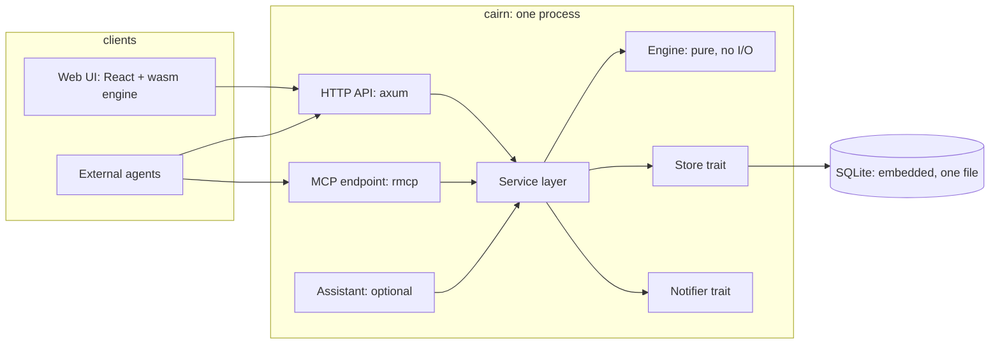
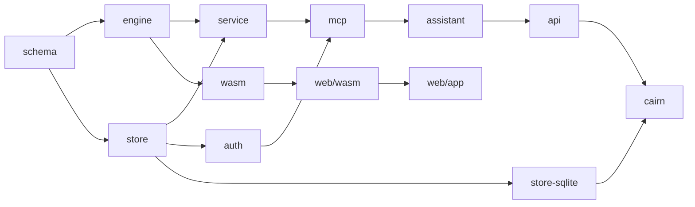

# Cairn: Architecture

How the PRD is built, never what is built. Read `PRD.md` first.

## Summary

One Rust binary around a pure **engine**: every product rule (model, patches, invariants, derive, dates, projections, save as route, file format) as I/O-free functions over in-memory graphs. The **shell** adds storage, the HTTP API, MCP, auth, the optional assistant, and the embedded web UI. The engine also compiles to wasm, so the browser derives and previews locally. `cairn demo` runs the binary over an in-memory store seeded with the fixtures, for development, demos, and browser tests.



Load-bearing decisions:

1. **The engine is pure.** No storage, HTTP, or clock: today, now, the time zone, and the viewer are inputs.
2. **Whole domain in memory.** Every read loads one journey or route whole and derives it once; every write validates a whole candidate graph.
3. **State and events in one transaction.** The patch applier is the only writer.
4. **One engine, two places it runs.** Server and browser run the same crate.
5. **The engine owns every rule and derived value.** Hosts keep only presentation. They read rules from the engine (directly, through wasm, or from the generated rule tables) and ask it for anything a table cannot say. No host copies a rule.
6. **Pluggable edges.** Storage, auth, and notification are traits, assembled in one composition root.

## Assumptions and limits

- **Journeys are small** (hundreds of nodes, a few MB), hence whole-domain loads, full derive on read, and the whole journey sent to the browser. The limits in `PRACTICES.md` hold it there; past them the path is incremental derive and paged reads, with the same schema.
- **One deployment, one trust boundary, one process** over one embedded database file.
- **Days in the deployment's time zone.** Today and now are computed once per request and passed in, so everyone sees the same dates and rank. A time of day is stored as the instant with the zone's offset then, so the engine needs no zone rules; the host checks the offset on write.

## Terms

PRD terms keep their meaning. Additionally:

| Term | Meaning |
|---|---|
| **Domain** | A patch target, loaded and revision-checked as one unit: a journey, a route with its draft, or the deployment. Published versions are immutable graphs read by id, never part of a domain. |
| **Derive inputs** | Today and now, the time zone, the viewer's identities, and the deployment's identities and aliases. Supplied by the host. |
| **Domain document** | A journey's graph and state plus its derive inputs: nothing derived, no proposals. The browser derives it locally. |
| **Projection** | A read-only view over a derived journey (snapshot, level, trace, timeline, summary, node list). |
| **Change set** | The persistence-neutral result of an accepted patch, a `schema` type, so stores depend on `schema` and never on the engine. Only the engine's `apply` makes one. |
| **Capabilities document** | `GET /api/capabilities`: what this server offers. The UI shows features from it. |

## Repository layout

```
cairn/
  crates/
    engine/        pure domain: model, patch, validate, derive, dates, project, save, format
    wasm/          the engine's browser surface
    schema/        serde types shared by engine and shell; JSON Schema export
    store/         Store and Notifier traits; memory backend; the conformance suite
    store-sqlite/  SQLite backend
    service/       load, call the engine, commit; runtime-free
    auth/          AuthProvider trait and providers; users and logins
    api/           axum endpoints, OpenAPI, SSE, the Rust client
    mcp/           rmcp server: tools, instructions
    assistant/     chat-completions client and tool loop
    cairn/         the binary: CLI, config, composition root, embedded assets
    tests/         the library crates' integration tests, one test binary
  web/
    app/           React UI
    client/        TypeScript client
    wasm/          wasm package and the derive worker
  instructions/    the shipped agent guide
  fixtures/        generic seed routes and journeys
  testbeds/        simulation testbeds
  openapi/, schema/  generated
  decisions/       judgment calls for the owner's review
  docs/            running a deployment
  mise-tasks/, scripts/  tasks and the ladder
```

Arrows point from a crate to one that depends on it, direct dependencies only where not implied; `crates/tests/tests/integration/architecture.rs` holds this graph and the list above to the manifests.



## Engine

### Model

- One `Node` struct with a per-kind payload enum, so a field a kind cannot have is unrepresentable. Kinds, states, transitions, and relevance are closed enums matched exhaustively; keys, ids, paths, and revisions are newtypes.
- A `Graph` is nodes, edges, roles, kinds, resources, retired keys, and for a journey its state. A route version or draft is a graph with empty state.
- A `Proposal` is separate from every graph, with its own revision.

### Read path

`derive(journey, inputs) -> Derived` is the only place derived values are computed, in passes that each read only earlier ones: relevance, effective dependencies, participation, dates, blocking and the frontier, priority, then flags and display state last.

- **Containment edges never copy.** Each container has internal entry points, one for requirements and one for conditions; a requirement or condition gate waits at a container's entry, and descendants inherit it through the entry chain, keeping the graph linear in nodes plus explicit edges. Explanations name the ancestor, never the entry.
- **Every edge gates.** Blocking, cycles, trace, gravity, and dates read one set of effective edges.
- **Derived carries what screens show**, with the inputs that explain it, so no screen recomputes. The engine's explanations are whole; responses cap each list and page the rest, except a rejection's, which is whole.
- Hosts may memoize a derivation by revisions and inputs, invisibly. A derivation says when the next time of day would change it, which bounds how long a cached one serves.

### Write path

`apply(domain, patch, inputs) -> Result<Applied, Rejection>` is the only way a graph changes: check the base revision, apply mutations to a candidate in order checking only transitions, then validate the final candidate once against one derive, returning every failure or the change set with one event per mutation. An intermediate candidate is never derived, so no guard is satisfied temporarily. `consequences(before, after)` is pure over two derivations and computed for every accepted patch and preview, never stored.

### Date network

One constraint network, rebuilt on every derive.

- **Plan layer**: no actuals, no today. A contradictory chain is a positive cycle, or a chain between pins needing more days than they allow.
- **Execution layer**: earliest bounds run forward from pins, actuals, and today; latest bounds backward from pins and actuals. They are computed apart and never reconciled: a gap is a shortfall. An actual is a fact, never moved or relaxed through, and a finished node's own constraints are off, so a recorded date never warns.
- Date solving never waits on blocking.
- **Algorithm**: strongly connected components in topological order, Bellman-Ford only inside cyclic ones. A cost test at the limits is part of acceptance.

### Projections

Every projection lives in the engine, so every host shows the same views, and its inputs and outputs are schema types passed through unchanged. `level` owns aggregation entirely: what is visible, roll-up, edge re-targeting, hidden counts.

### Conditions

A structured predicate tree with a fixed operator set, no parser. References resolve to decision keys at edit time, which is what makes condition gates, the decision view, and explanations possible. New operators are a product change.

### Save as route

A pure function from a journey (or a selection) to a proposal that creates or opens a route draft, with identity mapping and exclusions as reviewer-edited items. Insertion mints keys with one pure function, so preview and apply agree, and stores no record beyond the pointer on each inserted root.

### File format

YAML on disk, JSON on the wire, one schema. Files carry paths and ids for reading and keys for identity. Export is deterministic, and round-trip is tested.

## Storage

### Store trait

Whole-domain and async; nothing in it walks the graph. Every layer holds `Arc<dyn Store>`. A conformance suite runs against every backend.

- `load` returns one graph whole. `commit` runs one transaction on the one writer: it rechecks the patch receipt, verifies every revision the patch depends on (its base, a proposal's revision, the revisions an identity merge or hard delete checked), writes rows and events, and bumps the revision.
- A missing domain is at revision 0; the first commit creates it.
- Conversations, sessions, OAuth state, and tour records live outside every domain, with no events. Tokens and secrets are stored only as hashes.

### Backends

- **SQLite**: one file, WAL, strict tables. One writer connection runs every write in turn, so transactions never conflict; read-only connections never wait on writes. One process per database, held by an exclusive lock. Migrations are numbered, embedded, and applied in one transaction.
- **Memory**: the reference the conformance suite is written against.

Durability: nothing is answered from a write that may not be on disk. A failed `COMMIT` leaves state in doubt, so the backend fails closed and the server exits for its supervisor.

### Schema outline

Relational rows, never a graph as a blob; the migrations are the schema. Content and state rows are keyed by graph and node key. Structured values (conditions, rules, event deltas) are JSON columns validated by the engine's schema. Publishing copies a draft's rows into a new version; versions are never updated.

### Concurrency and notification

- Per-domain optimistic locking on the single writer. Reads never wait.
- A stale patch is refused with the revisions that moved and what the commits since touched, read off their real change sets. Nothing is applied past other people's changes, and clients never retry a stale write on their own.
- The notifier announces (domain, revision) after every commit. A subscription starts with every current revision, so nothing between fetch and subscribe is missed, and a view refetches only for a newer one.

## Service layer and composition

`crates/service` is the only caller of the engine on the server: receipt, load, derive or apply, commit, notify. The API, MCP, and assistant shape their own surfaces over it and never bypass it.

The composition root in `crates/cairn` assembles the store, auth providers, the optional assistant, and the public URL. An absent subsystem is a `None` at the root, never a flag in handlers. The UI renders from the capabilities document.

## HTTP API

- Every endpoint is under `/api`; `/.well-known/` and `/healthz` stay the server's, and every other path is the web app's.
- Rust types are the source of truth; the OpenAPI document is generated from them.
- The UI reads the domain document and derives it itself.
- One write verb: `POST /api/{domain}/patches`. Naming a proposal sends the mutations there. Bulk operations are patches underneath.
- SSE streams revision ticks, never diffs.
- Records carry user ids; screens resolve names in one call and never print an id.
- Errors carry the engine's violation list unchanged.

## MCP endpoint

rmcp, stateless Streamable HTTP at `/api/mcp`, behind the same auth and limits as the API. The tool set is curated for an agent's loop, not mirrored from HTTP, and runs in process for the server and the assistant alike. Writes go through two general tools (one journey's state, or any patch) plus identity and import tools. Every tool's arguments are a plain object schema the model providers accept, which a test holds each tool to. Outputs are bounded and paged.

The guide ships in `instructions/` as the server's instructions. It holds only what spans tools; each tool's description carries the rules for that tool.

## Assistant

Optional: a server-side loop over the in-process tool set, differing from an external agent only in transport.

- One OpenAI-compatible chat-completions endpoint per deployment, one hand-written client, no retries. The credential is the deployment's, never a user's.
- The model is offered the tool list less what only a person may do (applying a proposal, importing a file). Its system text is the guide, the same for every user so a provider can cache it. There is no policy layer: the guide decides when to propose.
- Each write is reported from the tool's own answer; the conversation keeps one plain line per write, naming no id.
- A turn carries no state of its target; the model reads it through the tools, like any agent.
- One conversation per target per user. A turn ends with a reply or stopped with a reason, and the writes before it stand.

## Auth

`AuthProvider` returns a verified login, a Cairn token's actor, nothing, or a refusal. Any refusal refuses the request; a bad credential never falls through to another provider.

Providers: a dev user (loopback only unless its override is set), OIDC, a built-in OAuth server for MCP clients that federates to OIDC and mints agent tokens, Tailscale behind trusted proxies, and Google Cloud IAP, which verifies the signed assertion on every request. Only one provider owns the OAuth endpoints.

A user owns logins keyed by provider and subject. A new login whose verified email another user's login holds joins that user, else it creates one. On every request, before any handler, the caller's verified emails are matched to an identity, and one is created when none matches.

## Web UI

React (Vite) with the wasm engine. DESIGN owns how screens look; the PRD owns what they do.

- **A write belongs to the app, not the control that started it**: leaving a screen never cancels a save. Every write is a patch with an id, resent with the same id until answered; a stale one is refused for a person to decide again. While a write is unconfirmed, leaving the tab asks first. A write a resend would repeat (minting an agent token) is never one of these: it is auth state, not a patch, and is sent once. Browser tests wait for the app to report it is settled.
- **Reads** are keyed: a key names what is shown, and a value or failure shows only for its own key. Ticks and key changes coalesce.
- **The worker derives.** One call fetches the domain document; a worker derives it and answers every projection and preview, so a large journey never blocks input. The engine serves the order, lateness, and other facts a screen shows; the tab only words them. A derivation is refetched at the moment it says it holds until. Committed state always comes from the server.
- **Previews**: the page applies a draft patch or proposal with the engine before sending, so each violation shows at its field.
- **Version skew**: the server stamps a digest of its web build on the page and every response; a tab whose stamp differs stops writing until reload.
- **Canvas**: React Flow with ELK layered layout in a worker, hinted by the view's previous positions. Collapse, Filter, and search are part of the level request, never tab-side filters. Positions are never stored.
- **Screens** read engine projections and add no engine concept. A route's graph is derived as a journey on day 0.
- **Addresses**: the path names the thing and mirrors the API; the query says how to look at it, written only off defaults. Every pattern is defined once in `web/app/src/address.ts`; no redirects or aliases.
- **One host**: the app always talks to the server's API; development and browser tests run against `cairn demo`.

## Generated artifacts

Generated from Rust types: the OpenAPI document, the TypeScript client types, the rule tables, the wasm bindings, and the file-format JSON Schema. They live only in the generated paths: `openapi/`, `schema/`, `web/client/generated/`, and `web/wasm/generated/`, carry a generated header, and are never edited by hand. `mise run gen` regenerates them, and the ladder fails if that changes anything. A source change and its generated outputs land in one commit.

## Build, run, deploy

- `cairn serve` runs everything on one port over one database file. `cairn demo` runs the same over seeded memory with stub sign-in and a scripted assistant; it saves nothing.
- Configuration is one file plus environment overrides; a deployment-specific value has no default, so a missing one fails startup.
- A `Host` allowlist fronts the whole router before auth. TLS and supervision are the proxy's and the host's.
- The web build is embedded in the binary, which refuses to start without it.
- Releases are git tags; nothing committed changes per release. Minor for a change to the API, tools, file format, or stored data, or a feature; patch otherwise. The build version comes from the tag at build time.

## Observability

Structured logs on the API, MCP, and assistant with request and patch ids; metrics for requests, patches, panics, derive time, and commit time.
