# Proof: a graph-first journey page

A journey is one page that opens on its graph. The views (Graph, List, Timeline, Summary) are one
control, the Frontier is a lens on all of them rather than a page, and every list of nodes reads
like the list's table. Each picture is shown in the light theme and the dark theme, which are both
native.

## The graph, and the Frontier

A journey opens on `/journeys/<id>/graph`. The head is two lines: the name, its status and the
actions, then one muted line with the route and version, progress and the next milestone. Under the
toolbar a strip names the best ranked work (`FRONTIER  #1 ... · #2 ...`); each item centres its
node, and `+N` turns the Frontier chip on. With the chip on, cards that cannot move now fade and the
structure stays. The ladder row above the canvas holds the detail steps and the Signal button. Stages and groups are frames with a header row (kind, title, progress, status, fold).

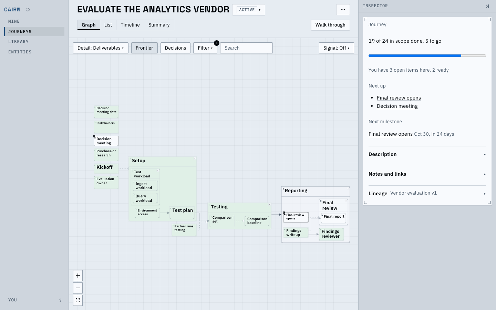
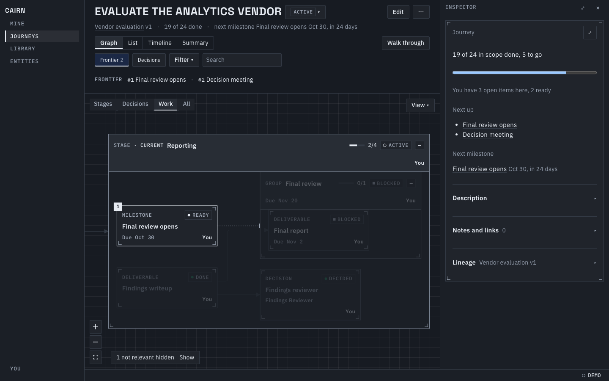

## The list, as the frontier

With the Frontier on, the List is only what can move now, flat in rank order: the Rank column
first, the status chip, the title with one reason in words, and the owner and primary action
(shown on hover or selection). What needs a look and what is snoozed sit under it as panels.

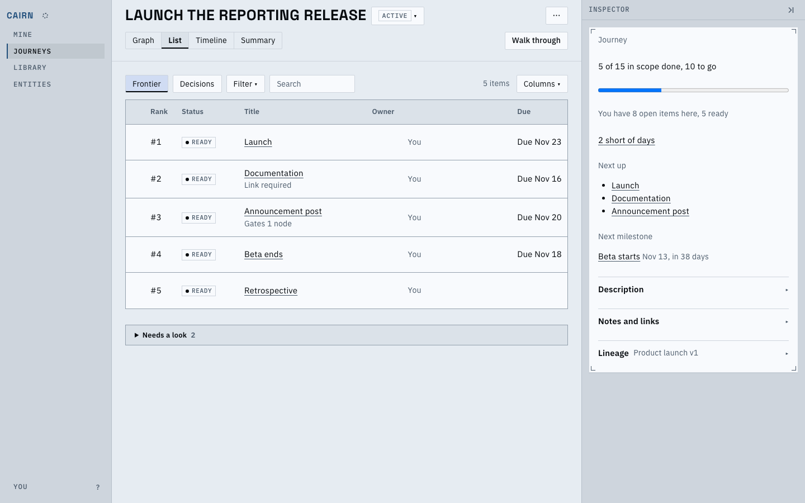
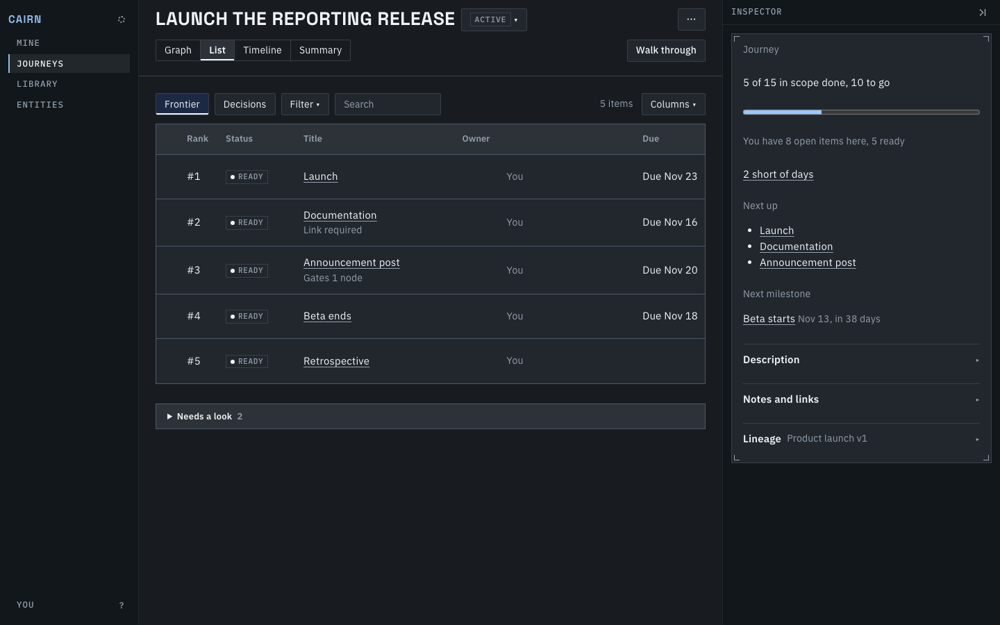

## The list, as a tree

A container is a band with a heavier title and its progress, so it reads as the header of the rows
under it; a 1px guide runs through each 24px indent gutter with an elbow into each row.

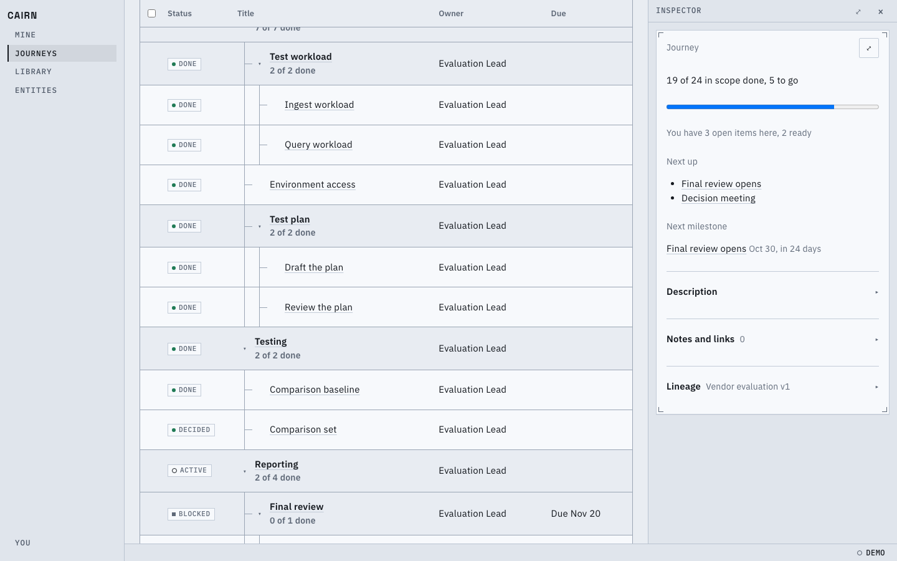
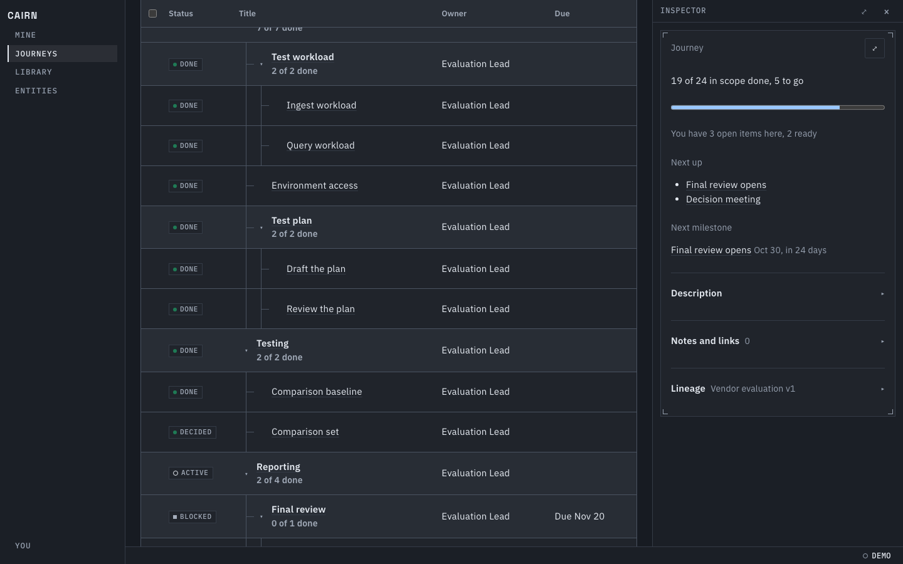

## A node's menu

Right-click a card (or press Shift F10 on a focused one) for the node's actions, in groups.

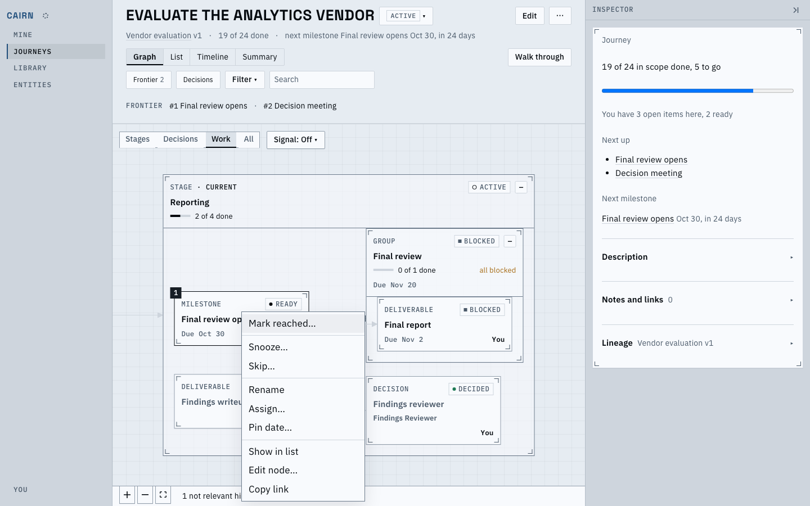
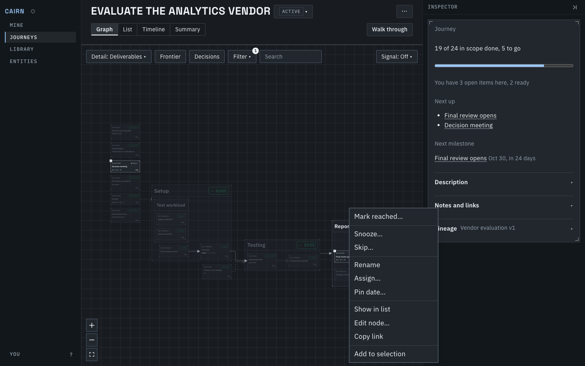

## Walk through

The cards, one at a time, are one button away (`w`) at `/journeys/<id>/walk`, with a way back to
the graph. The pass rail uses the same row look.

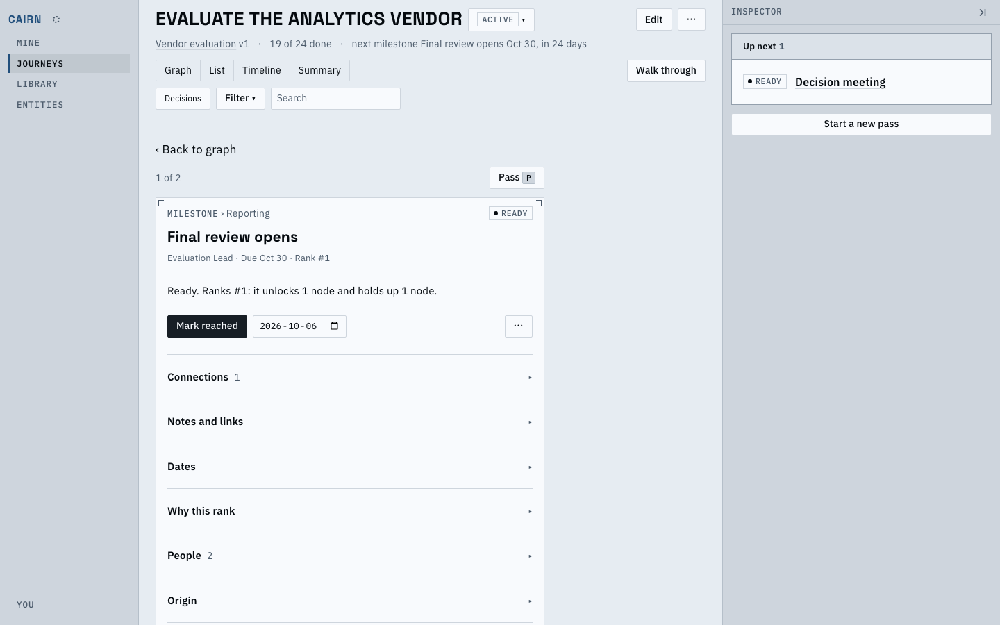
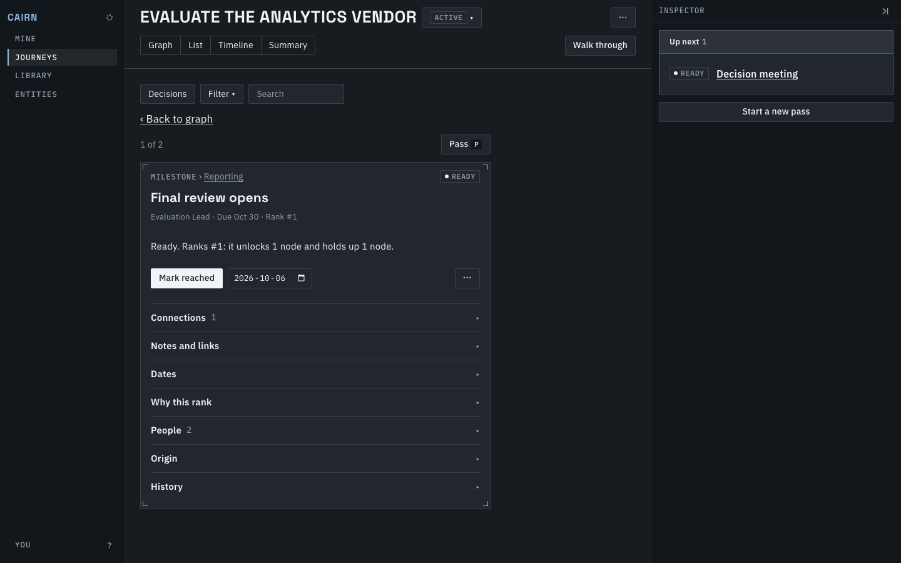

## Zoomed out

Zoomed out, cards stay whole and only scale, so their text is too small to read. A stage or group's head shrinks to its title, which holds 13px on screen and breaks only between words, and a stage keeps its state chip at the right. Done work is faded to half and its chip draws a check.

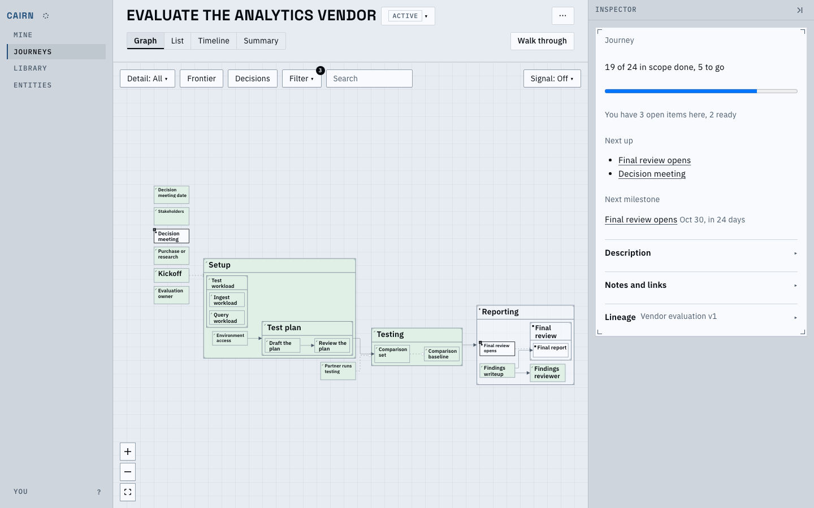
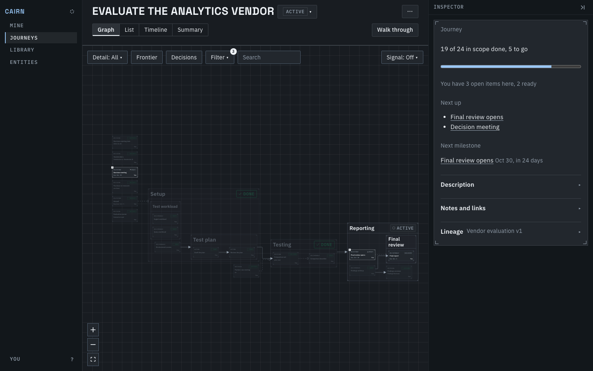

## Known limits

- The Frontier key is Shift F: the canvas keeps `f` for fit.
- "Rank for me" left with the Next page; the List sorts by its column headers.
