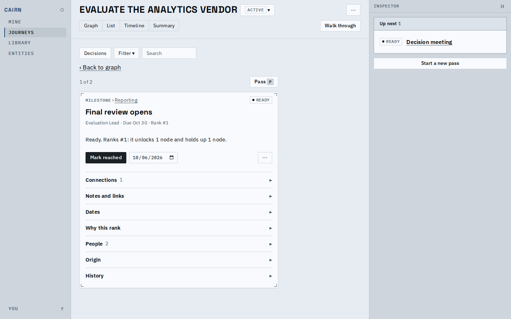
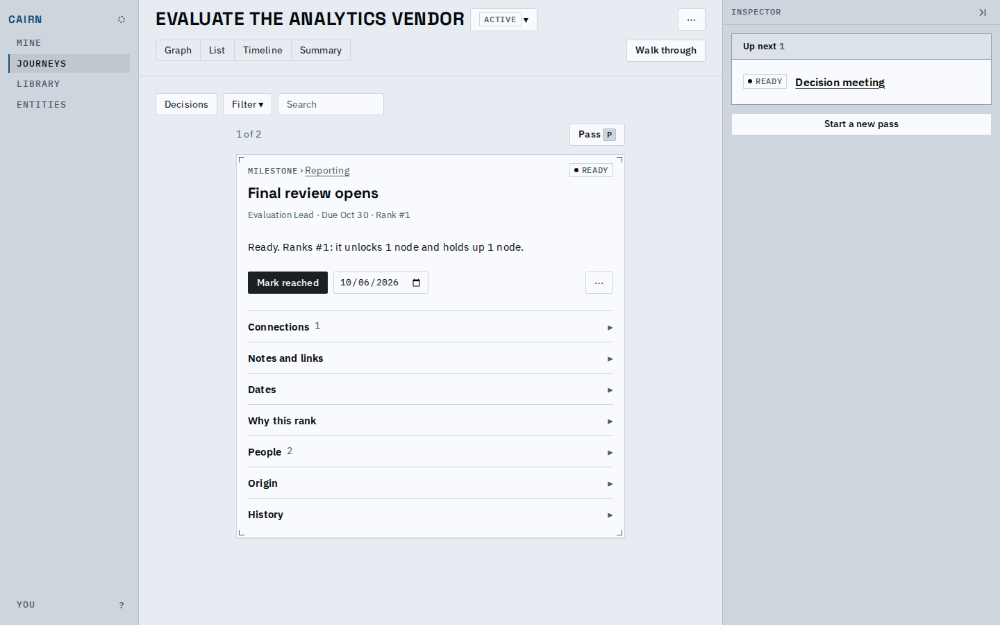
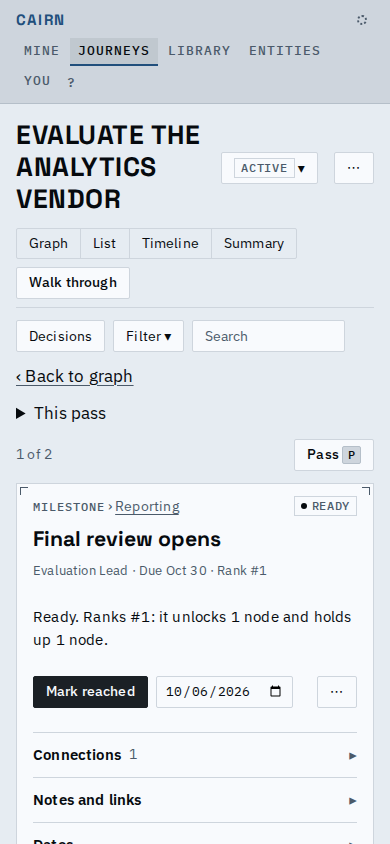
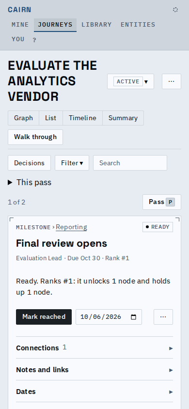
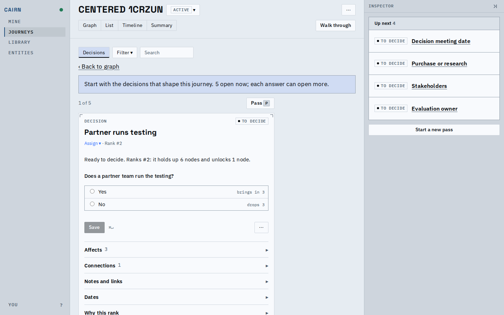
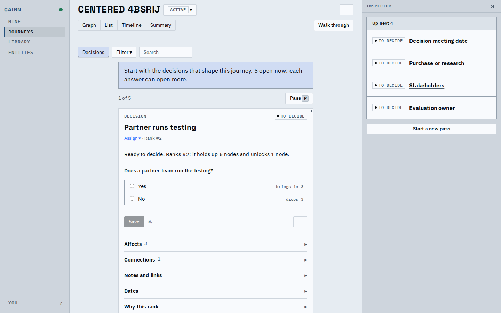

# Proof: the walkthrough's card is centered

The walkthrough now sits in the middle of the canvas area, at every width, and the "Back to
graph" link is gone (the view picker and the browser's back button already lead there). The card,
its position and Pass line, the introduction, and the end-of-pass and stalled notes share one
560px column. On a phone the column fills the width, to the screen's gutter. Regenerate the
"after" pictures with `prove.sh`; the "before" pictures were taken on the commit before this
change.

## A desktop

Before, the card hugged the left of the canvas with the link above it. After, it is centered
between the toolbar's left edge and the inspector, with nothing where the link was.

## A phone

Before, the link took a line above the card. After, the card is the first thing under the
toolbar and the pass fold, at the same gutter as before.

## The decision walkthrough on a new journey

The introduction now takes the card's measure instead of running wider than the card it
introduces.

## Known limits

- The toolbar above the card (Decisions, Filter, Search) stays at the left: it is the one bar the
  views share, not part of the walkthrough.
