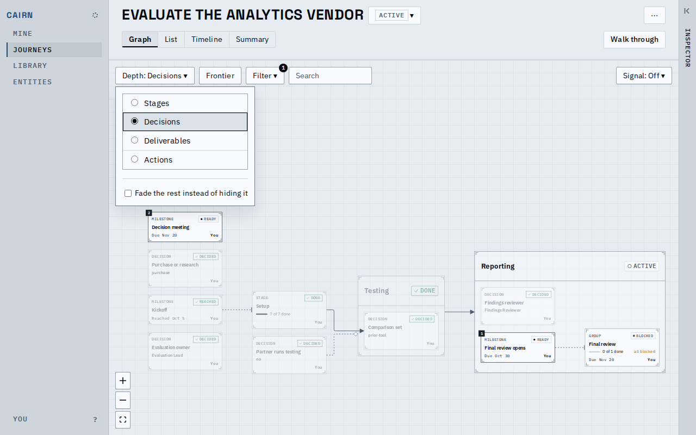
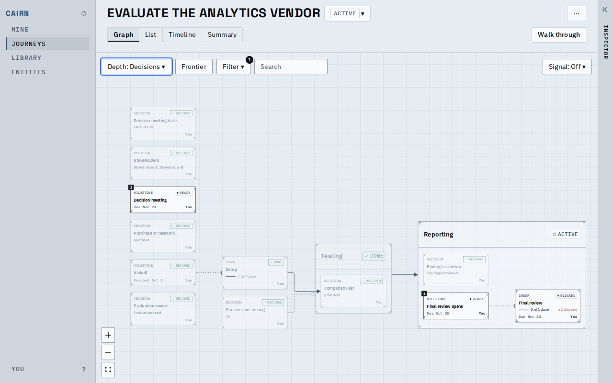
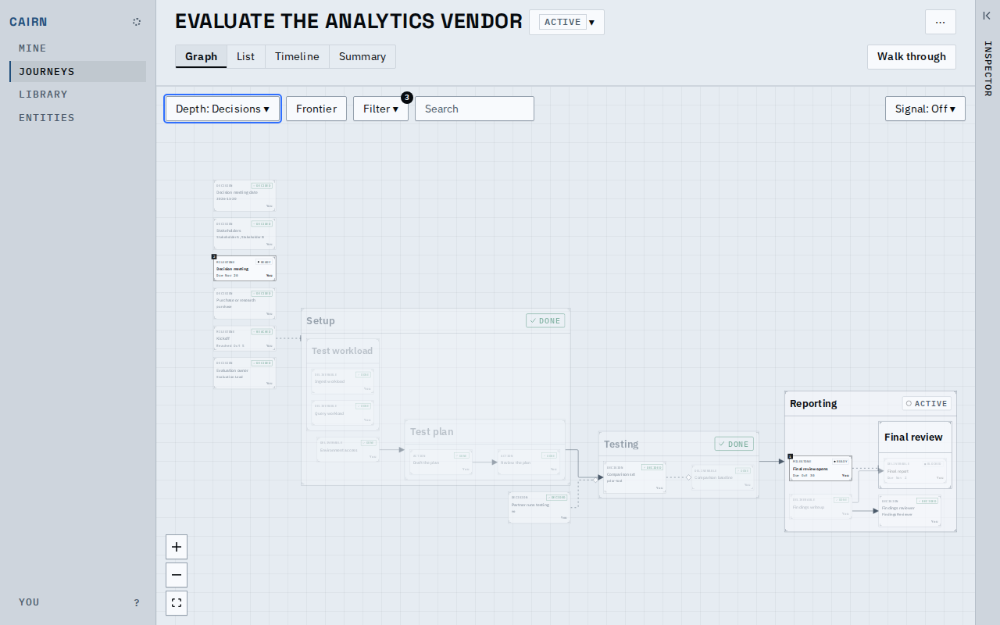
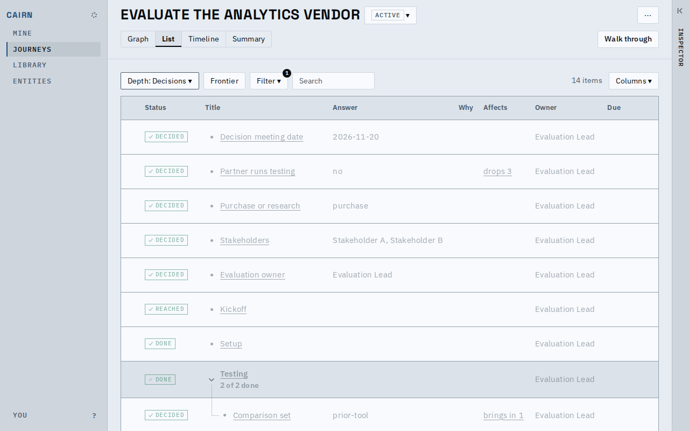
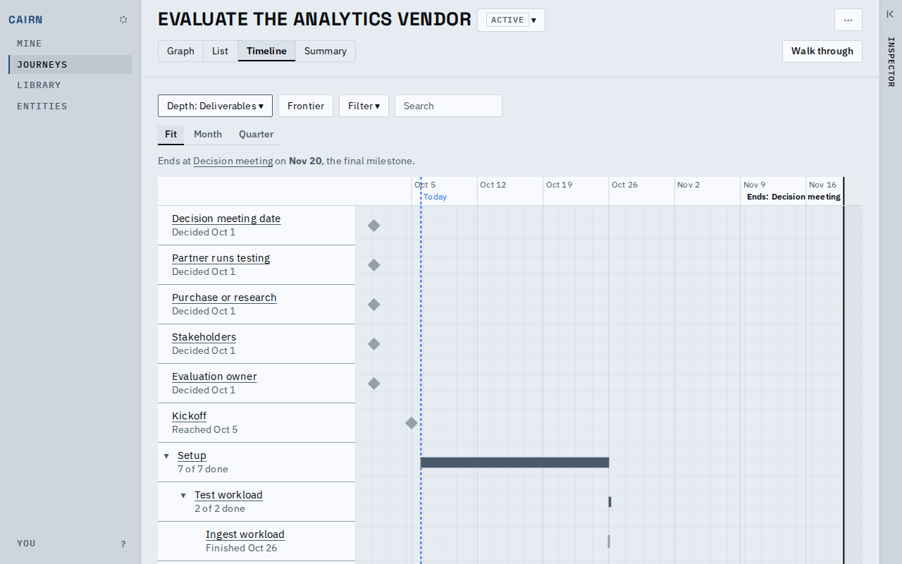
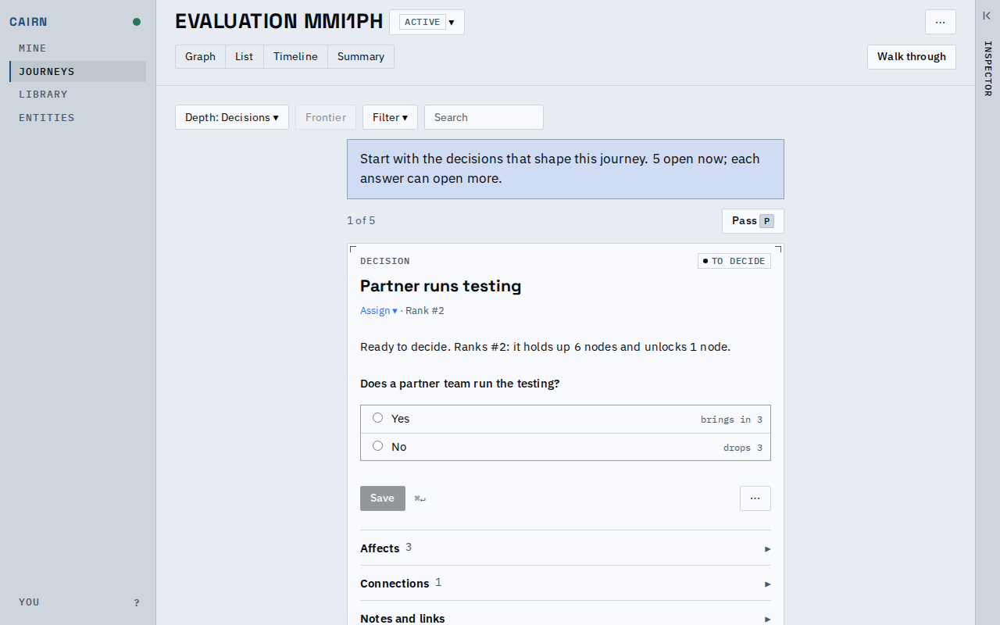
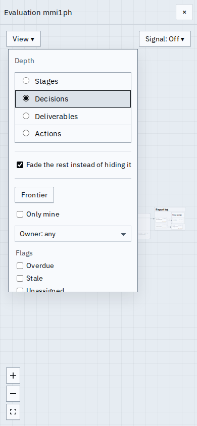

# Proof: one Depth control

One Depth control replaces the Detail steps and the Decisions button. It has four steps, named
after the deepest kind each draws: Stages, Decisions, Deliverables and Actions. Actions is the
default. Keys 1 to 4 pick the step, on every view but the summary. Under it, "Fade the rest
instead of hiding it" draws every card and dims the ones the depth would hide. The address says
`depth=` and `fade=1`. Regenerate the media with `prove.sh`.

These shots use the fixture vendor evaluation, in the light theme.

The menu lists the steps from coarse to fine, then a hairline and the Fade checkbox. The graph
behind it is at Decisions: decisions and milestones, in their stages.

Closed, the control reads "Depth: Decisions". The graph draws only what that step names, and the
Filter badge counts what the Filter hides at this depth.

With Fade ticked the same graph draws every card, laid out as at Actions, and dims all but the
decisions and the milestones. The layout is the Actions one at every depth, so stepping the depth
with Fade on moves nothing; ticking Fade adds the hidden cards, so the map is laid out afresh.

The list at Decisions adds the Answer, Why and Affects columns after Title.

The timeline has the same Depth menu in the same place, here at Deliverables.

A journey started from the vendor-evaluation route opens its walk through at Decisions: one
decision card at a time, with Frontier disabled and no Fade, since the walk draws no hidden cards.

On a phone the Depth steps, Fade, Frontier and the Filter are in the one View menu, Depth under its own label.

[main-flow.webm](main-flow.webm): the graph steps through Stages, Decisions, Deliverables and
Actions, back to Decisions, then Fade is ticked and unticked, and the list follows the same depth.

## Known limits

- The walk through at Decisions walks decisions only; Fade does not apply to it.
- Fade at Decisions dims by depth only; with Frontier on, the cards Frontier does not light are
  dimmed as well, once.
