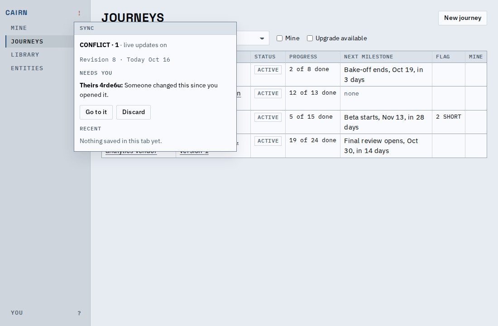
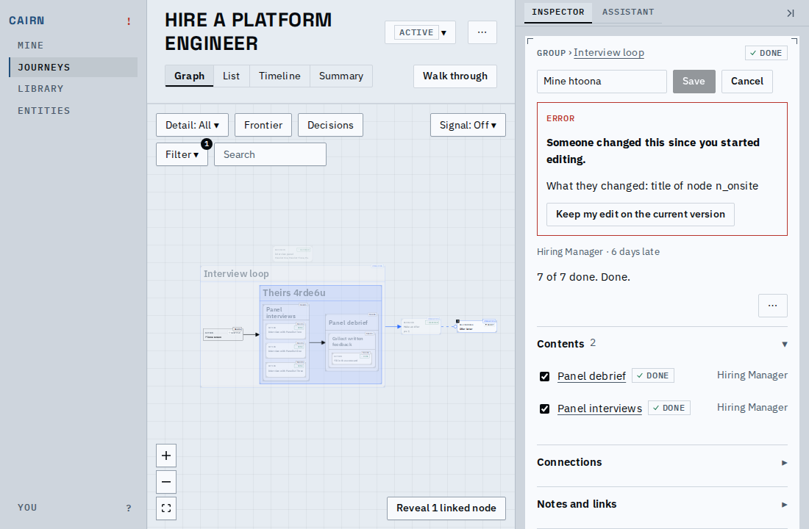
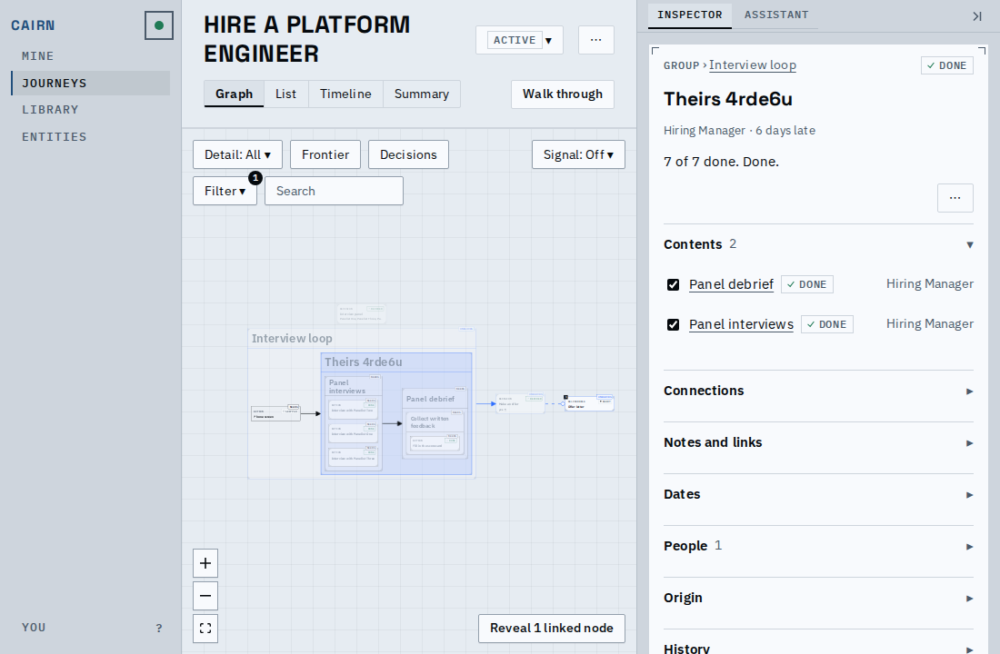
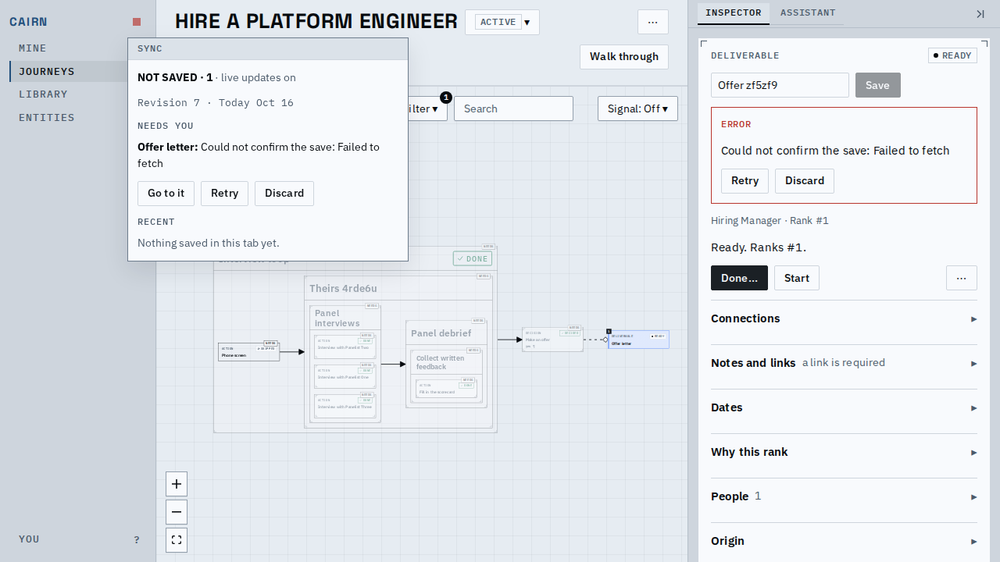

# Proof: Edits are kept until they land

An edit that was sent and did not land stays on the Sync chip until you act on it, however you
got away from it: another screen, a reload, a lost answer. A rejected rename is still there
when you come back to it, with its text and a way forward; Discard drops exactly that edit and
nothing else. Cairn keeps each sent edit in this tab (and so loses nothing that may have
committed) and resends one that got no answer under the same id, so it lands once.

## A rejected edit

Someone else renamed the node while this rename was open. The form keeps the text and says what
changed; the chip in the rail shows that something needs you.

## Away, and after a reload

Leaving the screen does not drop the edit: the chip lists it under Needs you with Go to it and
Discard. A reload keeps it, because the tab holds a record of the edit until it lands or is
discarded.

## Back to it, then Discard

Go to it opens the node with the form as it was: the typed text and the conflict, with Keep my
edit on the current version. Discard on the chip removes the edit, the form shows the node as it is,
and the chip returns to its quiet state.

## An answer that never came

When a save gets no answer, Cairn resends it a few times with the same id; if it still cannot
confirm, the chip says so, and Retry sends it again (still the same id, so a save that did
commit is not applied twice).

[Video of the main flow](main-flow.webm)

`prove.sh` regenerates the media.

## Known limits

- The browser host's failures all count as unconfirmed (it has no status to tell a refusal
  from a lost answer).
- Duplicating a tab duplicates its kept edits.
