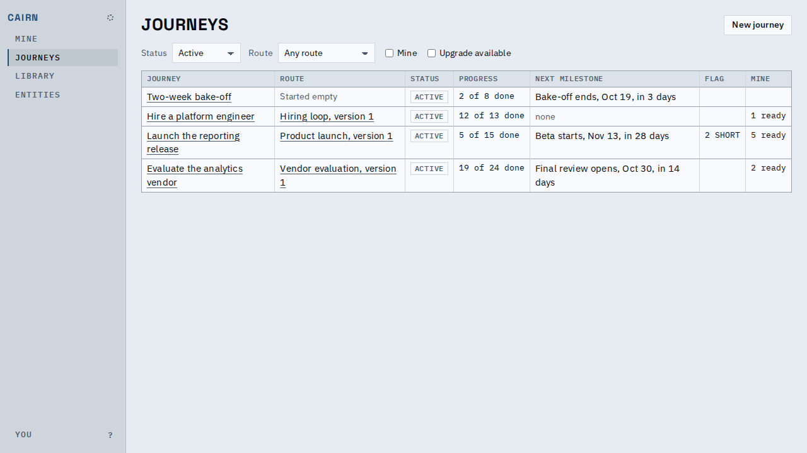

# Proof: the journey index is `/`

Opening Cairn shows the journey index straight away, at `/`, and the address stays `/`. There
is no redirect and no second address for the index: its filters ride in the query
(`/?status=any`). The page used to say "Reading your journeys...", read every journey's own
list, and then move to Mine or the index; an interim version redirected `/` to `/journeys`.
Mine is one click away in the rail.

*Opening `/` on the in-browser host: the index, with Journeys current in the rail.*

| Opening `/` | Before | After |
|---|---|---|
| First screen painted | a one-line "reading" notice | the journey index |
| Address after load | `/mine` or `/journeys`, once every journey was read | `/`, unchanged |
| Data read to decide | the viewer, the index, every journey's "mine" | none |

The decision is recorded in `decisions/2026-10-16-the-journey-index-lives-at-the-root.md`.

## Known limits

- A person who mostly wants Mine opens one click away from it; the decision record says what
  would move `/` to Mine.
