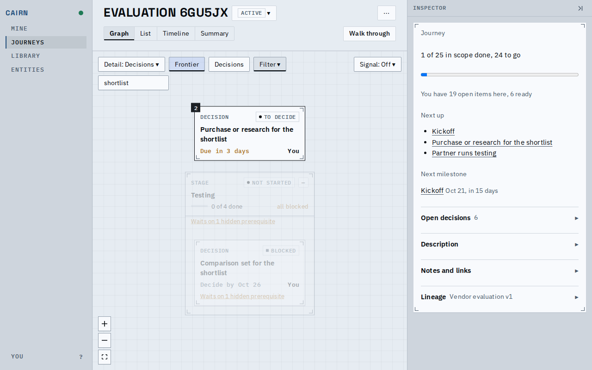
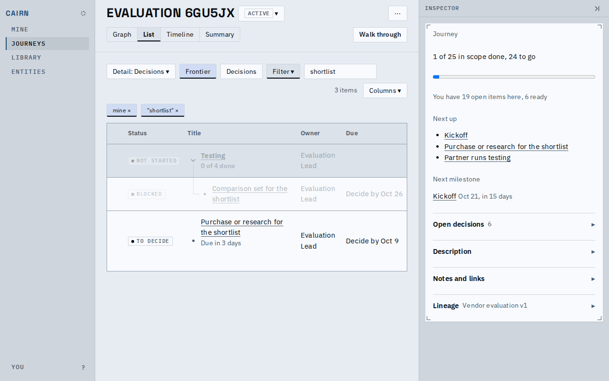
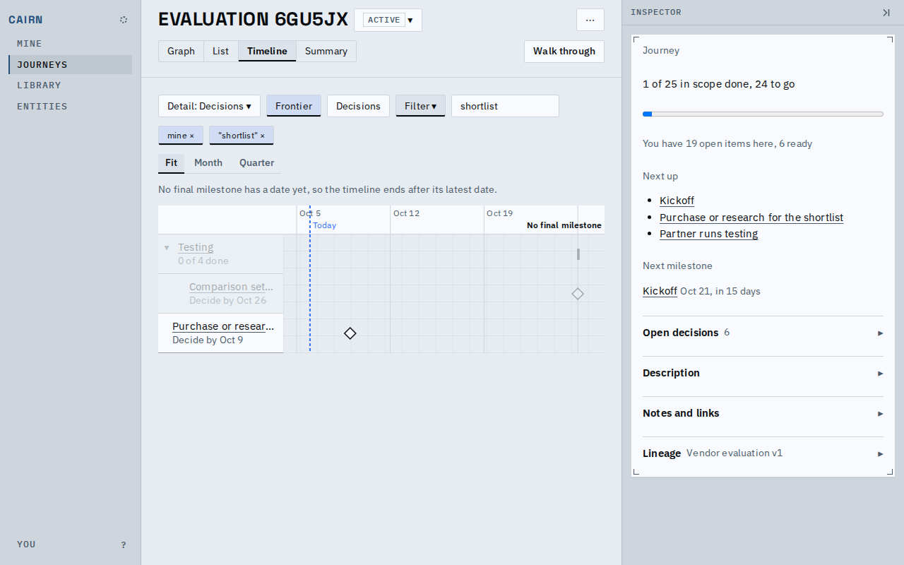
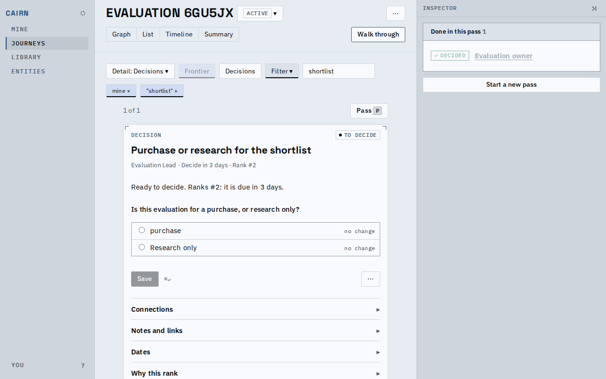
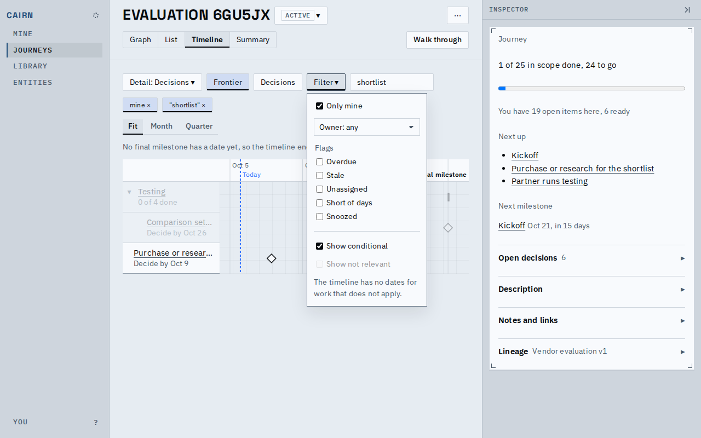
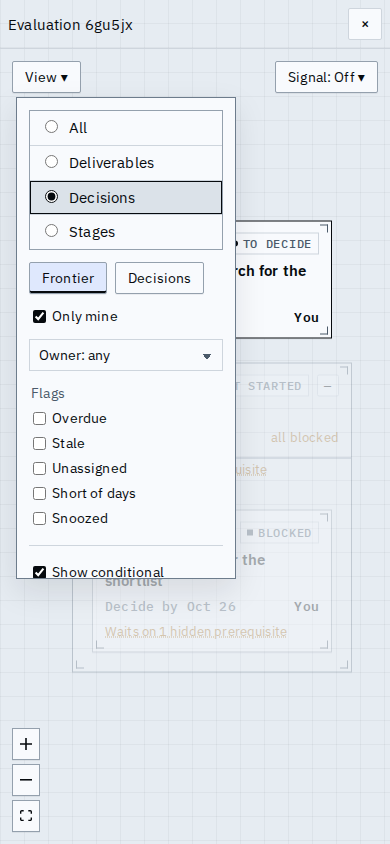
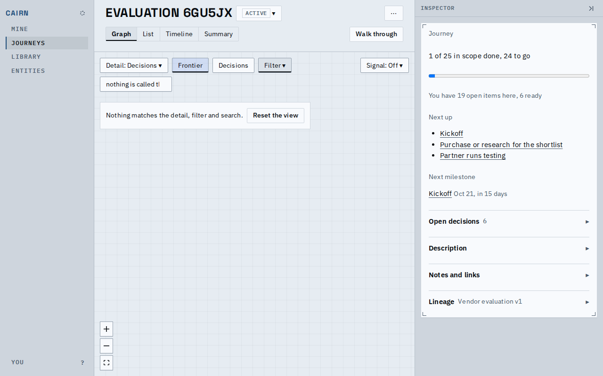

# Proof: one view state on every journey view

Detail, Frontier, Filter and search are now one set of settings. Set them on one view and every
view draws from the same level: the graph, the list, the timeline and the walk through keep the
same nodes, and each switch of view carries the settings with it. Frontier and Decisions only
highlight. A view that cannot honour a setting keeps it set, shown disabled with the reason.
Regenerate the media with `prove.sh`.

These shots use a fresh vendor evaluation the viewer owns. Two decisions have dates, and their
titles hold "shortlist": X is on the frontier, and Y waits on the plan. The settings are Detail at
Decisions, Frontier on, Only mine, and a search for that word.

The graph draws X and Y with Testing, the stage that holds Y. Frontier lights X, and the rest fade
to 0.3. The plan that Y waits on is hidden, so its marker says so.

The list has the same three rows. X, the frontier row, gives its reason under its title, and the
chips under the toolbar take off one setting each.

The timeline shows the same dated rows, highlighted the same way.

The walk through has one card, X, since every card it shows is on the frontier. Its Frontier chip
keeps its value and is disabled.

Every view has the same Filter. On the timeline, Show not relevant is disabled, with the reason
under it.

On a phone, the graph's controls fold into one View menu that holds the same settings.

When a search matches nothing, the view says so and offers Reset the view.

[main-flow.webm](main-flow.webm): the settings are made on the graph, then followed through the
list, the timeline, the summary (which counts the whole journey and says so), the walk through,
and back to the graph.

## Known limits

- Decisions still means something different on each view: it highlights decisions on the graph
  and the timeline, lists only decisions on the list, and starts the decision walkthrough.
- The timeline cannot show not-relevant work, which has no dates.
- The summary counts the whole journey, whatever the settings.
