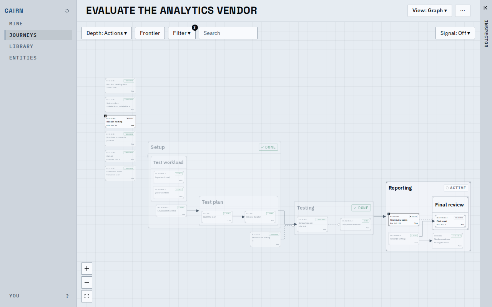
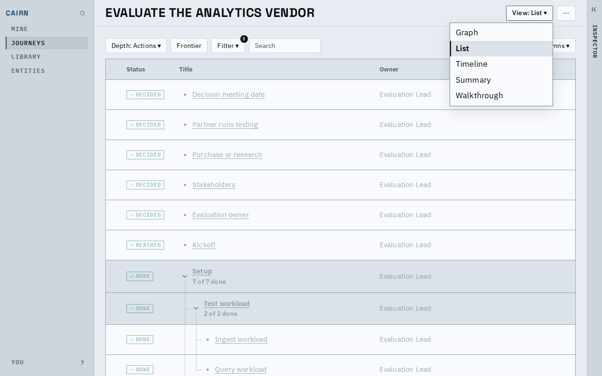
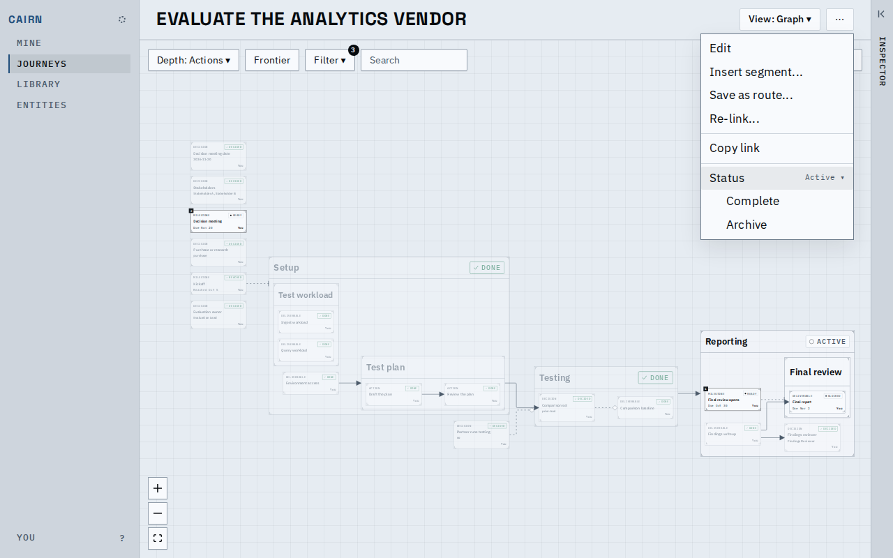
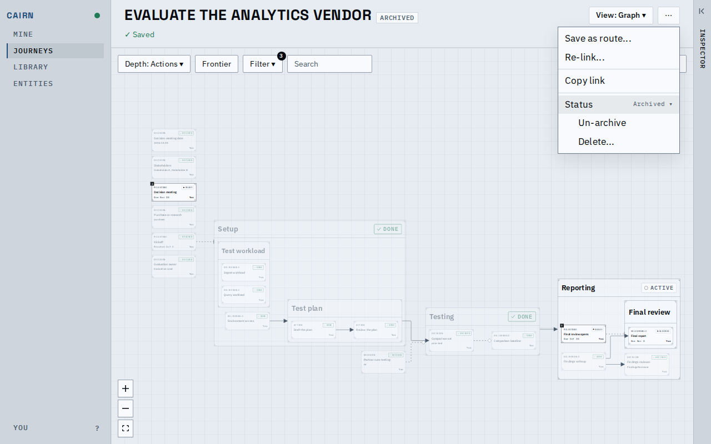
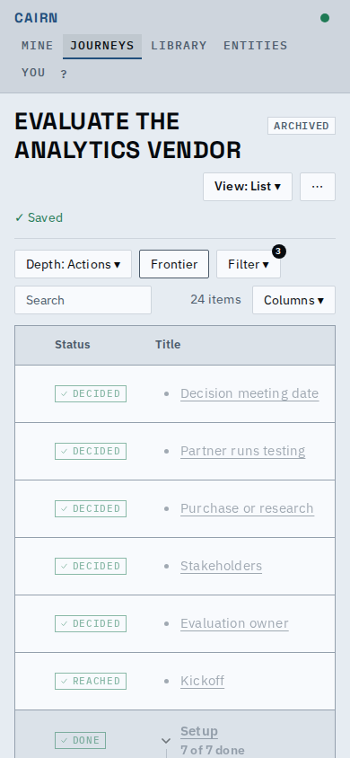
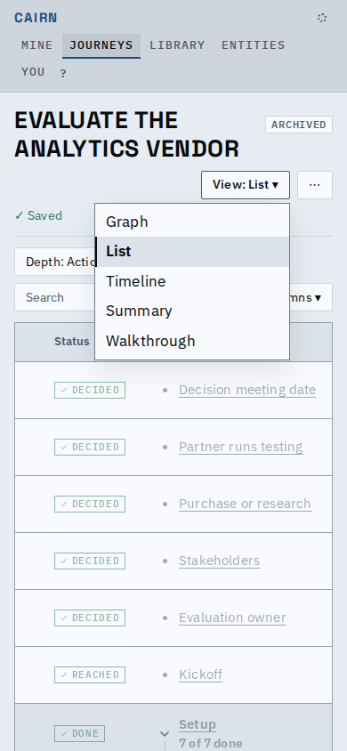

# Proof: the journey header holds the View picker and the status

A journey's header is one line: its title, a "View: Graph ▾" picker that lists every view
including the Walkthrough, and `⋯`, which now holds the journey's status. The row of Graph, List,
Timeline and Summary tabs and the Walk through button are gone. A journey that is not active also
says so beside its title, in a read-only chip.

These shots use the fixture vendor evaluation, in the light theme.

An active journey: the title, the View picker and `⋯`, and nothing else above the view's own
toolbar. Active shows no status chip.

The picker lists Graph, List, Timeline, Summary and Walkthrough. The open view is banded with an
ink edge. Arrow keys, Home, End and Enter work, and Esc returns focus to the button.

`⋯` ends with a Status row showing the current status. It opens in place to the moves the status
allows: Complete and Archive for an active journey.

After archiving, an ARCHIVED chip follows the title (its tooltip says what that means and where
to change it). Edit and Insert segment are gone, and Status offers Un-archive and Delete, which
is offered only once archived.

At 390px the title and chip take the first line; the picker and `⋯` sit under it at the right,
so the header is the same height on every view.

The picker slides inside the window.

[main-flow.webm](main-flow.webm): the graph, then the picker to List, Timeline, Summary, the
Walkthrough and back to Graph.

## Known limits

- On a long, wrapped title the chip sits on the first line, at the right of the title block, not
  directly after the last word.
- A status change still shows the app's "Saved" receipt under the header until it clears, which
  moves the view down a line for a moment (the receipt is shared by every write).
