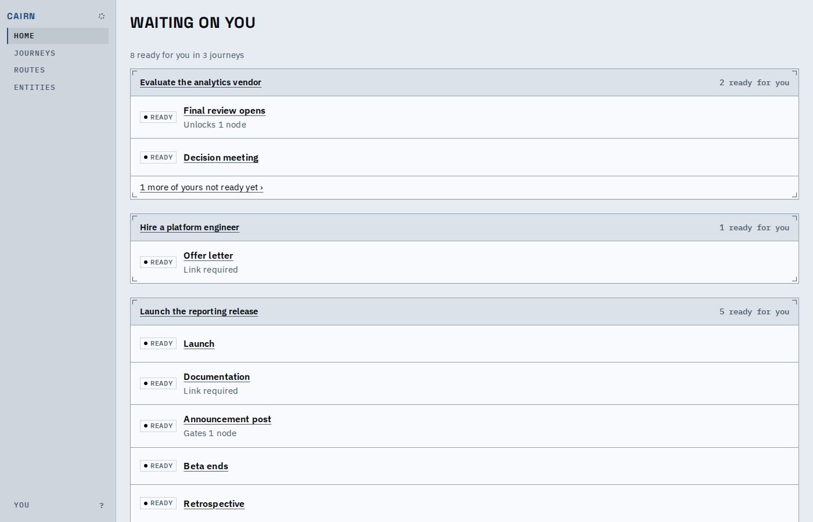
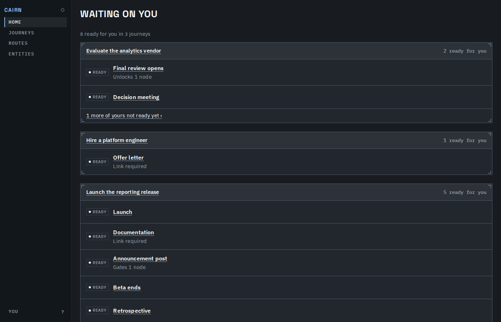
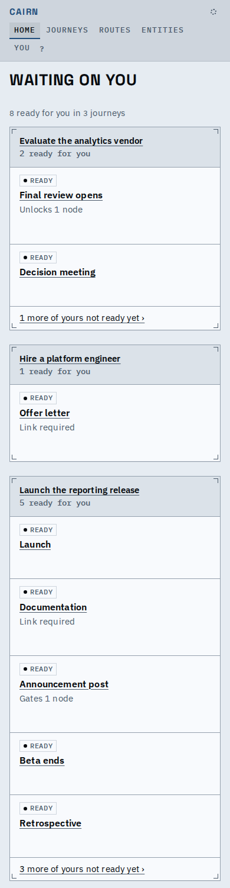
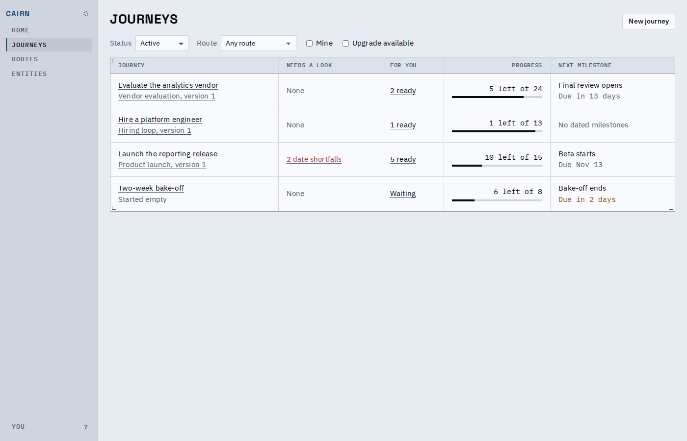
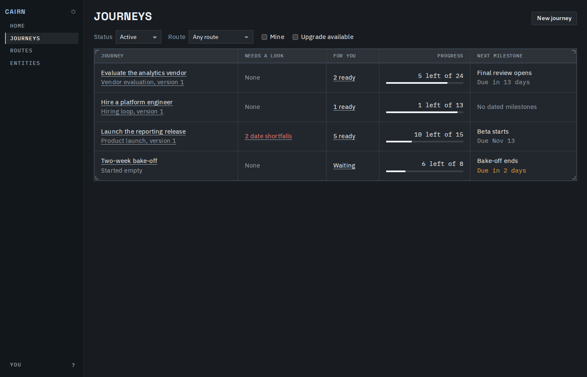
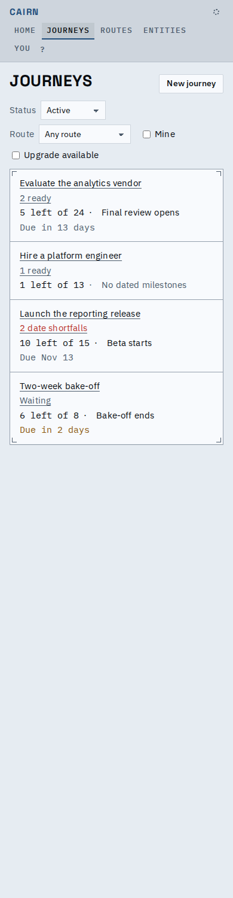
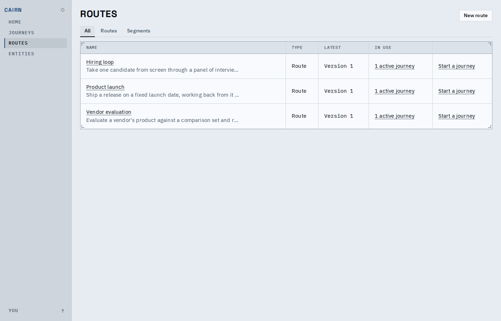

# Home and the indexes

Home now lists, per active journey, the work you can move now, bounded at five with the rest
of your work counted and one click away. The Journeys and Routes indexes are tables that say
what is going on in each row, and a long Journeys table derives only the rows near the view.

## Home

Each active journey is a group headed by its name, with your ready work under it as rows that act in place; "1 more of yours not ready yet" counts the rest.

The same page in the dark theme.

At 390px the groups stack with nothing off the side.

## Journeys

A row says its context under the name, then what needs a look (in the error ink when it does), what is ready for you, progress and the next milestone.

The dark theme.

Each row is a block: name, context, then one attention line, so nothing is said twice.

## Routes

`All | Routes | Segments` writes `?type=` and each row says what uses it.

Rows stack the same way as the Journeys index.

Main flow: [main-flow.webm](main-flow.webm) goes Home, a row to its node, Journeys, Routes, Segments.

## Before and after, 300 journeys on the Journeys index

| | Before | After |
|---|---|---|
| Rows shown | 19.8s | 0.7s |
| Heap | 148MB | 68MB |

Regenerate the media with `prove.sh`.

## Known limits

- The loading, failure and empty states are drawn by the same `IndexState` and are covered by
  the models' tests, not pictured here (the in-browser host does not fail on demand).
- A row far below the view says "Reading..." until it is scrolled near.
