# The journey Summary is its front page

Open a journey and the first thing you see answers "where are we, and
what needs me?": what is left, the end date, what to act on, the work
under way, what is blocked and by what, and what just finished. Rows act
in place (Done, Decide), and the page prints as a dated status report.
`./prove.sh` regenerates everything here.

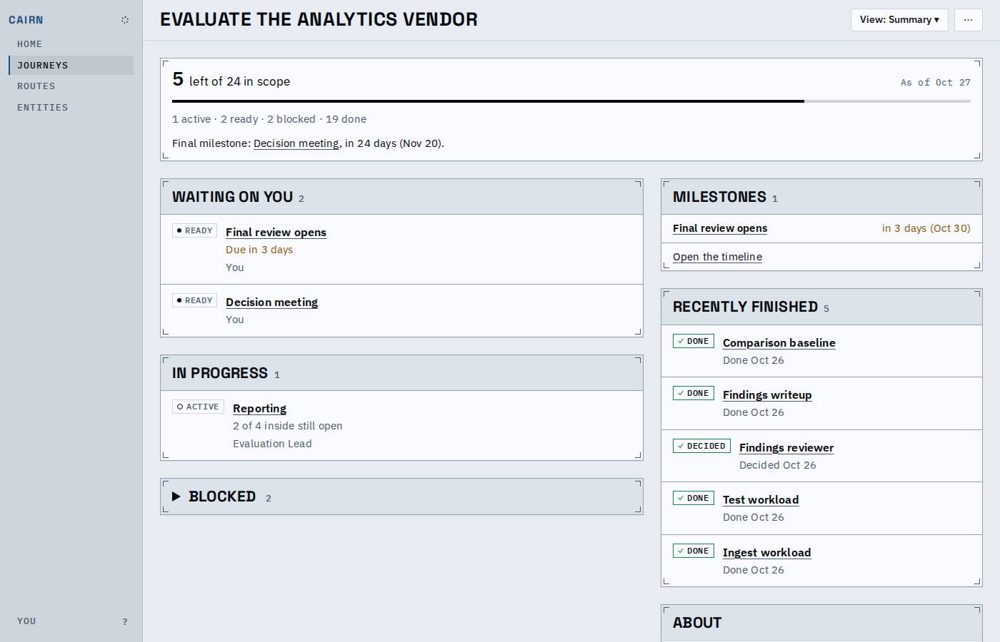

Mid-journey: the lead holds the figures; Waiting on you and In progress
sit in the main column, the milestone list, recent work and About beside.

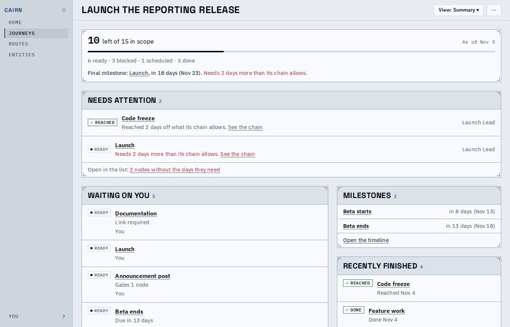

Needs attention says what each shortfall means in plain words, with a
link to its chain, and counts as links into the list at its foot.

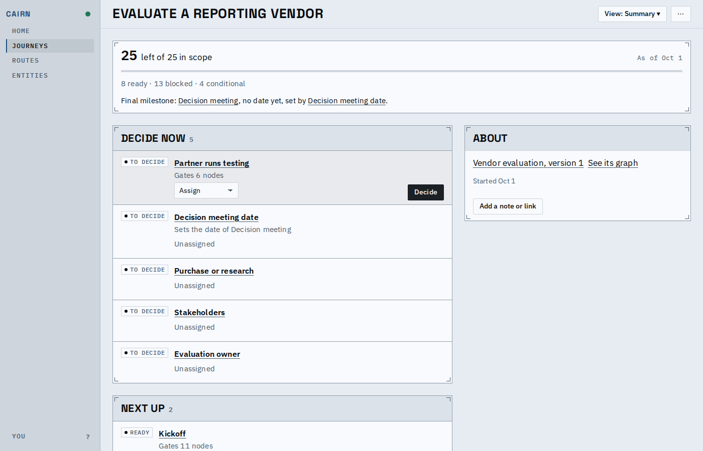

A fresh journey: the decision that sets the end date says so.

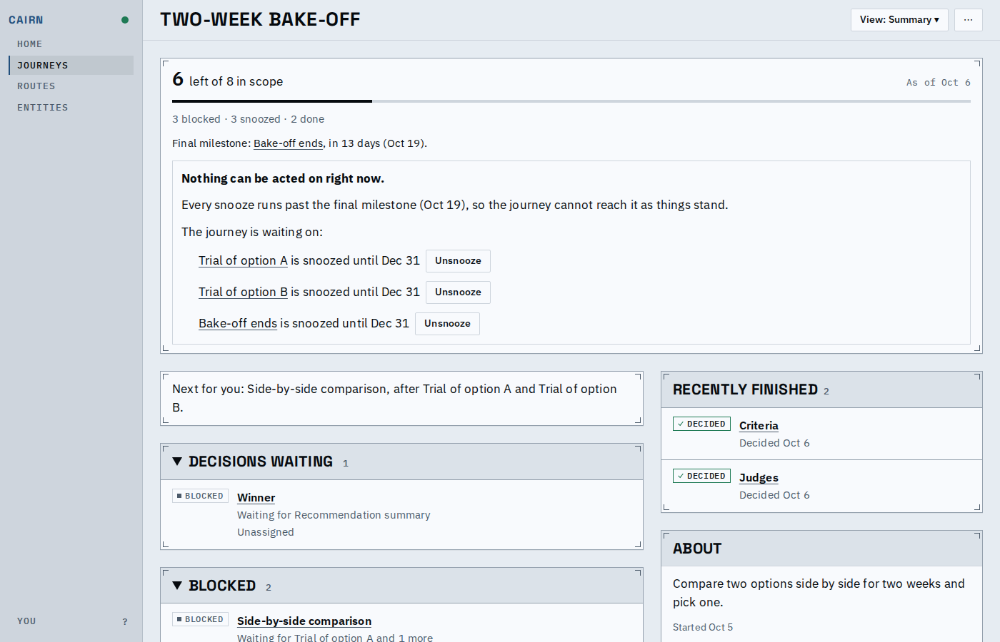

Stalled: every snooze runs past the final milestone, said once, with
Unsnooze beside each cause; blocked work names what holds it.

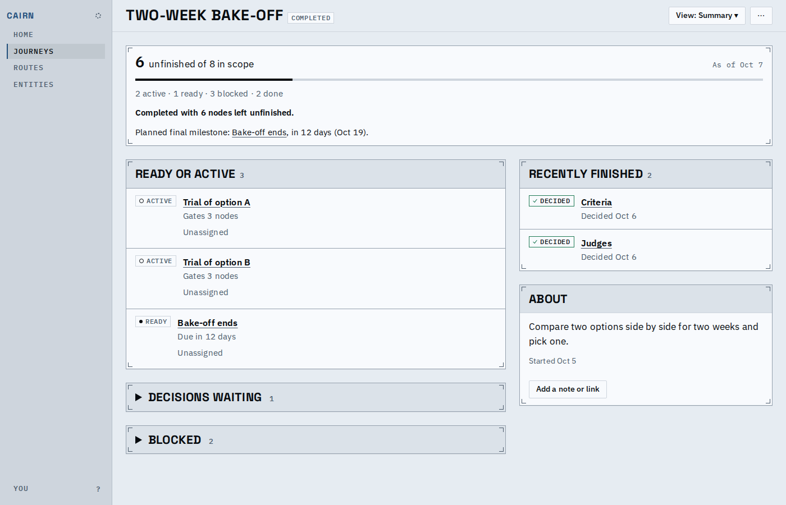

Completed with work left: the lead says so and lists it as unfinished.

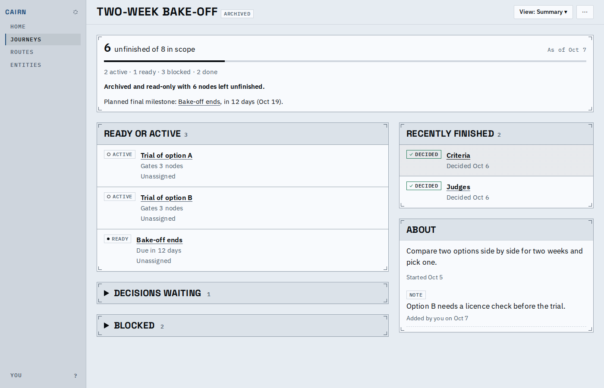

Archived is read-only: no Done, Decide or note controls.

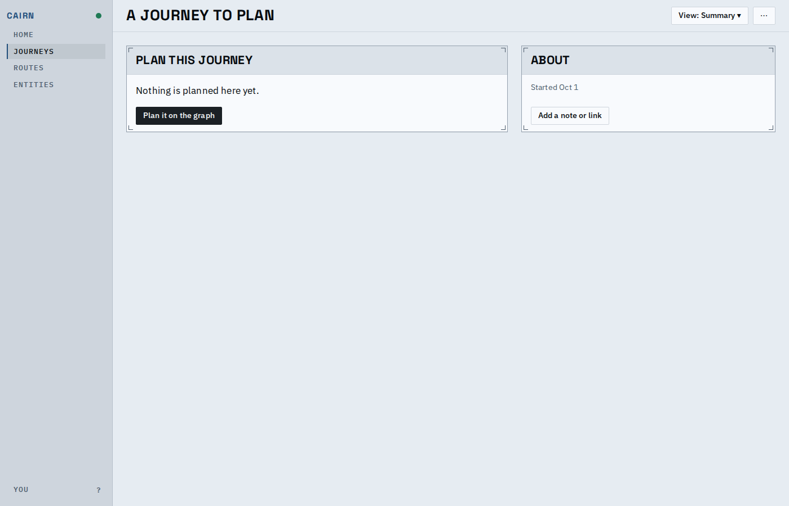

An empty journey leads with the invitation to plan it, About beside.

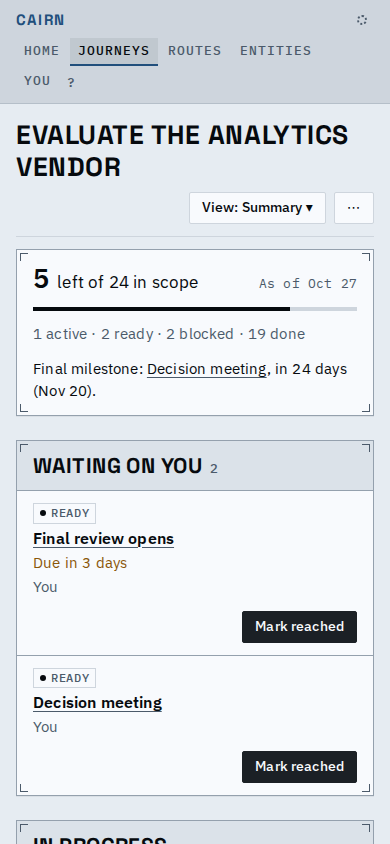

On a phone (touch): one column, the chip above the title, the owner under it, every row's actions in view.

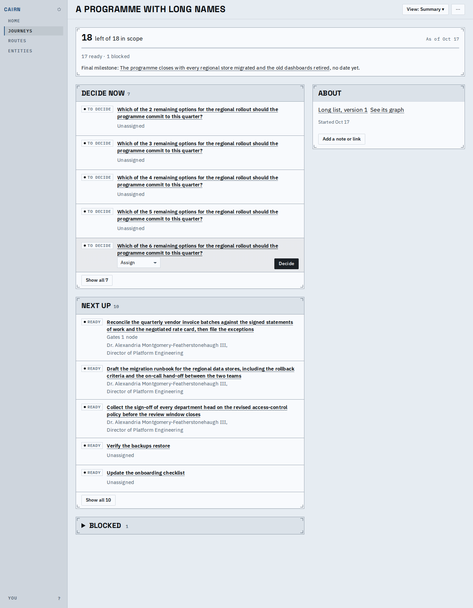

Long titles and owner names, and more than five rows in a list: five
show, "Show all N" reveals the rest.

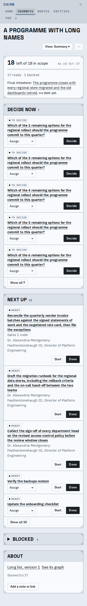

The same on a phone: titles and names wrap at the full width, nothing is cut.

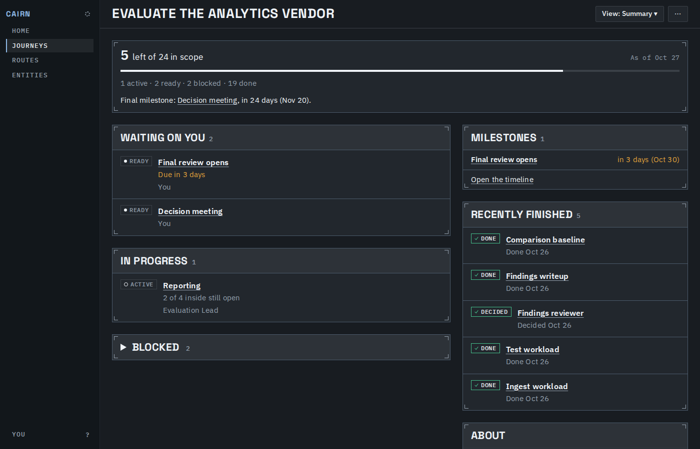

Dark theme: finished work stays readable.

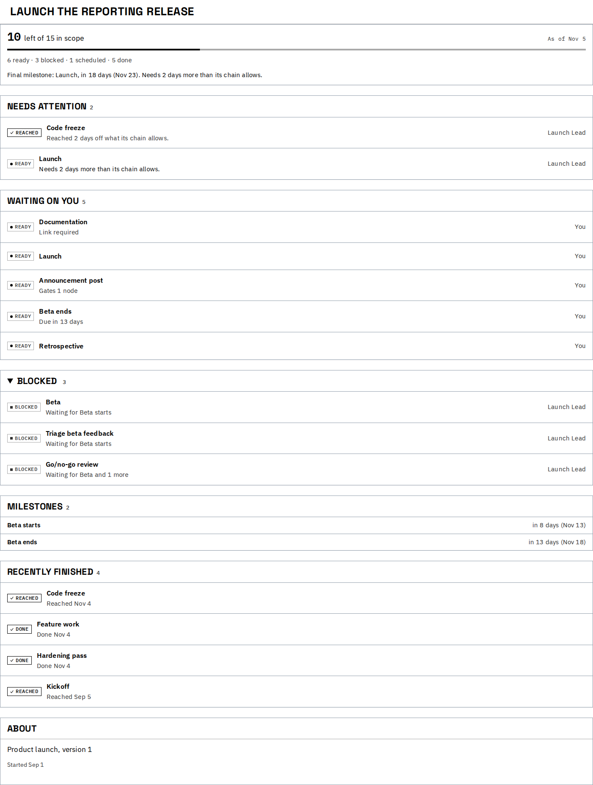

Print: every row, no controls, no empty footers, black on white.

Also saved here: `8-phone-full.png` (the phone page whole) and
`main-flow.webm` (open a journey, mark a row Done in place, open a node
and come back).

## Known limits

- The count of nodes behind each blocked node (its downstream gates) is
  not shown: the engine's explanations cut it, so it cannot be exact.
- Expanded lists reset when you navigate away and back.
