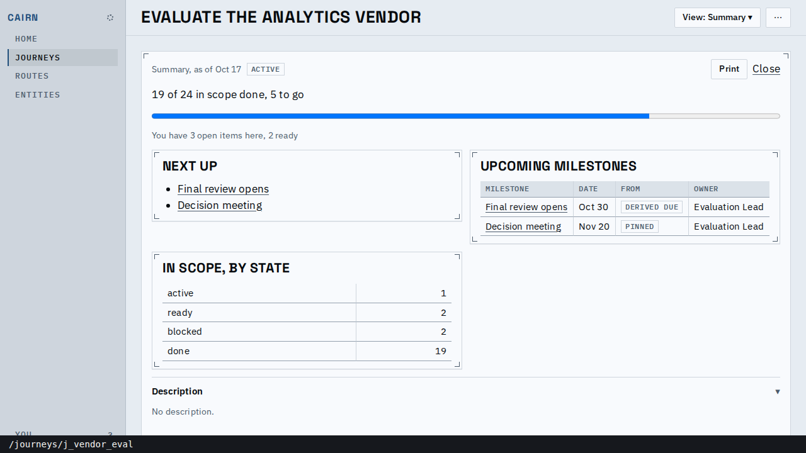
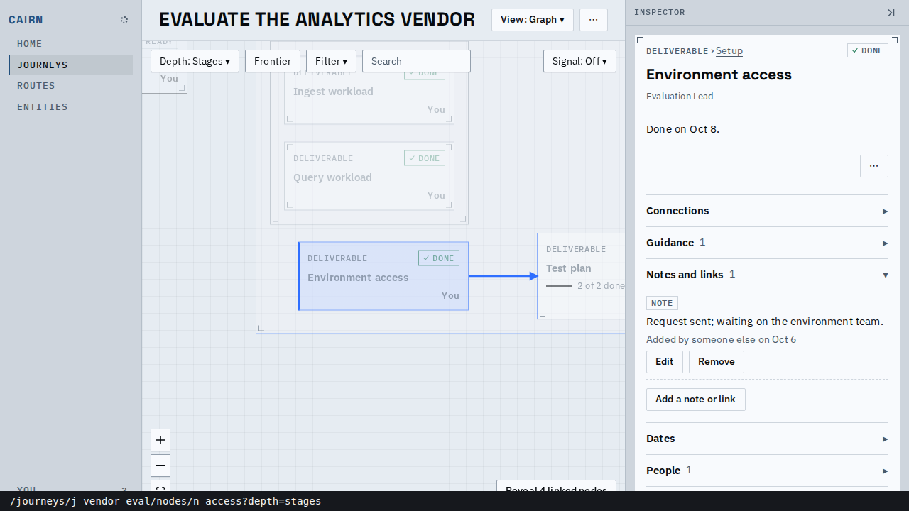

# Proof: one address per journey and node

You can now open Cairn at Home (`/`), which shows what is waiting on you in each active
journey with no redirect; every journey and node has one address (`/journeys/<id>`,
`/journeys/<id>/nodes/<key>`); and a link to a node draws that node even when the depth or a
filter would hide it. The strip along the bottom of each picture and of the video is the
tab's address, drawn by the proof script (the page itself has no browser chrome).

*Home at `/`: each active journey's waiting rows, then (below) the viewer's journeys. The rail
is Home, Journeys, Routes, Entities, with Home current.*

*The index moved to `/journeys`; its filters stay in the query.*

*`/journeys/j_vendor_eval` opens the Summary, with no `view` in the address.*

*`/journeys/j_vendor_eval/nodes/n_access?depth=stages` opens the Graph (a node address's
default), draws Environment access, a deliverable Stages would hide, with its stage, and the
address stays as it was opened. Depth still says Stages.*

<video src="main-flow.webm" controls muted width="720"></video>

*Home, a waiting row (the node's own address, on the graph), the View picker (list, then
summary: the address gains and loses `view=`), Journeys, a node link, Routes.*

| Address | Before | After |
|---|---|---|
| `/` | the journey index | Home |
| journey index | `/` | `/journeys` |
| a journey | redirected to `/journeys/<id>/graph` | `/journeys/<id>` (Summary) |
| a view | `/journeys/<id>/list` | `/journeys/<id>?view=list` |
| a node | a redirect carrying reveal parameters | `/journeys/<id>/nodes/<key>` (Graph) |
| routes | `/library`, a New menu on the page | `/routes`, `/routes/new` |
| `/mine`, `/new`, `/library`, per-view paths | pages or redirects | no page |

The calls are in `decisions/2026-10-17-one-address-per-journey-and-node.md` and
`decisions/2026-10-17-a-selected-node-is-always-drawn.md`. `prove.sh` regenerates the media.

## Known limits

- The address strip covers the bottom 28px of each picture, including the rail's
  You item and the graph's bottom controls.
- The Summary's content is redesigned separately; this unit only made it the default.
