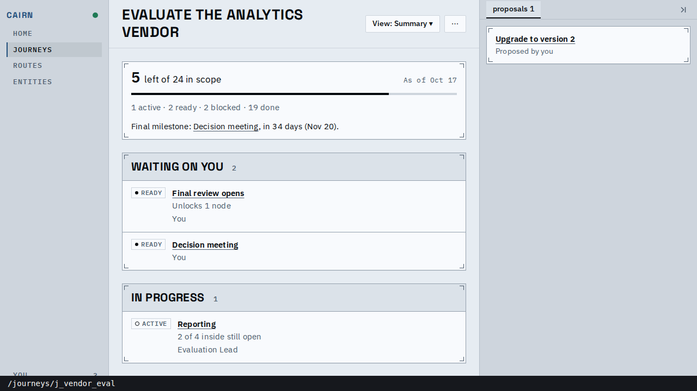
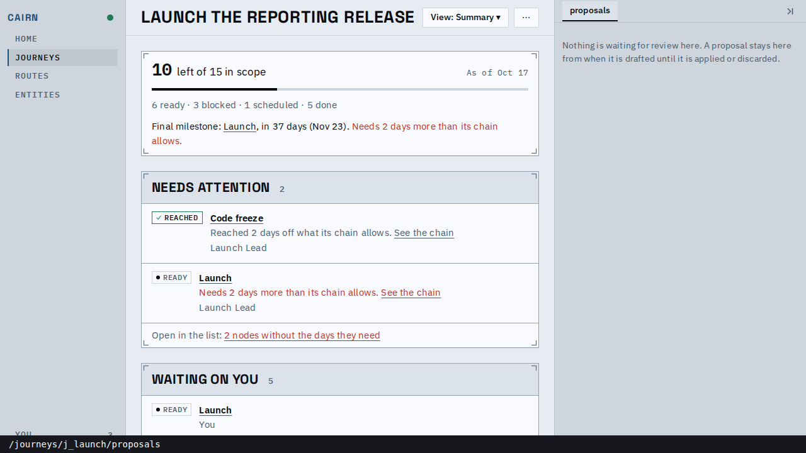
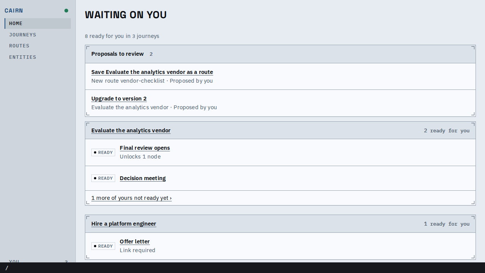
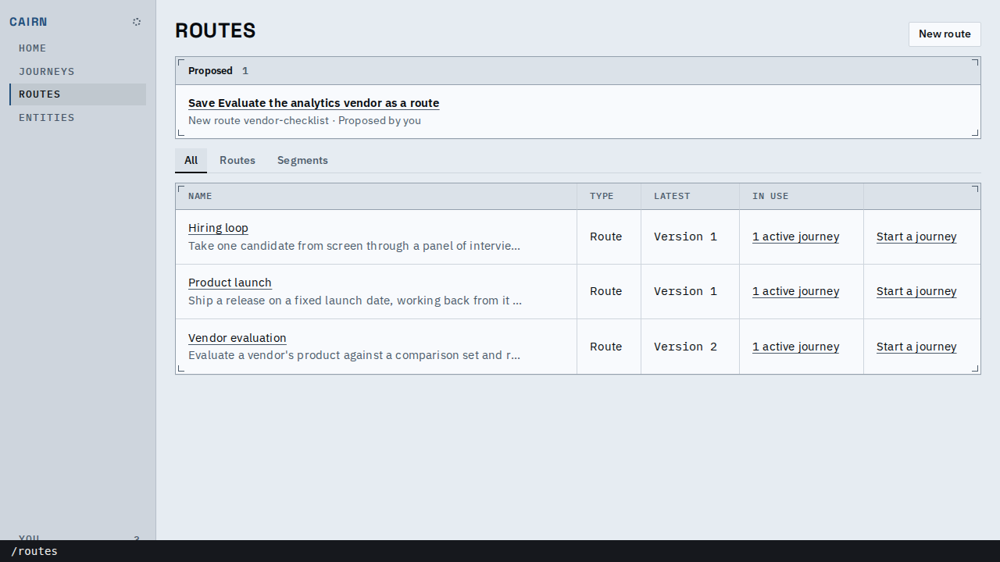
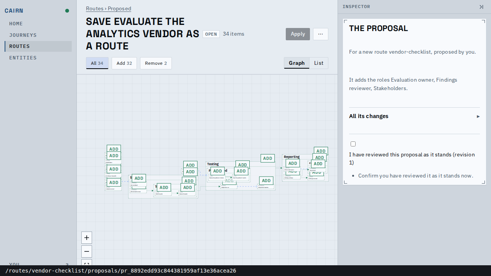
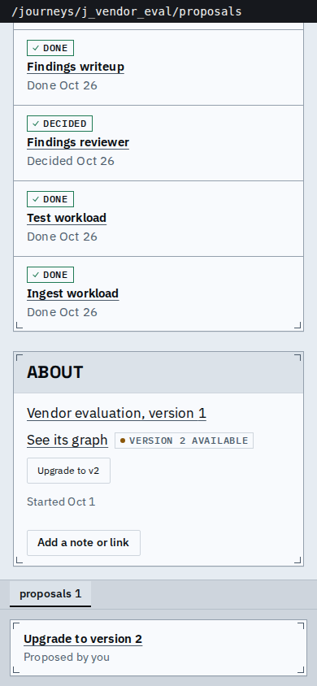
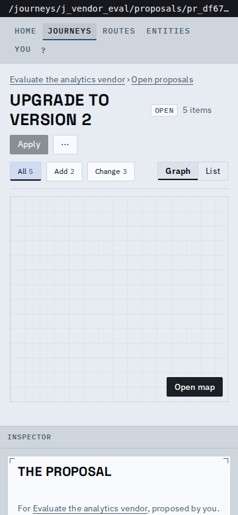

# Proof: open proposals are listed where they wait

You can now find an open proposal from the thing it is about, and from Home, without its
link: a journey's or route's inspector column has a Proposals tab, Home lists the proposals
waiting on you, the Journeys and Routes indexes list the ones that would create something, and
every proposal lives under its destination (`/journeys/<id>/proposals/<proposal>`). The strip
along the bottom of each picture and of the video (the top on the phone) is the tab's address,
drawn by the proof script.

*A journey with one open proposal: the tab shows its count, and the row is a link to the review.*

*A journey with no open proposals has no tab until one is drafted; its `/proposals` address (the `⋯` menu's "Open proposals") shows the tab and says so.*

*Home: "Proposals to review" above the journeys, each row naming its destination.*

*A save-as-route proposal has no route to be listed on yet, so the Routes index carries it.*

*Its review at `/routes/vendor-checklist/proposals/<id>`: the rail lights Routes, and the line
above the title leads back to the index that lists it.*

*On a phone the column is stacked under the page and opening `/proposals` scrolls to it.*

*The review keeps its way back (destination, then its open proposals) at 390px.*

<video src="main-flow.webm" controls muted width="720"></video>

*Draft an upgrade and a save-as-route, open the journey's Proposals tab, follow the row, take
the way back, then find the proposal again from Home.*

| Address | Before | After |
|---|---|---|
| a journey's proposal | `/proposals/<id>` | `/journeys/<id>/proposals/<id>` |
| a route's proposal | `/proposals/<id>` (rail on Journeys) | `/routes/<id>/proposals/<id>` (rail on Routes) |
| the deployment's | `/proposals/<id>` | `/entities/proposals/<id>` |
| the list of open ones | none | `/journeys/<id>/proposals`, `/routes/<id>/proposals` |
| the API | `/api/proposals/{id}...`, no list | `/api/{journeys,routes}/{id}/proposals[/{proposal}]`, `/api/deployment/proposals`, `/api/proposals?scope=` |

Known limits:

- The deployment's panel on Entities is covered by a server test, not pictured: the in-browser
  host has no way to draft an entity proposal without an agent.
- The lists read every page of open proposals; a destination with hundreds would want paging.
