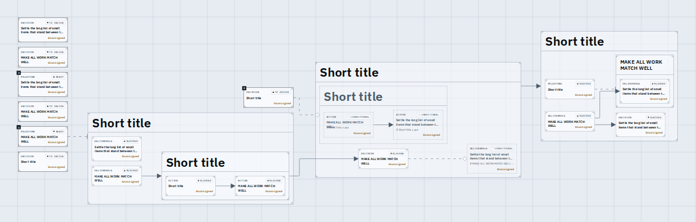
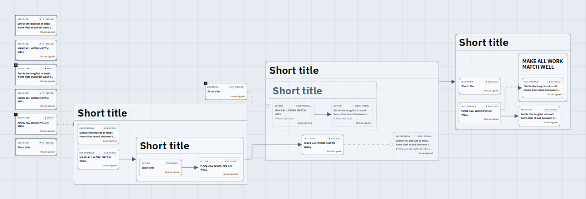
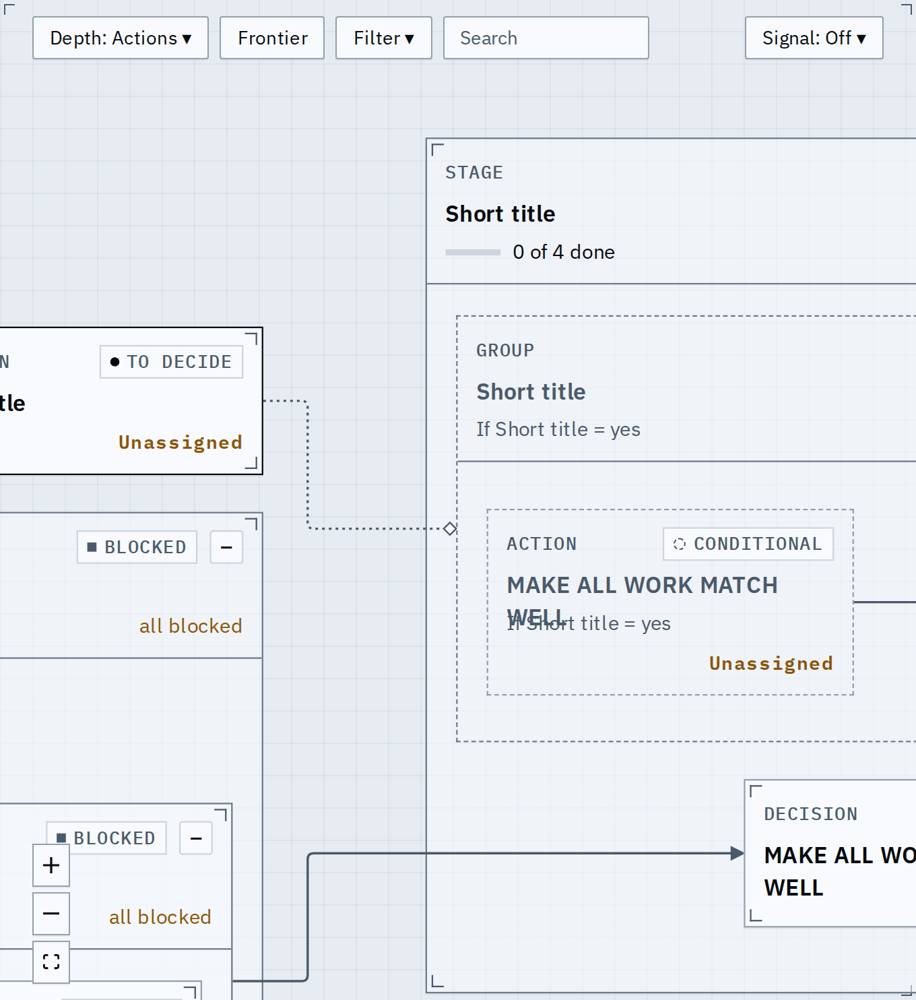
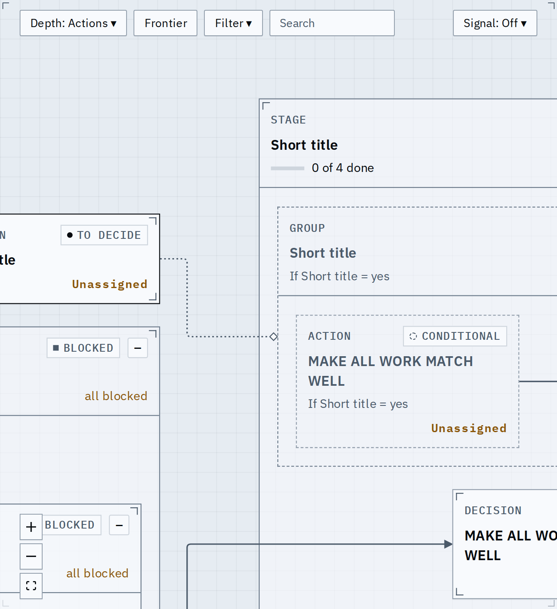
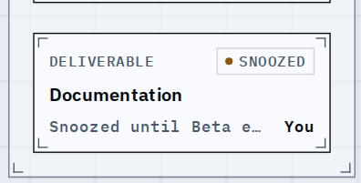
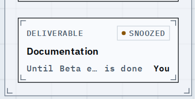

# A card's title never outgrows its card

A card's title is now cut to the lines the layout gave it, so the rows under it (body, date, owner) are never printed over and the border never cuts a line. The fixture is a route whose titles run from a few characters to a full sentence, including a short title in wide capitals.

## Fitted graph, a journey

Before: a title that wraps to a second line the layout did not count (the capitals one) sits on the date and owner row.

After: the same graph, every title inside its row, the longer ones ending in an ellipsis.

## At the reading zoom

Before and after at zoom 1, the same cards:

## A snoozed card's foot

The chip already says snoozed, so the foot says only where it ends: "Until Oct 31" or "Until <node> is done" (the full sentence stays in the tooltip). Before, it began "Snoozed until" and the date was what got cut.

## What changed

- Layout and drawing read one rule for the lines of a title (words wrapped in the card's room, capitals wider than lowercase, at most two). The card is sized by it and the title is clipped to exactly that many lines, on the text's own box, not on a button, which some browsers do not clamp.
- The row also clips its overflow, so a browser that ignores the line clamp still cannot draw past the row.
- The trace tag ("unblocks") hanging over a card's top-right corner is the design's hanging tag, as the rank tag is at the top left: it straddles the edge and covers the corner tick on purpose. It does not touch the state chip, so it is unchanged.

## Known limits

- The two-line cut is by an estimate of the font's widths; a title the estimate counts one line short is cut with an ellipsis rather than drawn over its neighbours.
