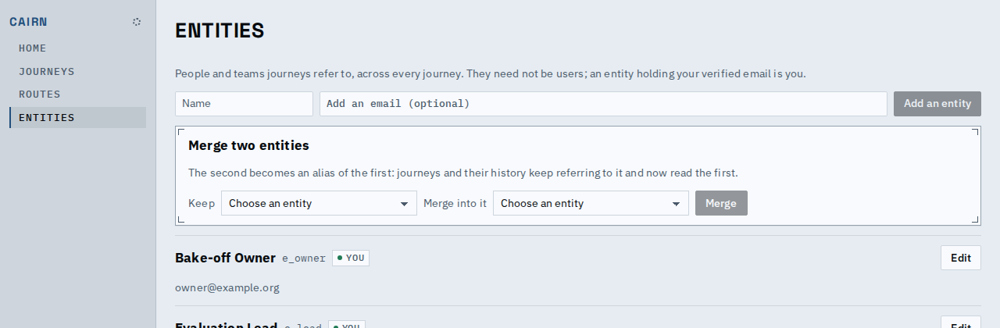
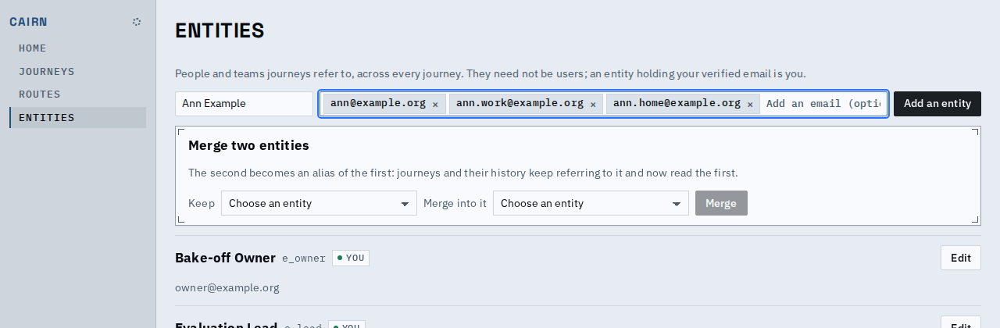
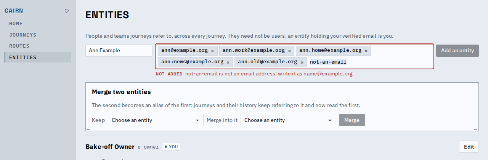
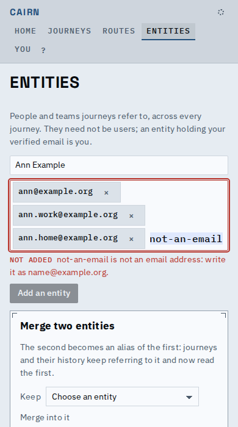
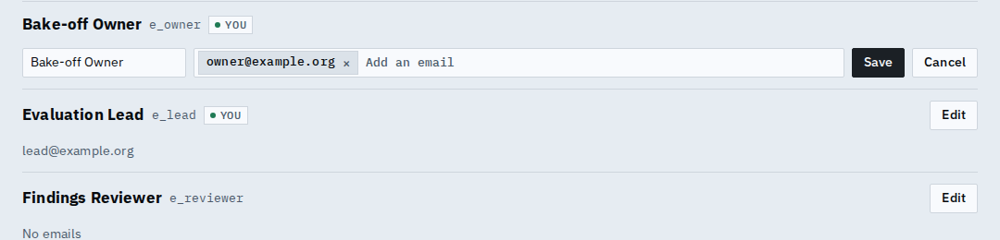

# Proof: an entity's emails are chips, not a comma-separated box

Adding or editing an entity now takes its emails as a list: each one is its own chip with a
remove button, the input takes the next on Enter, a comma, a space or when it loses focus, and a
pasted list splits into chips. A value that is not an email, or is already there, stays in the
input under its reason and holds the save back until it is dealt with.

Empty, as the entities page opens:

Three emails taken (one typed and confirmed with Enter, one with a comma, one pasted):

A pasted duplicate and a typed "not-an-email" are refused, in the input, with the reason; the box
turns to the error colour and Add an entity waits:

On a phone (390px): chips wrap one under another, the remove buttons are full-size touch targets,
and the input is 16px so the browser does not zoom.

Typing, a comma, a paste and a refusal, as a short video: [typing-and-pasting.webm](typing-and-pasting.webm).

Edit uses the same field, opened with the entity's emails as chips:

Backspace in the empty input removes the last chip, and the whole field works from the keyboard.
A refused value is selected, so the next key or paste replaces it, and Tab still leaves the field.

Known limits:

- The entity row still lists its emails as plain text; a read-only chip row is the planned
  people redesign's call.
