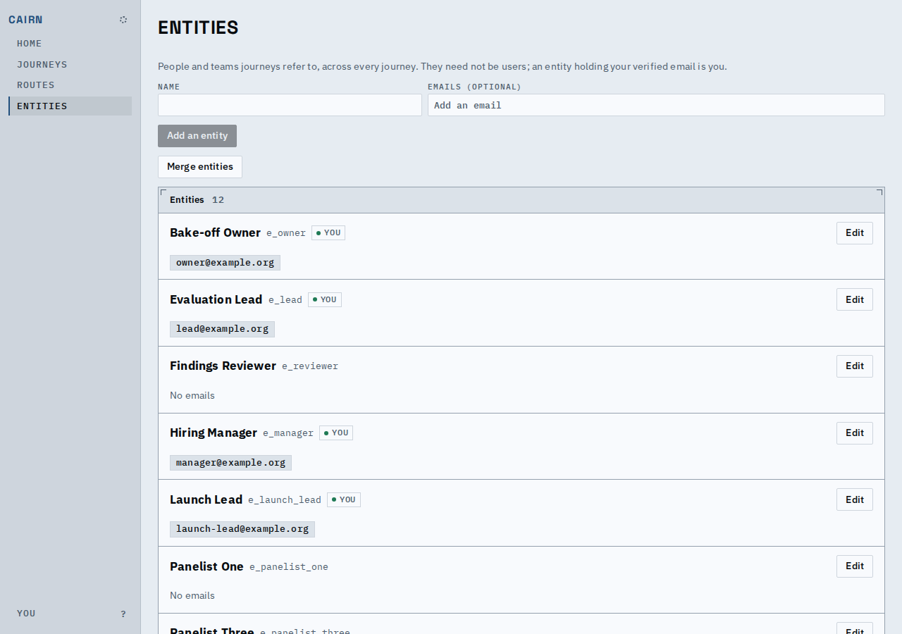
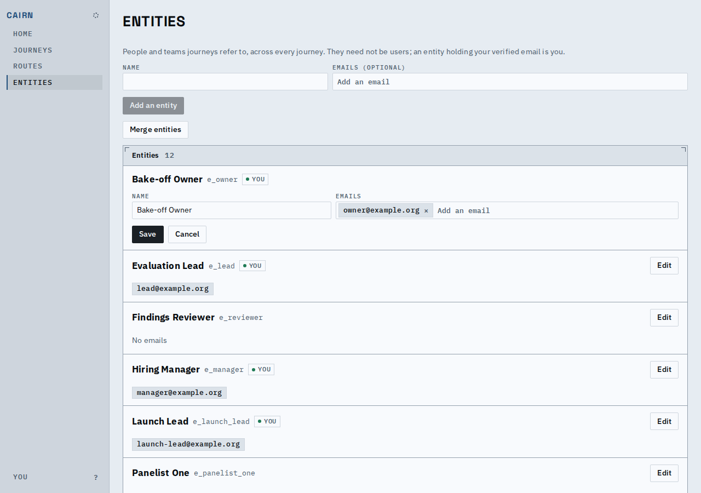
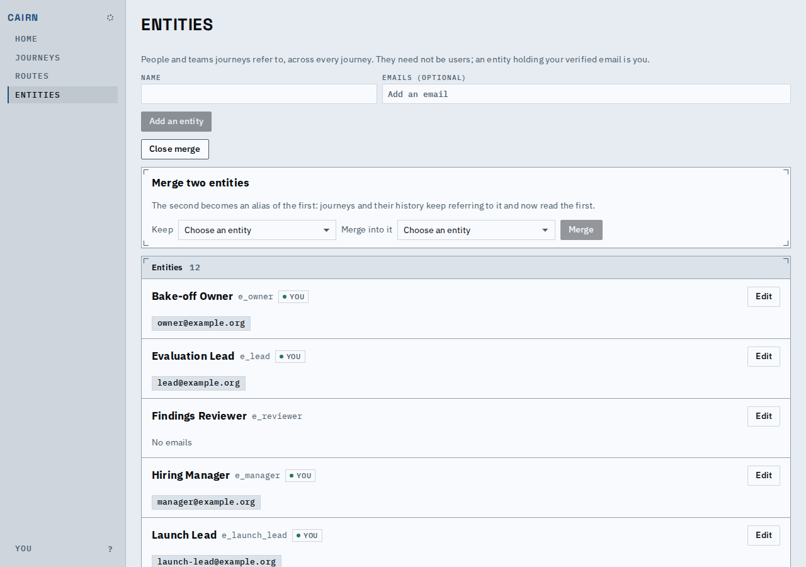
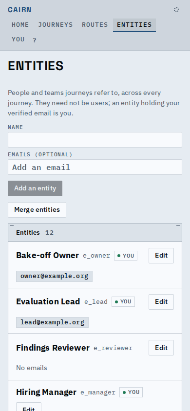
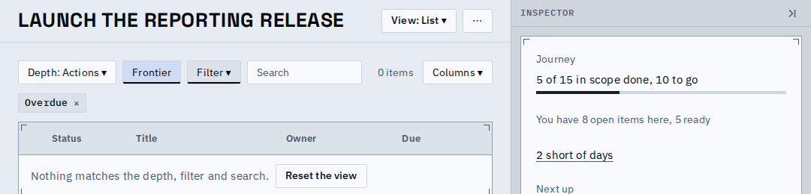

# Proof: the entities page, labelled, on paper, with the merge folded

The entities page reads as the rest of the app does: its form fields have real labels, the
entities sit in a ticked Panel, their emails are the same chips the editor uses, and the merge
tool is one button until asked for.

The page, as it opens (Name and Emails labelled above their fields, actions on their own line,
Merge entities folded, the entities in a Panel headed with their count, emails as chips):

Edit, with the same chips as removable ones, and labels:

Merge entities opened (it also opens by itself from the sign-in page's "Merge them" link):

On a phone (390px):

An active filter is the same chip, its x taking the setting off:

Known limits:

- The bulk-merge redesign and the people and sign-in redesign are still to come; this only
  folds, labels and re-surfaces what is there.
