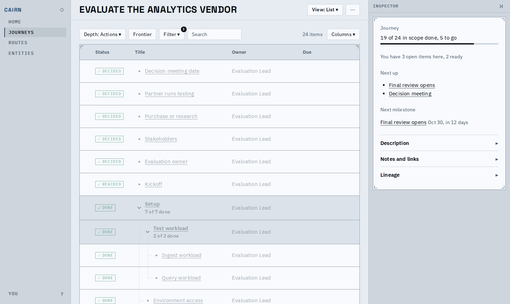
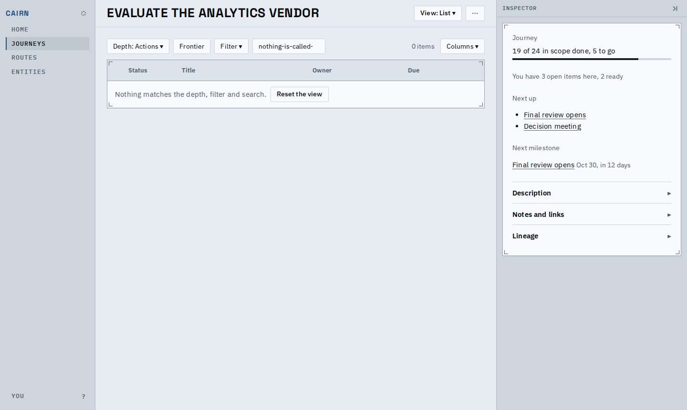
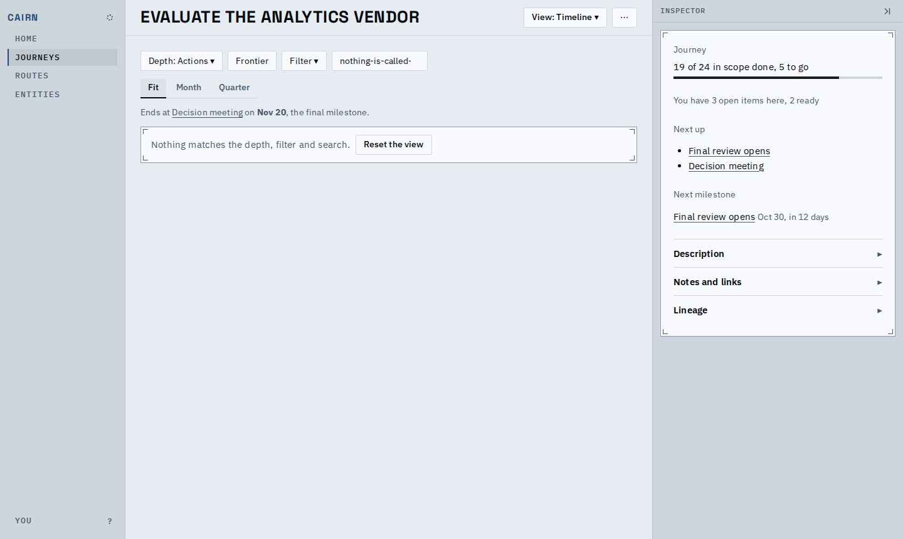
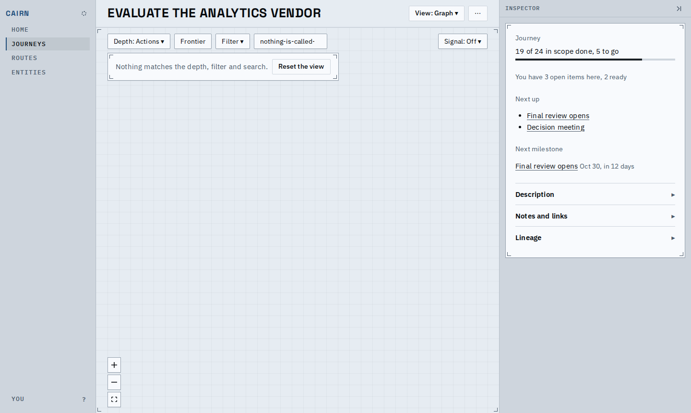
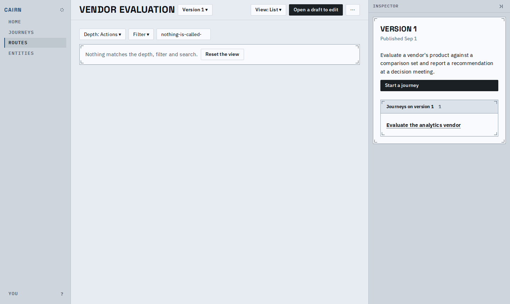
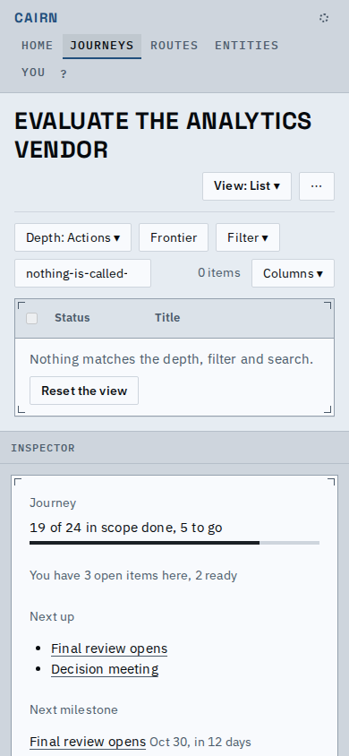
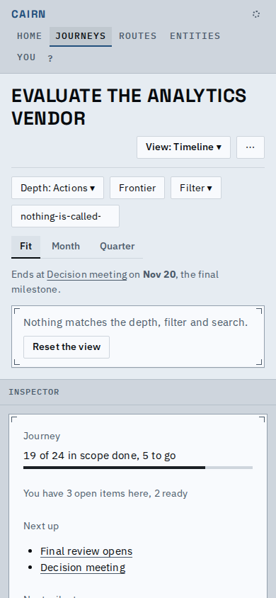

# The list is a Panel, and an empty view keeps its surface

Someone can now read the Plan list and the route List as one ticked paper panel, and an empty view (nothing matches the depth, filter and search) as the same paper surface with its Reset the view button, not text on the ground.

The Plan list: one Panel with corner ticks over the sticky header band and the rows.

Empty: the header stays and the sentence sits on a paper row inside the same panel, ticks still at the corners.

Empty timeline: a paper Panel of its own where the rows would be.

Empty graph: the same Panel, over the ruled canvas.

The route page's List and its timeline and graph use the same pieces.

At 390px the header band spans the panel and the button wraps under the sentence.

Phone timeline.

The route timeline's empty line now says the same words as every other view.

Known limits:
- The phone graph is the map preview with an Open map button; it has no empty line of its own, the full graph it opens does.
