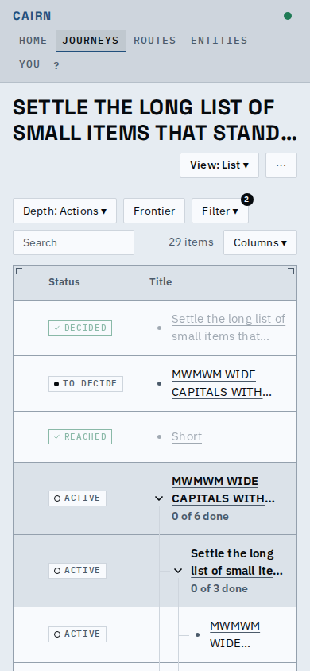
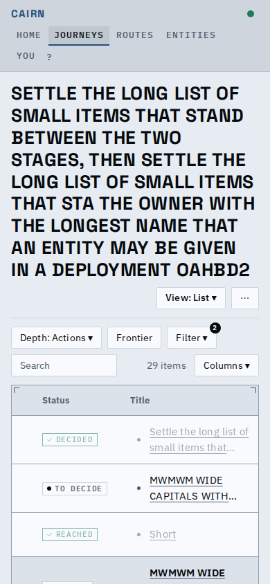

# The clamped journey name opens on a tap

A journey name too long for two lines ends in an ellipsis, and a tap or click on it opens the
whole name in place (it is a button with the full name as its accessible name and an expanded
state), since a tooltip cannot be reached on a phone.

| Clamped | Opened |
|---|---|
|  |  |

The cut-text check no longer skips an element that holds an overhang: it measures that element's
own text against its box.

## Known limits

- The name opens but does not close on its own when the page changes; the next screen's heading
  starts clamped again.
