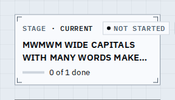
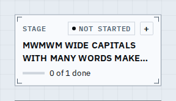
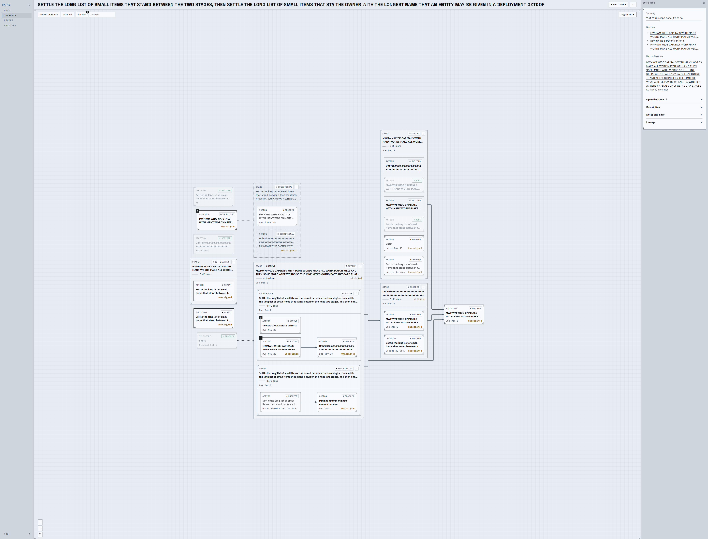
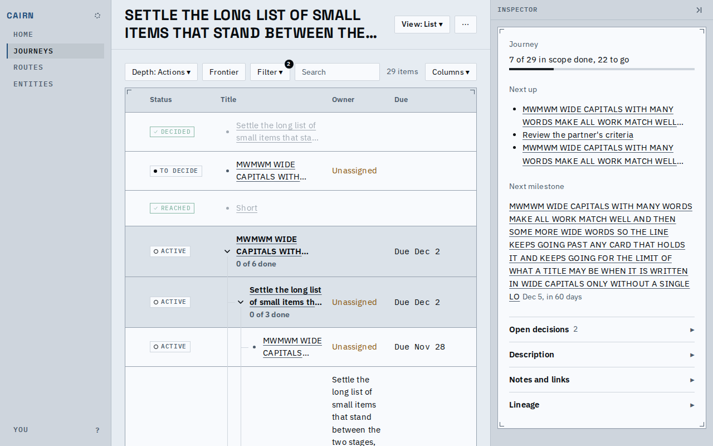
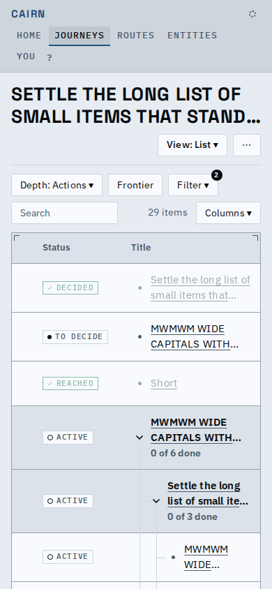
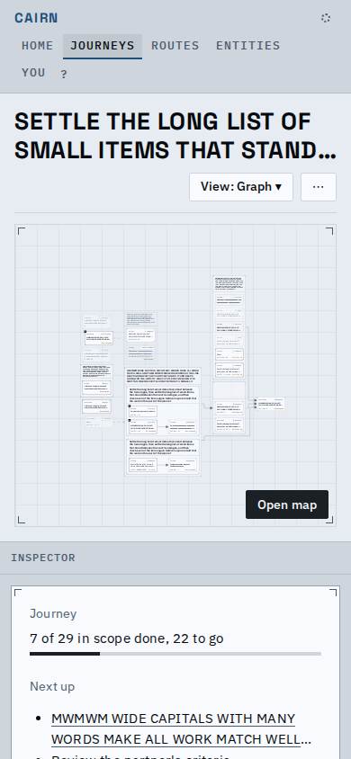

# Nothing spills out of its box

Every browser test now fails when an element sticks out of the box it belongs to or text is cut
without a sign, and a stress journey of worst-case content is walked through every screen.

## The stage head

A folded stage that is current and not started: the chip pushed the fold button out past the
border. Now the head gives way in order: CURRENT is dropped, the kind takes an ellipsis, and the
chip and button never move.

| Before | After |
|---|---|
|  |  |

## The stress journey

Titles, a journey name, an owner name, choice labels and the snooze target at the limit; wide
capitals, an unbroken word, every display state, nested containers, current stages.

Graph at the reading zoom, in a window that holds it: every card inside its border.

The List: an unbroken word breaks in its cell instead of widening the table past its panel.

| Phone, List | Phone, graph |
|---|---|
|  |  |

Found and fixed by the check on the way: the list table widening, an unbroken title cut with no
ellipsis on cards, the sync popover's long line, the entity merge selects, timeline words, the
filter badge (now a documented overhang), the journey name (three lines, then an ellipsis).
Card title lines are now counted from measured text width, not an estimate.

## Known limits

- A title in a script the loaded face lacks is measured in the fallback face until it loads.
- An open container's title lines are counted for a card's width; in a wider container it may
  take fewer.
