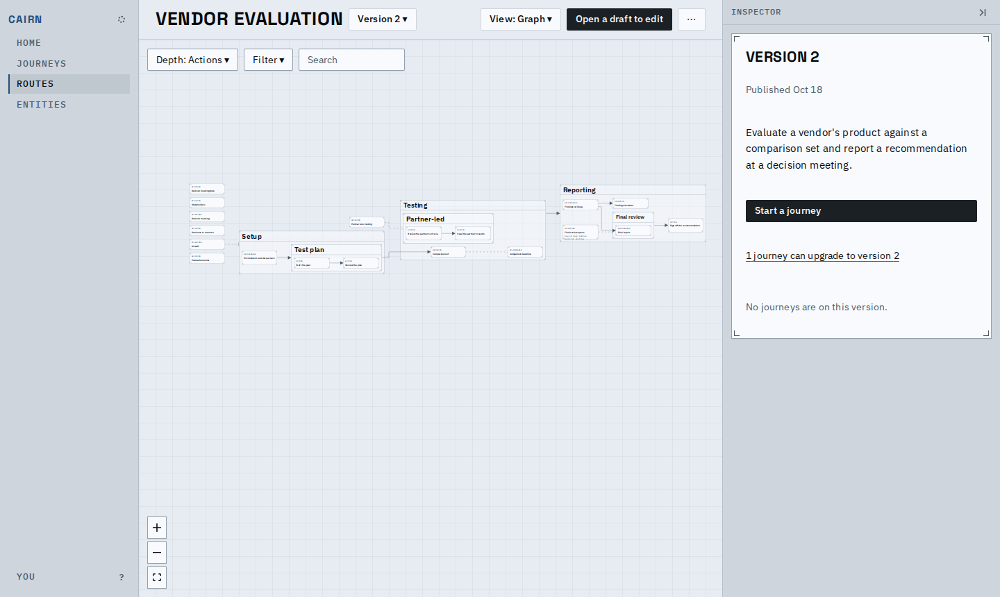
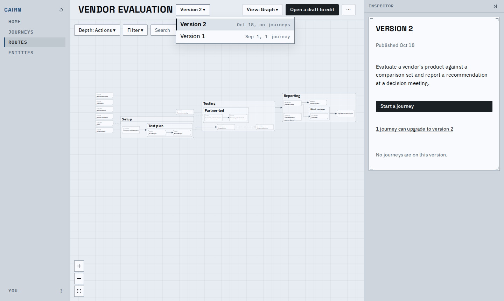
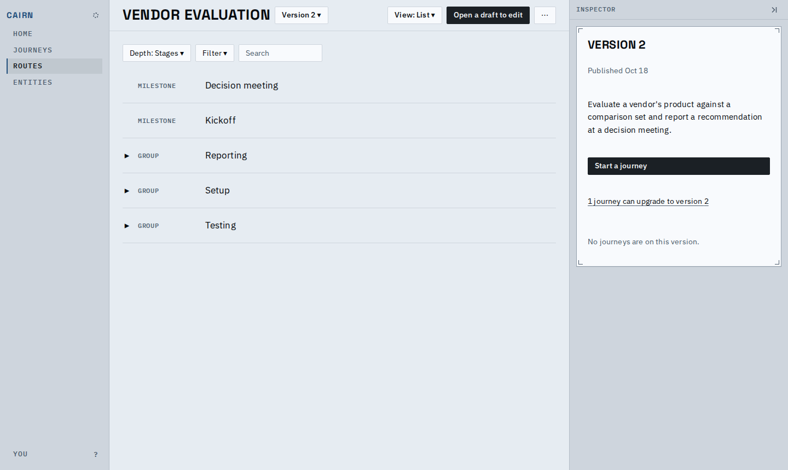
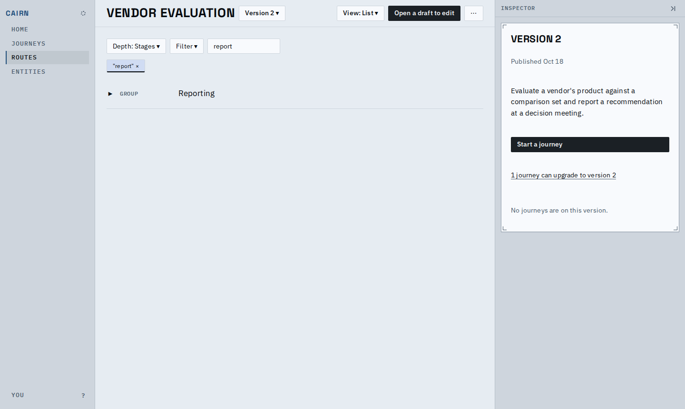
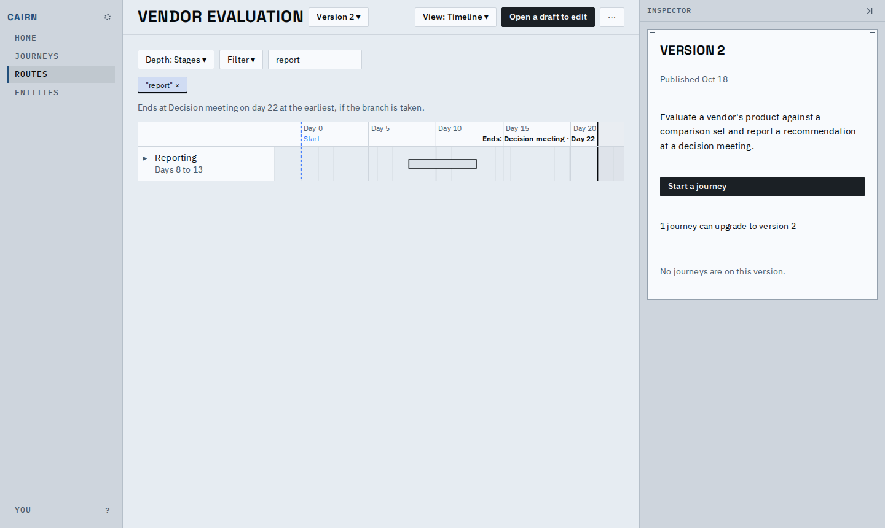
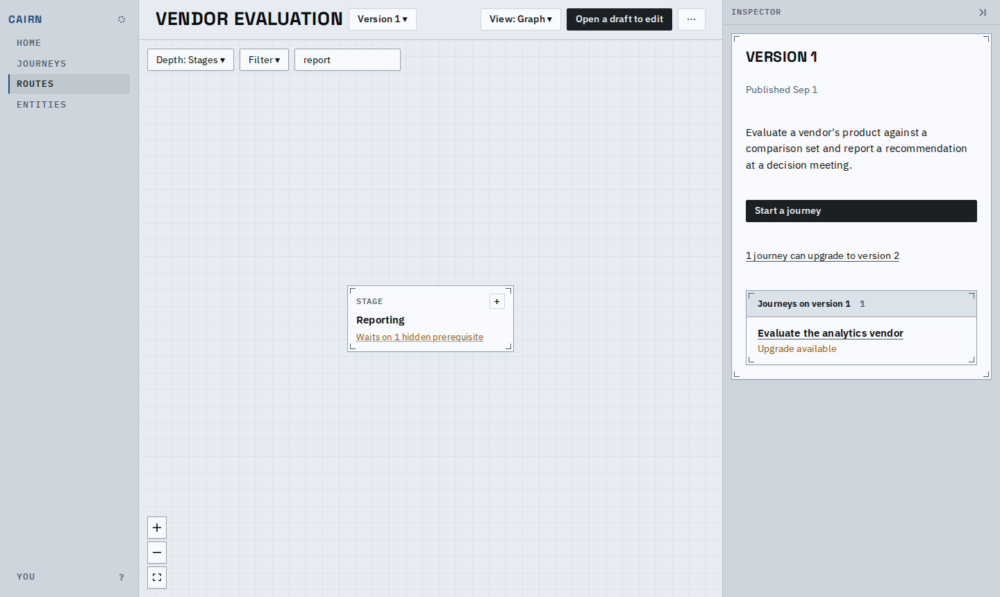
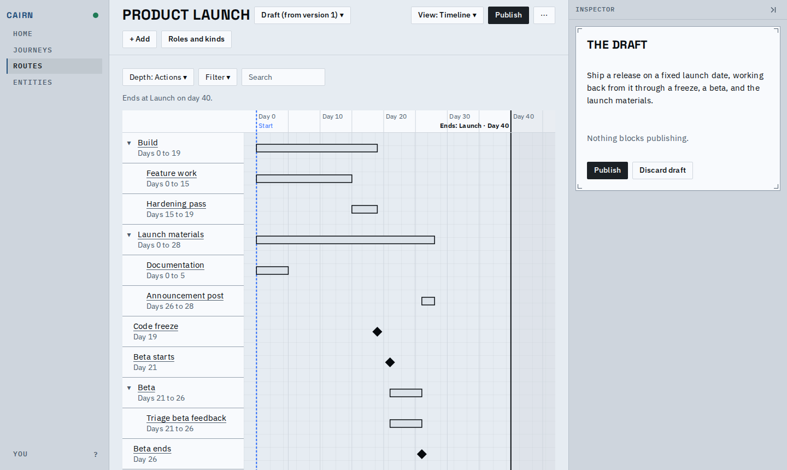
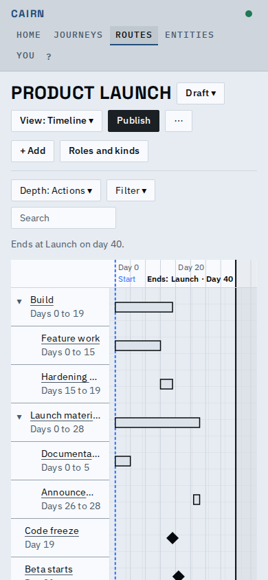
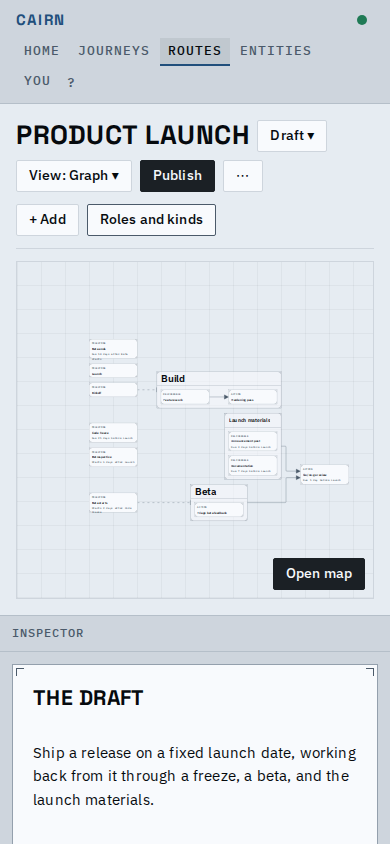

# Proof: a route has a journey's views

A route is now read the way a journey is: one page, the same View picker (Graph, List,
Timeline), the same Depth, Filter and search, and a version selector in its header. The
Timeline is new for routes: the earliest schedule of the route, in days from its start.

The route's page at its bare address: Version 2 is the latest, so it is shown read-only,
with its card (the journeys that can upgrade to it, Start a journey) in the inspector.

The selector names the graph shown. Each item is a link: a version says when it was
published and how many journeys are on it; the draft, when one is open, is the first item.

Depth and the search are the journey's. They ride in the address (`depth=`, `q=`) and
every switch between views keeps them.

The Timeline on days from the start: a Start line at day 0 and the final milestone as the
end anchor, which says when it is only reachable through an undecided branch.

Picking Version 1 keeps the view and the view state, drops Publish for "Open a draft to
edit", and shows the journeys on that version with their upgrade state.

A draft of the product launch: the feature work starts at day 0, the beta follows the
code freeze, and Launch ends the line on day 40. A row's title opens that node's form.

Video of the main flow: [main-flow.webm](main-flow.webm).

## What changed for someone using it

| Before | After |
|---|---|
| A route's versions, its graph and its draft were three screens | One page, `/routes/<id>`: the draft if one is open, else the latest version; `?version=<n>` names one |
| The route's graph had its own ladder and a drill-in, and no search | The journey's Depth, Filter and search, shared by every view |
| No timeline for a route | Timeline from day 0 (Day 0, Day 5, ...), no calendar dates |

Known limits:

- Two versions cannot be compared side by side; the selector only switches between them.
- A route's timeline is the earliest case: estimates are not ranges.
