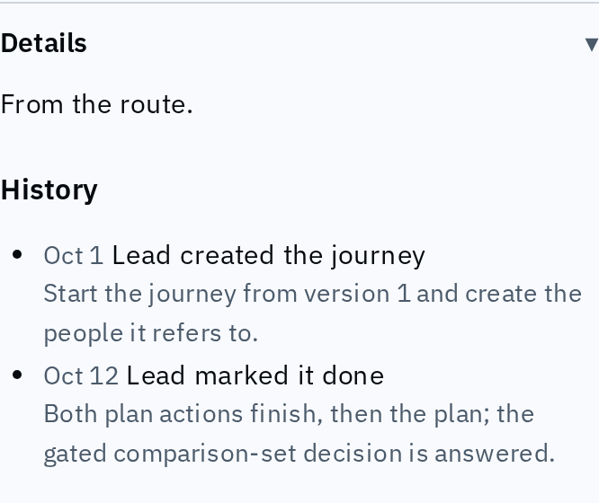
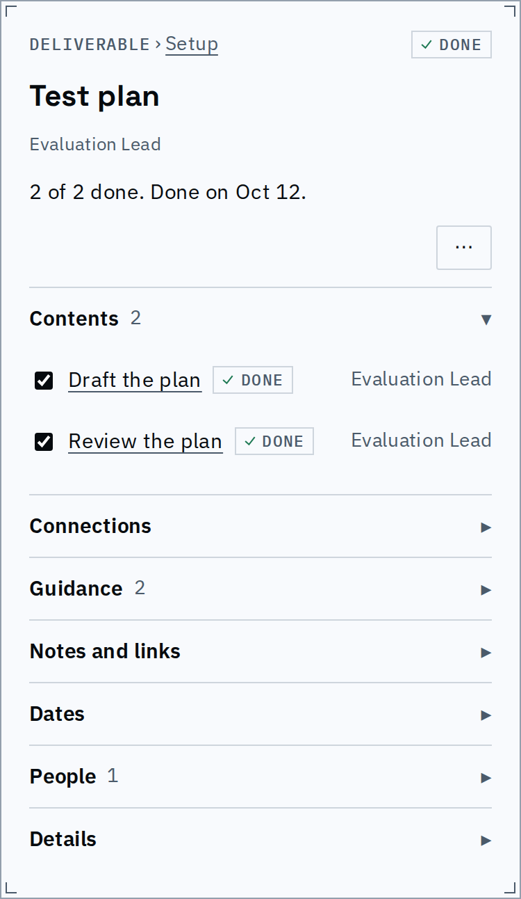
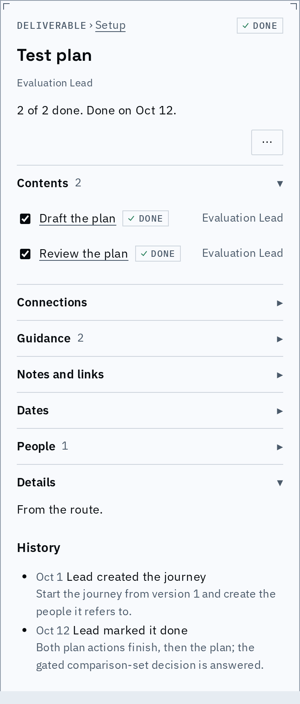
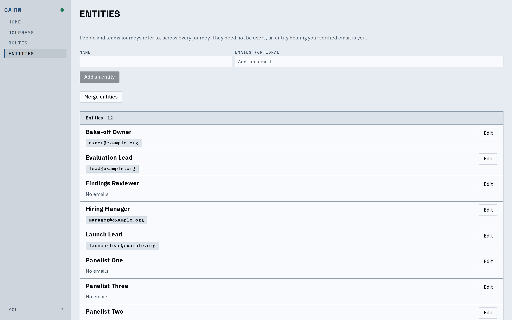

# Proof: say who and what, name every person, fold the details

A detail panel tells you in plain sentences who did what and when, no screen shows a raw
id where a name belongs, and the facts nobody acts on sit in one folded "Details" section
at the bottom.

## History reads as sentences

| | Before | After |
|---|---|---|
| A journey's history | `Oct 18 by u_e31b... node transitioned` | `Lead marked it done`, dated, with the note beside it |
| Who | the user id | the entity's name, else the name their sign-in gave |
| Which events | a type label per kind | one sentence per event kind ("started this", "stopped work on it", "snoozed it until Oct 31", "renamed it from ...") |

History in the server host: each line names the person and what happened.

## Details come last, folded

Origin, History and the other non-actionable facts are one section, closed by default and
always the last one.

Details closed at the foot of a done step, after People.

Details open: Origin, then History.

## Another spot the sweep fixed: the entities page

| | Before | After |
|---|---|---|
| An entity row | `Technical Writer e_writer` | `Technical Writer` and its emails |
| Merge options | name and key | name only |

Entities with names and email chips, and no keys or aliases showing.

The same sweep removed ids from journey tooltips, edge labels, the sync popover
("Revision 3"), the signed-in page, proposal review and conflict text. A global e2e check
fails any test whose page shows an internal id.

## Known limits

- A server error message shown in "could not be read" may still carry an id.
- The history's first and last lines carry the created and changed dates; there is no
  separate dates row in Details.
