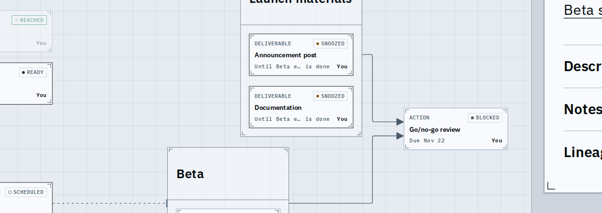
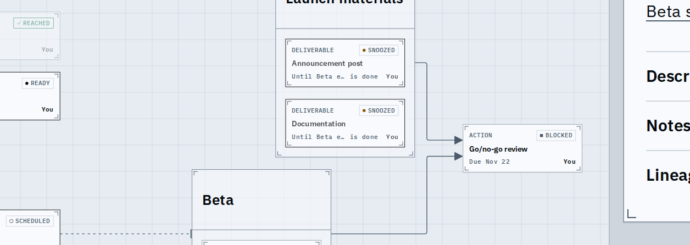
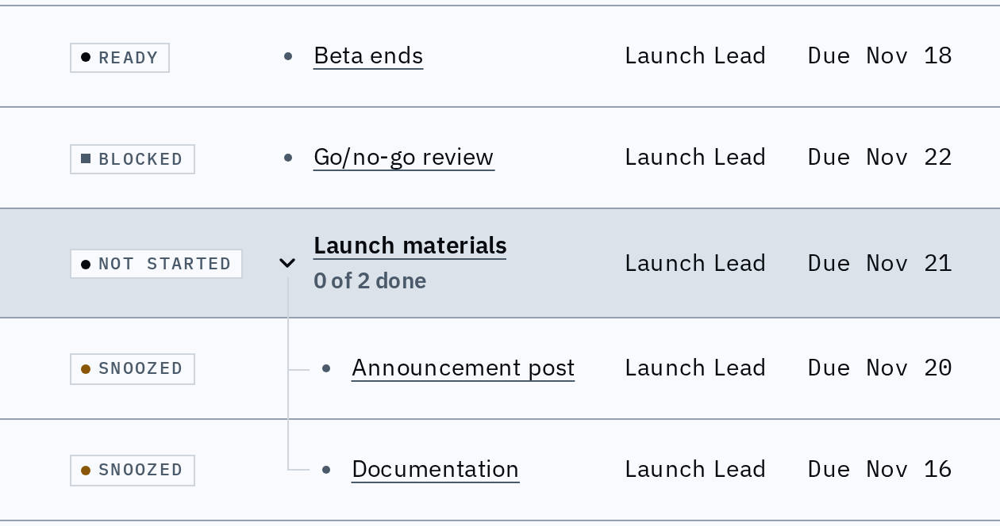

# Snoozed work is dimmed, the same on every view, and sorts by when it returns

A snoozed node is off the acting frontier but still blocks, so it stays visible; it is now drawn as "not now": its title and owner at 0.7 (done is 0.5), with the SNOOZED chip and the date left clear. The same one token dims a graph card, a list row and a timeline label.

## Graph

Before, snoozed cards look like work that can be done now. After, the title and owner are lighter; the chip and the "Until ..." foot are not.

## List

Before and after: the snoozed rows' title and owner are lighter; the status and due cells are not. Blocked, ready and scheduled rows are unchanged.

## Order

Display order only; the shared rank is unchanged.

| Where | Before | After |
| --- | --- | --- |
| Plan tree and timeline, a node snoozed until Oct 30 whose own date is Oct 6 | first of its siblings | after the sibling dated Oct 20 |
| The same, snoozed until a node with no finish date | by its own date | after every dated sibling |
| A list sorted by rank, slack, gravity, unlocks or due | among the others | after the unsnoozed, in its own order |

## Known limits

- The timeline is covered by a browser test, not a screenshot: it dims the label's title, never its date words, as the list does.
