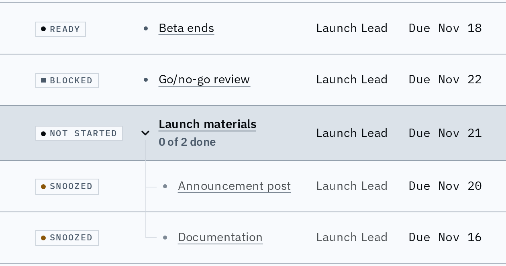
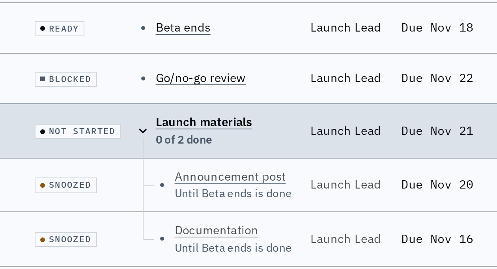

# A snoozed row says when it comes back

A snoozed node sorts by when its snooze lifts, so its row now says so: under its title it reads "Until Oct 31" or "Until <node> is done", the same words (from the same function) as a card's foot. The Due column stays the node's own due date. A timeline row leads its date words with the same phrase.

Before: the snoozed rows show a chip and a due date, and nothing says why they sit where they do.

After: the return sits under the title, at full strength while the title is dimmed; the other rows are unchanged.

Timeline rows lead their date words with the same phrase (one line, ellipsis, full text on hover).
