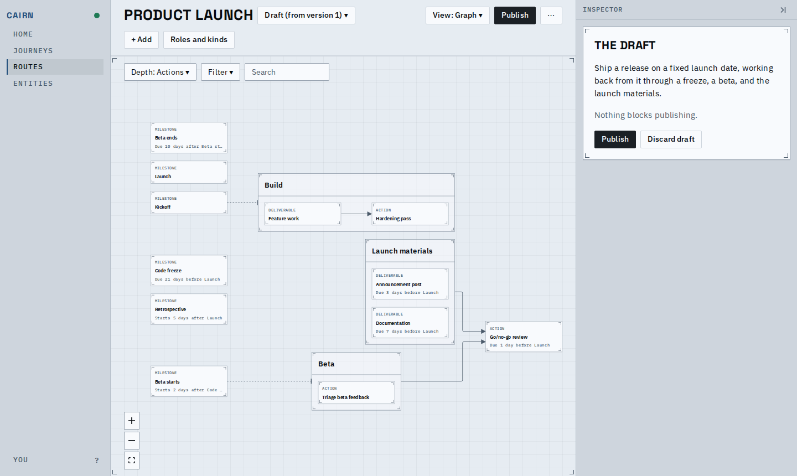
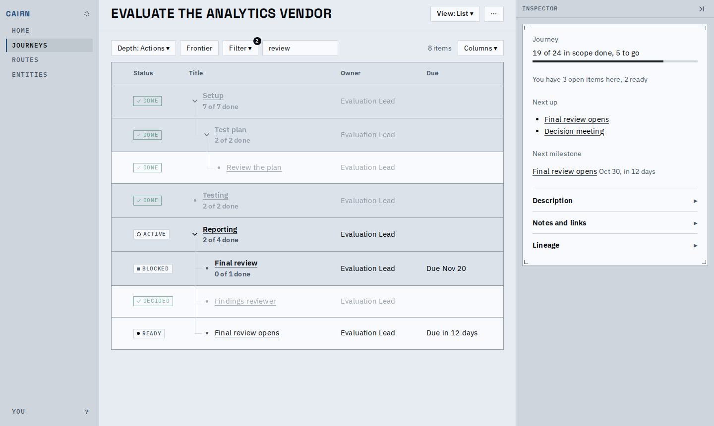
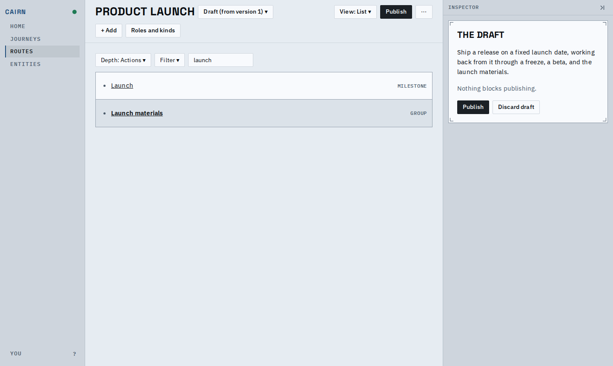
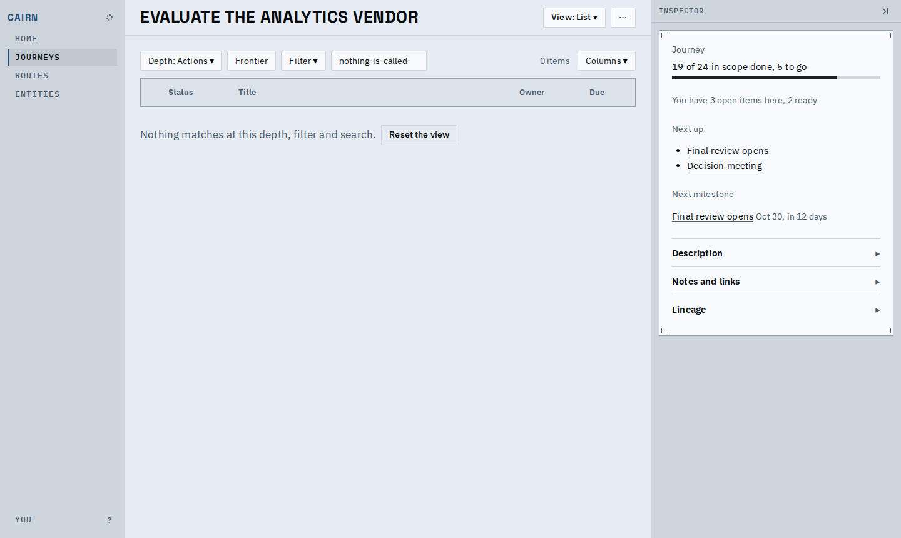
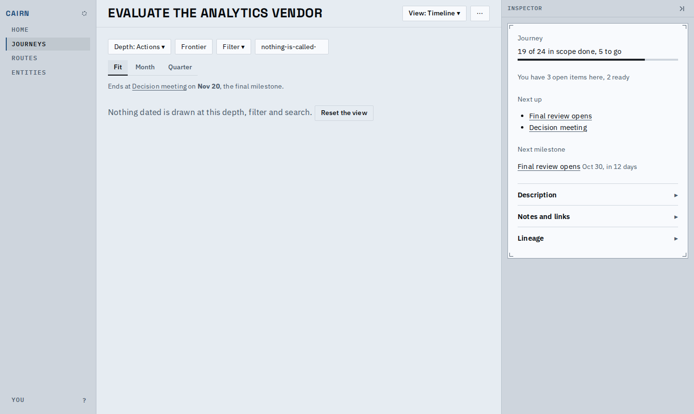
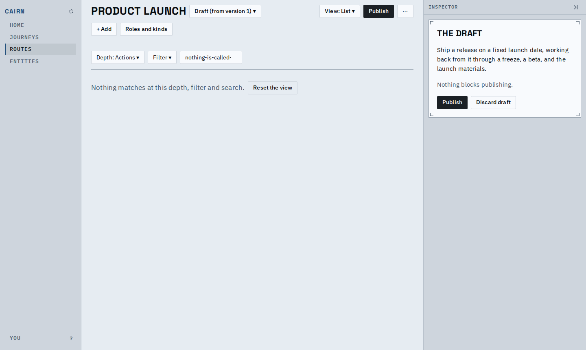
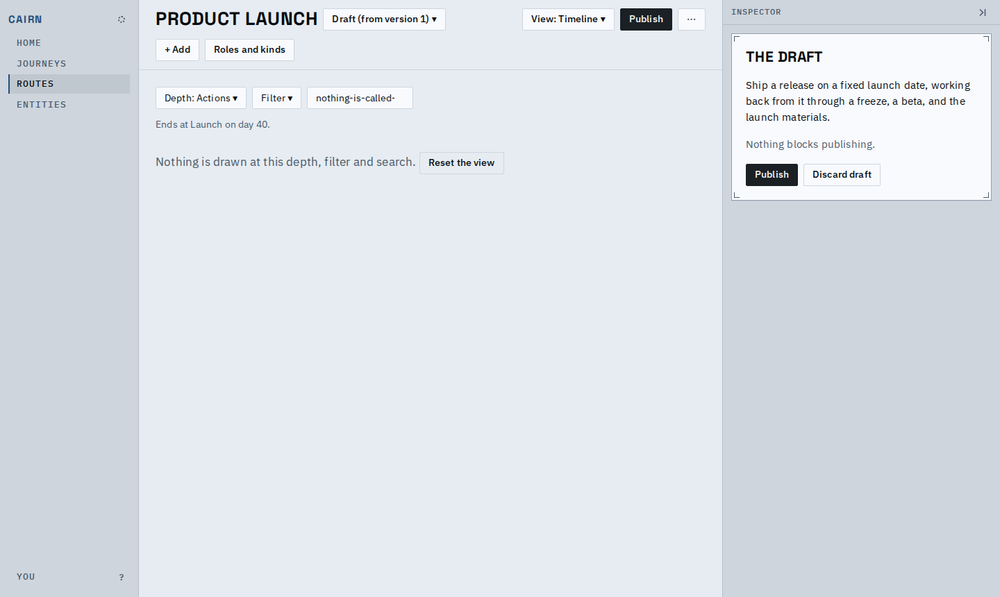
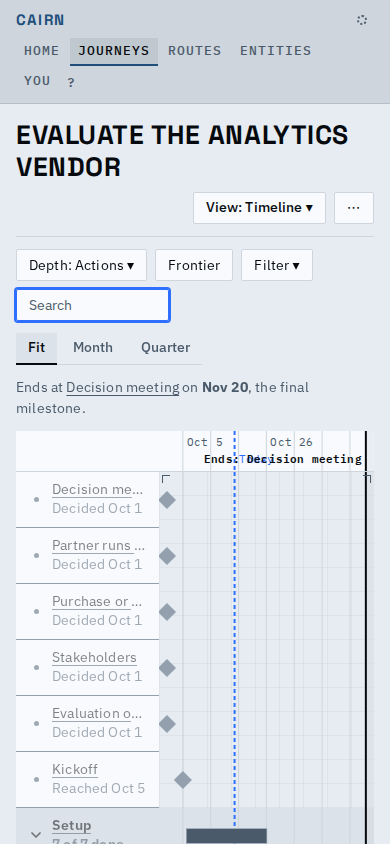
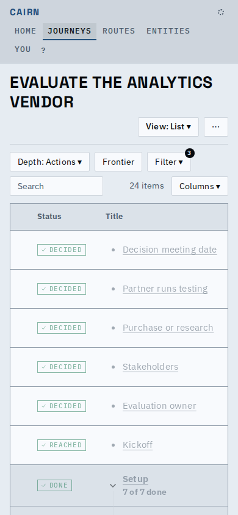
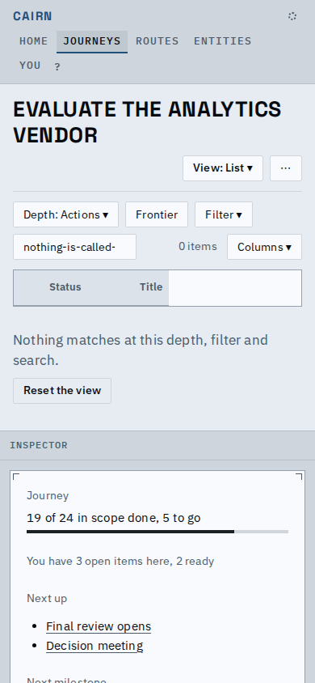

# Proof: containers stay containers, cards keep their text, empty and phone states

Addendum to the views proof.

**A card's date ends in an ellipsis instead of wrapping out of the card.** At fit, "Due 10
days after Beta starts" used to spill below the card's border.

| Before | After |
|---|---|
|  |  |

**A container is a container however a search narrows the list.** "Testing" has none of its
work matching "review", and stays a banded row with its progress and a 600-weight title,
without a fold button; the Plan list and the route's list now ask one function.

**Nothing matches.** Each view says so and offers Reset the view.

| | List | Timeline |
|---|---|---|
| Journey |  |  |
| Route |  |  |

**Phone (390px).**

| Timeline | List | List, nothing matches |
|---|---|---|
|  |  |  |

Known limits:

- On a phone the timeline's end label runs into "Today" and names truncate: the phone layout
  work owns it.
