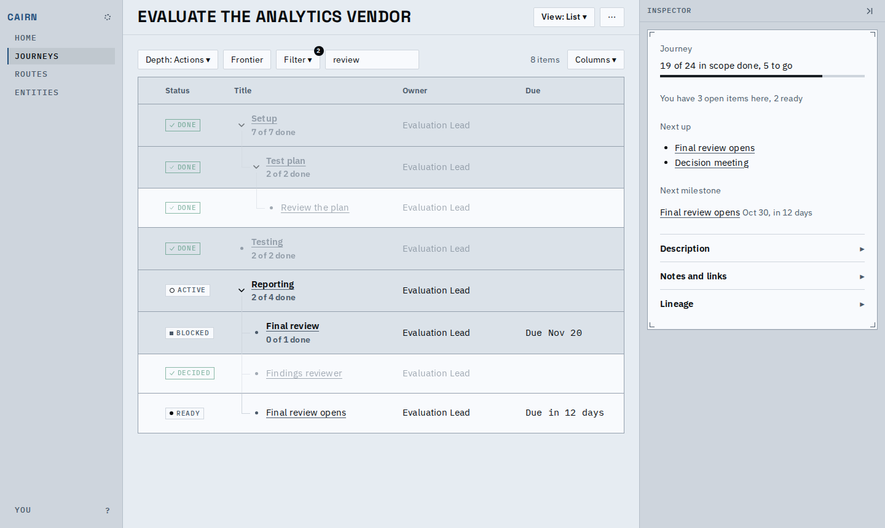
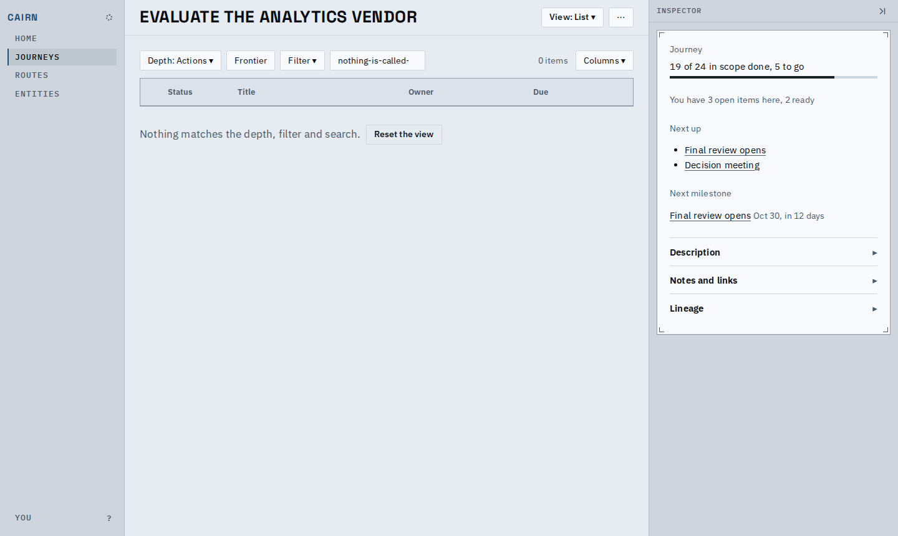
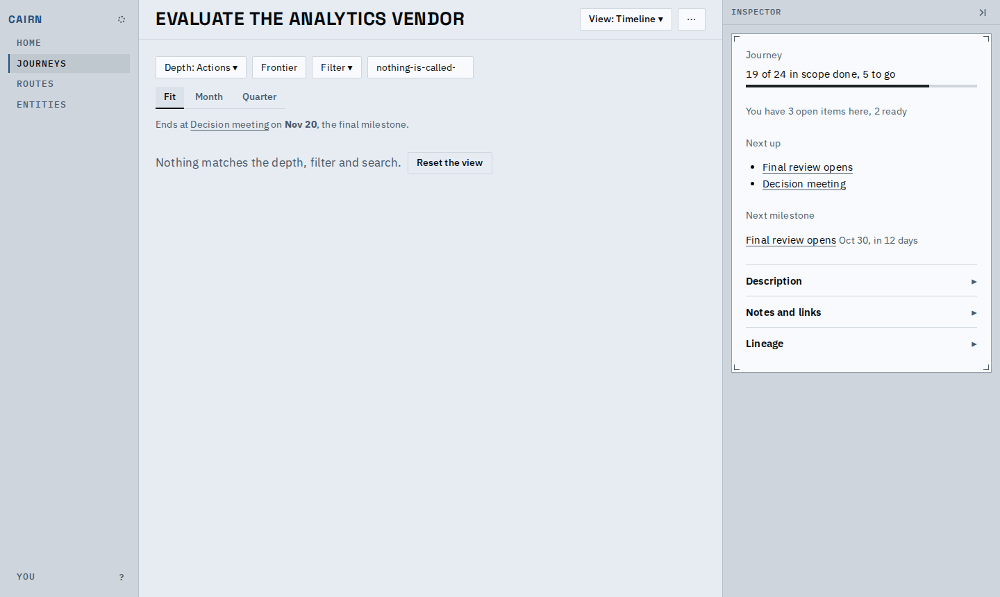

# Proof: the Plan list keeps its columns, and every view says "nothing matches" one way

The list's Owner and Due columns hold their width, so the header does not jump when a search
leaves no rows. Due is mono with tabular figures. The List and Timeline (and the graphs) share
one empty-state wording and its Reset the view button.

| | Before | After |
|---|---|---|
| Searched list |  |  |
| Nothing matches |  |  |

The Timeline with nothing matching, in the same words:

Known limits:

- The walk through keeps its own empty wording: it speaks of the frontier.
