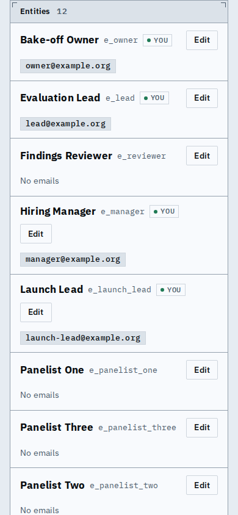
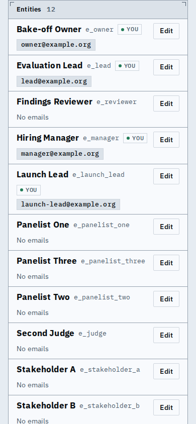

# Proof: entity rows keep Edit in its own column, at DESIGN's row size

On a phone, Edit used to drop under a long name (Hiring Manager, Launch Lead) and rows were
about 95px. The name block now wraps in its own column and Edit keeps the other, so it sits at
the right on every row; rows use the Table's 8px 12px padding with the two lines close, and the
page's groups (form, merge, list) are a larger step apart.

| Before | After |
|---|---|
|  |  |
