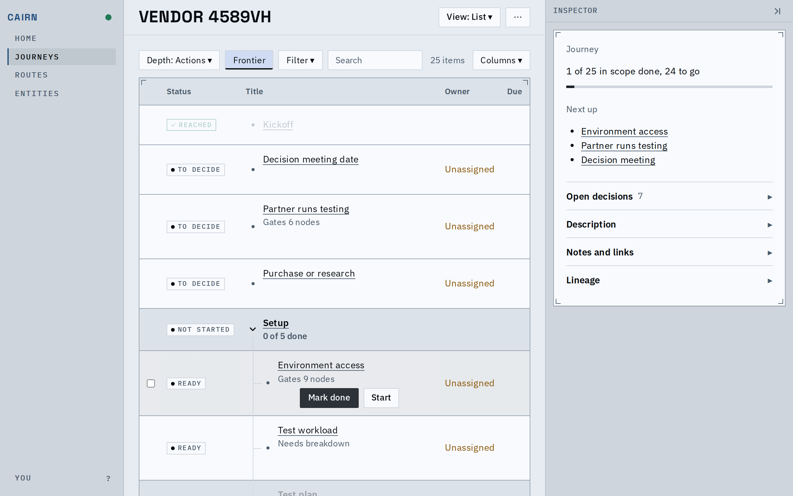
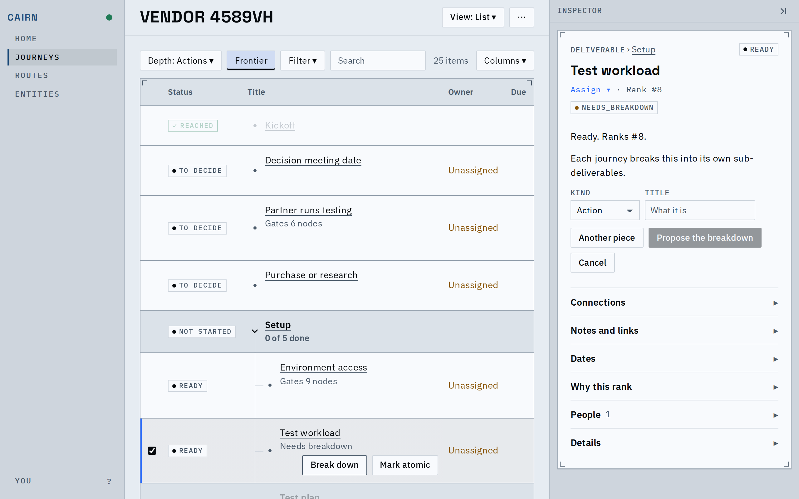
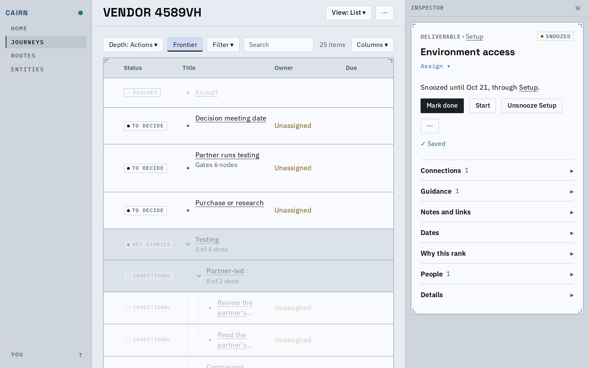

# Proof: every surface offers a node the same actions

Rows, the inspector, the folds, the stalled panel and the graph's menu now ask one place which
actions a node has and what they are called. A few things people can now do or see:

- A placeholder that needs breaking down says so on its row: Break down, with Mark atomic beside it.
- The inspector of a node held by its container's snooze offers Unsnooze, naming the container.
- A scheduled milestone's reach is Confirm reached now on the row, in the inspector, the graph's
  menu and the stalled panel; Mark done and Mark done... read the same everywhere too.

## A row that needs breaking down

Break down on the row opens the same break-down form in the inspector as the inspector's own button, its fields labelled. A list row says who owns it once, in the Owner column; the inspector assigns.

## Held by a container's snooze

The sentence above no longer carries its own Unsnooze link; the button row is the only place.

## Known limits

- Rows do not offer Snooze or Skip; those stay in the inspector.
- Notes are still written through three forms (a stale node's note, done's evidence, and notes and links).
