# One voice for dates and node facts

A date, a due time, where a date comes from, where a snooze ends, a node's flags and a journey's trouble counts are now each said one way on every screen, from one set of helpers. Before, the same decision read "Due in 5 days" on its canvas card, "Decide in 5 days" in the inspector and "Decide by Oct 24" in the list; now it is "Decide by Oct 24" everywhere. Milestone dates read right for any title, "Arrive in Ambleside" as much as "Kickoff", because the date follows the title and no sentence is built around it.

The same plan on the graph. Before: a decision is "Due in 5 days", work due in 10 days is "Due Oct 29" (a window only the card used), and a card cut its date short ("Start by Oct ...") while keeping the owner whole. After: the card says what the list says, and the date stays whole while the owner takes the cut.

| Before | After |
|---|---|
| 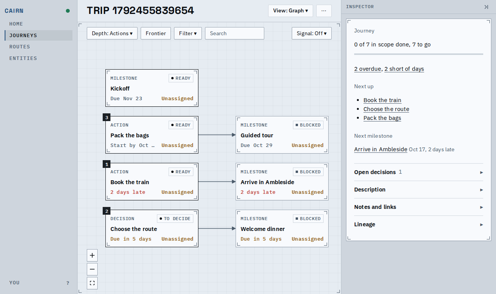 | 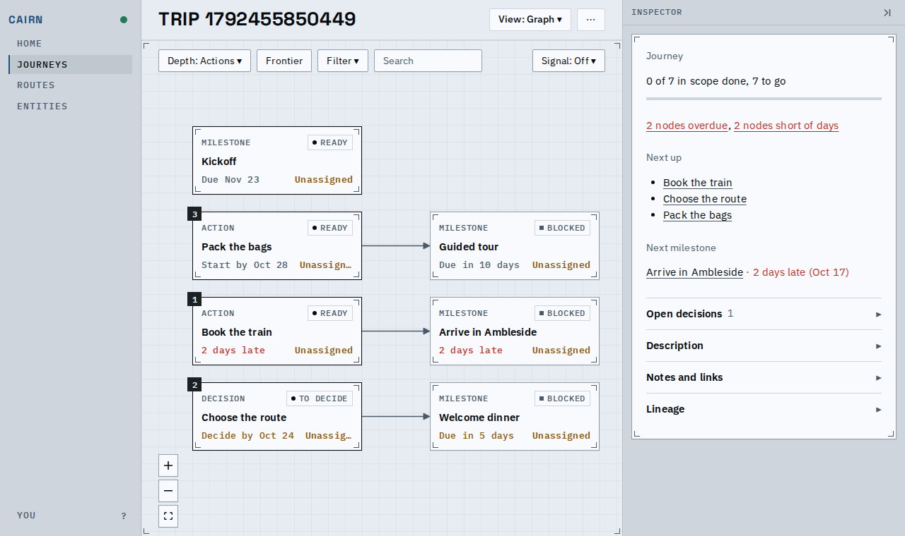 |

A decision's date in the inspector, and a late action's flags. Before: "Decide in 5 days" and "it is due 2 days ago". After: "Decide by Oct 24" (in warning ink while soon, like the list) and "it is 2 days late", a chain that names "the finish of Book the train" instead of gluing a word after a title, and the flags are the rows' own list, named as the journey counts name them ("overdue", "short of days"; no internal name such as needs_breakdown).

| Before | After |
|---|---|
| 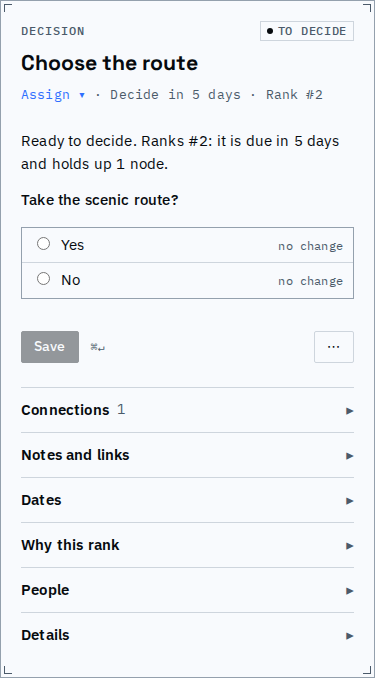 | 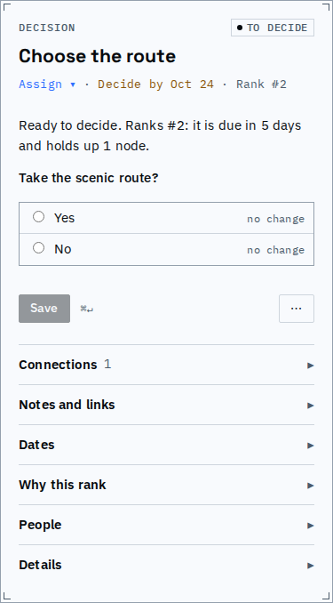 |
| 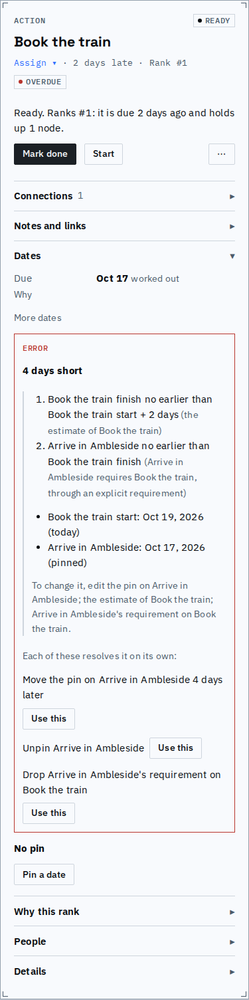 | 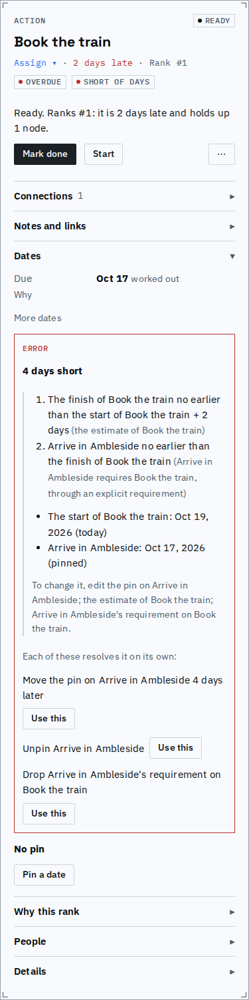 |

The journey index: "2 late" became "2 nodes overdue", the one count the card and the Summary say too, and the next milestone says how far off it is, then its date, in the ink every screen gives a late or soon date.

| Before | After |
|---|---|
| 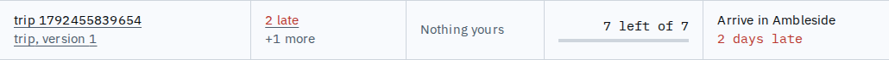 | 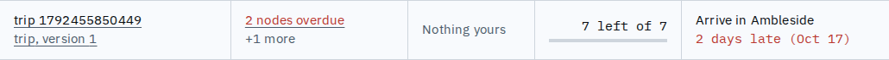 |

The stalled panel and a milestone that reaches itself on its date. Before: a date then a distance ("Oct 20, in 1 day"), and the sentence said "(auto-reach)". After: the nearness first, then the date, and the sentence says it counts as reached by itself that day.

| Before | After |
|---|---|
| 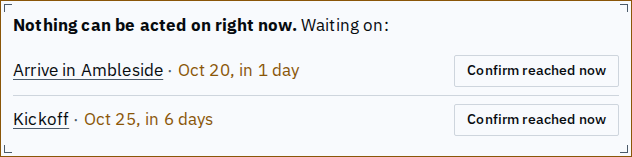 | 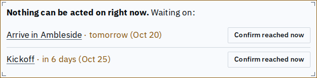 |
| 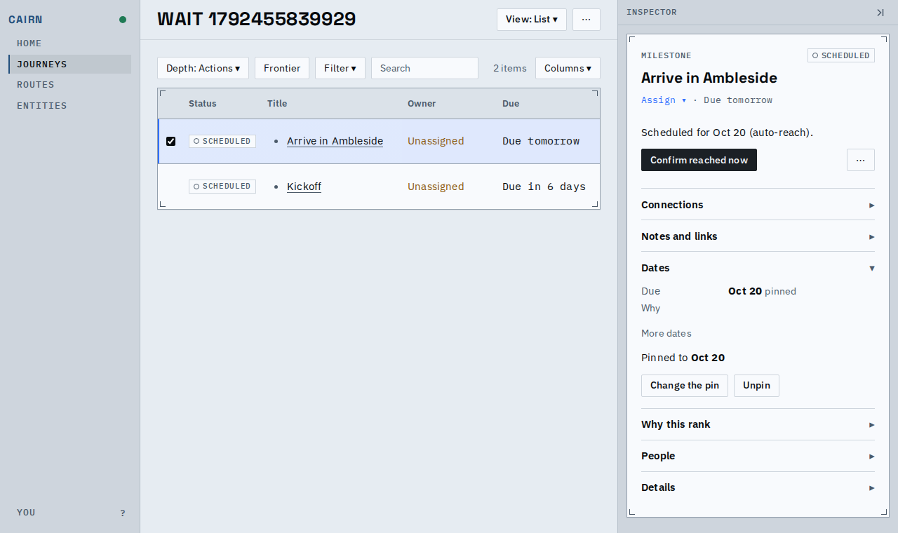 | 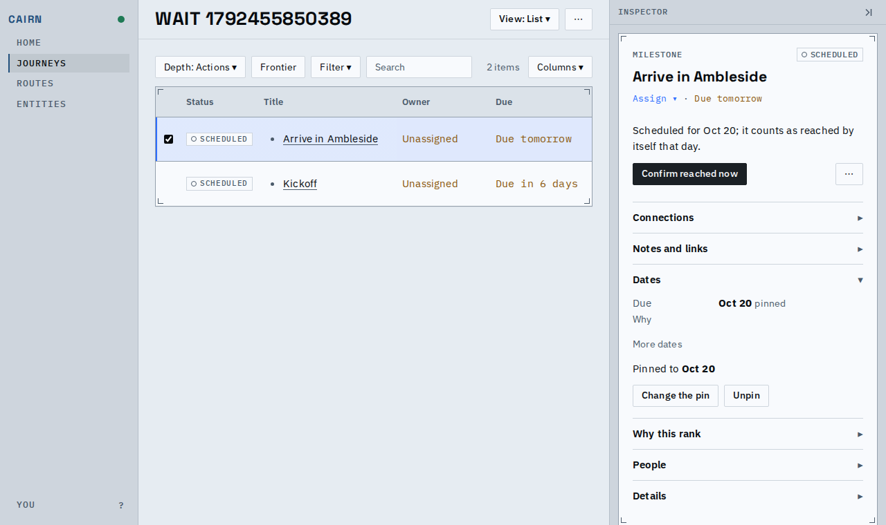 |

Known limits:
- A route's screens have no journey, so their "today" is the session's clock in the tab's own time zone; the deployment's zone reaches the page only inside a journey's document.
- An event's day (a published version, a history entry) is still the UTC date of its timestamp.
