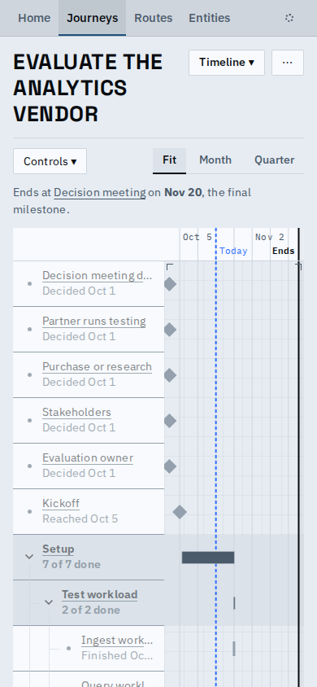

# The phone's timeline gives its labels room and its controls one row

Addendum to the phone-layout proof. On a 390px phone the Timeline's Controls button and its Fit | Month |
Quarter switch now share one row, and the labels column is wider and stops indenting after two levels of
nesting, so a nested title stays readable (a long one ends in an ellipsis; a tap opens the node).

| Before | After |
| --- | --- |
|  |  |

- The range switch moved to the end of the view controls' row at every width (the same slot the List's
  Columns uses), so desktop has one row too; "Back to ..." still appears under it after a pan.
- Also: the journey-name chevron is measured again once the font arrives, so a name that fits never shows it.

## Known limits

- Past two levels of nesting rows line up at the same indent, so depth is told by the guides alone.
