# The phone gives content the room

On a 390px phone you can now open a journey's graph straight on the page and use it: no preview to tap
through, no full-screen map that hides the header, Apply and the stale-refresh notice. The top bar is one
short row, the header is one row, and the controls are one button on every view. Before on the left,
after on the right, all at 390x844.

<table>
<tr><th>Before</th><th>After</th></tr>
<tr><td>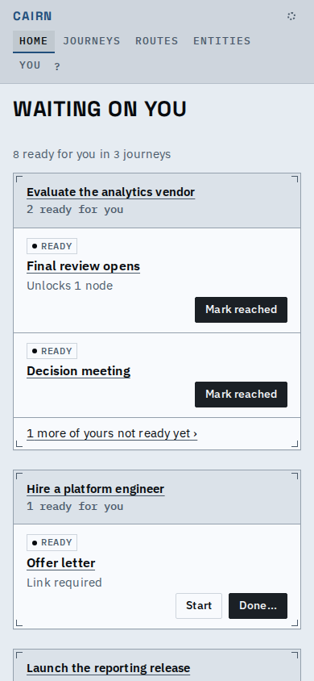</td><td>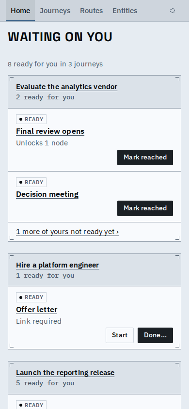</td></tr>
<tr><td colspan="2">Home: the top bar loses its second and third lines (brand, You, ?); the nav is sentence-case tabs.</td></tr>
<tr><td>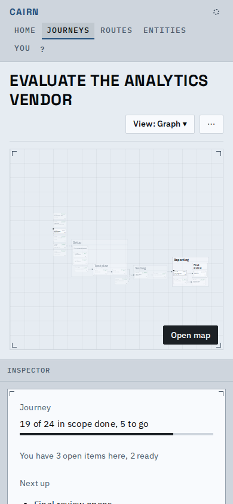</td><td>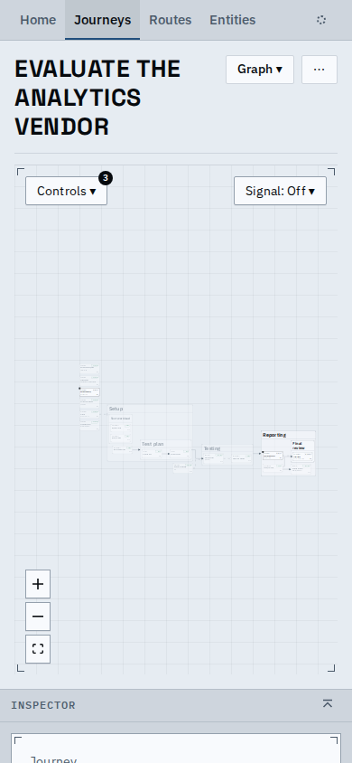</td></tr>
<tr><td colspan="2">A journey's graph: live on the page under a one-row header and one Controls button, the inspector's head (with its hide button) peeking below.</td></tr>
<tr><td>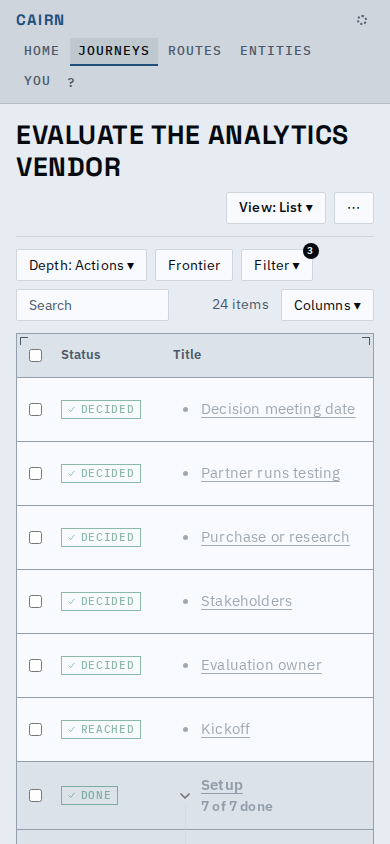</td><td>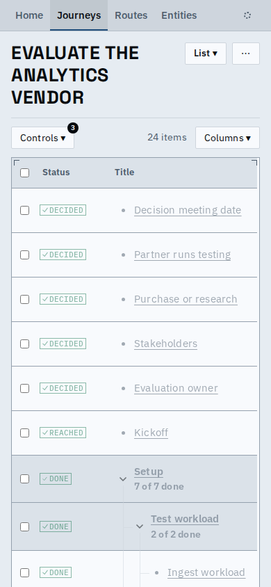</td></tr>
<tr><td colspan="2">The List: the controls fold into Controls beside the count, the status column is narrower so the title has room.</td></tr>
<tr><td>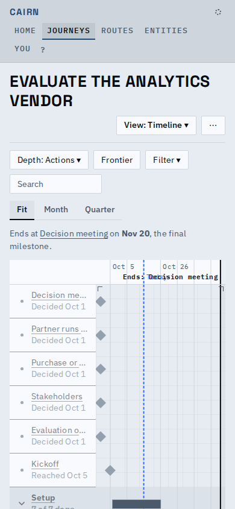</td><td>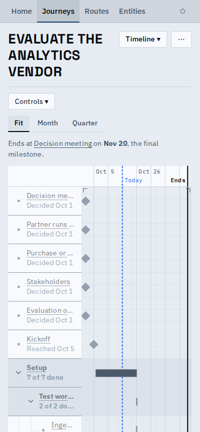</td></tr>
<tr><td colspan="2">The Timeline: the end label gives way to "Ends" where it would run over "Today".</td></tr>
<tr><td>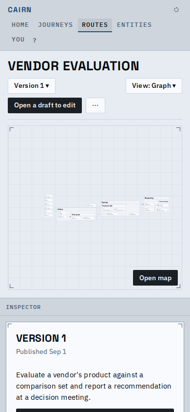</td><td>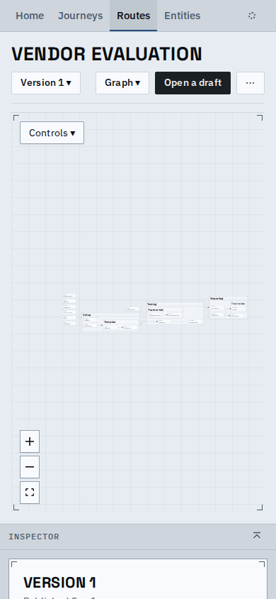</td></tr>
<tr><td colspan="2">A route: two rows of header (the primary says only "Open a draft"), and its graph is live.</td></tr>
<tr><td>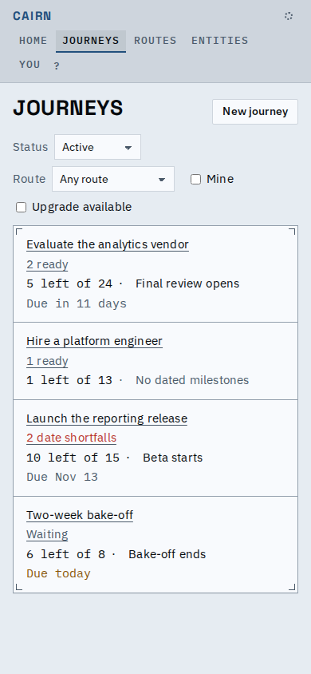</td><td>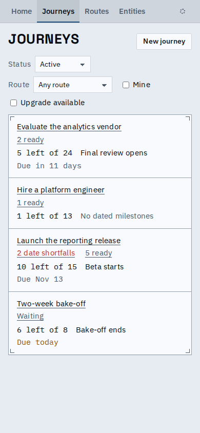</td></tr>
<tr><td colspan="2">The Journeys index: each row says both what needs a look and what is yours, on one line; the context follows.</td></tr>
</table>

Other states, after: the Controls menu, a graph with nothing to draw, and the inspector hidden to its bar.

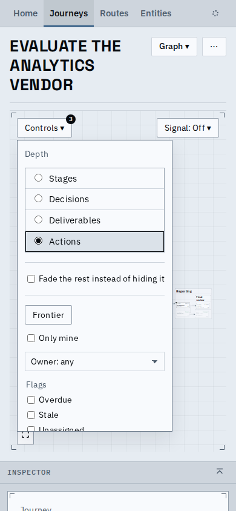 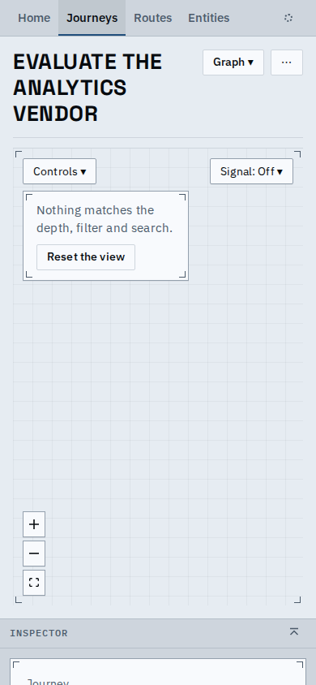 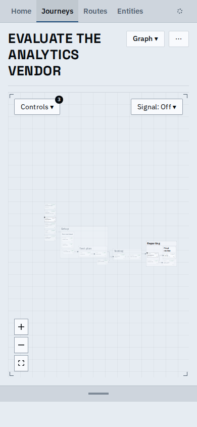

[A short video of moving around a journey](moving-around-a-journey.webm): Home, Journeys, a journey, its
graph (pan, Controls, pick a node, hide and show the inspector), then List and Timeline from the View picker.

Also changed on a phone, without a picture of their own:

- You is a link in the sync popover (the dot), and the keys hint is gone: a phone has no keyboard.
- A journey name cut by its clamp (three lines on a phone) wears a small chevron; a tap opens it whole.
- The List's status column is 104px, set by its longest one-word state; two-word states wrap onto two lines.
- An index row says every fact it has (what needs a look and what is yours) and always the "Version N available" notice.
- A graph with nothing to draw says so on the page, with Reset the view.
- A toast stays on the window, not at the foot of the long page.

## Known limits

- The inspector stays stacked under the page; its form on a phone (a bottom sheet) waits on the owner.
- A swipe that starts on the canvas pans it; the page is scrolled from the header or the inspector's peek.
- The Timeline's label track is still narrow once rows nest, and its Controls and range switch still take two rows.
