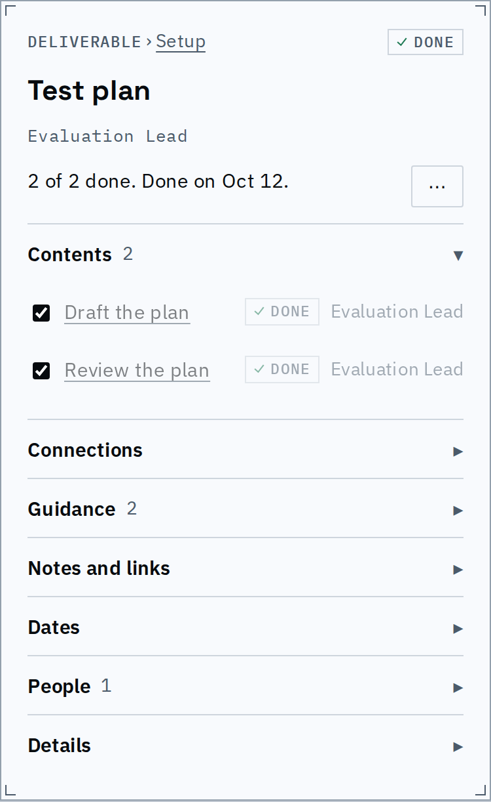
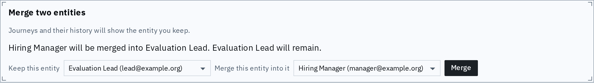
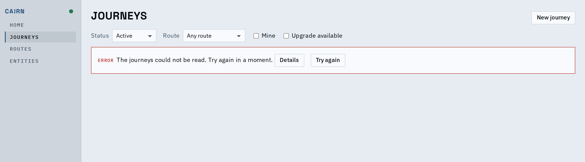

# Proof: the follow-ups to naming people and folding details

A done step's children recede, the inspector's owner line is set as the design says, merging
two entities says which one stays, and a failed read says what happened in a sentence.

Done children (Contents) are faded like every done row, with their checkbox at full strength;
the owner line under the title is 13px mono, and the overflow sits beside the sentence.

Merge labels name the consequence, and a sentence names both entities before Merge is pressed.

A failed read: a sentence and a next step; the server's own message, which can carry ids,
sits behind Details and is never on the page by default.

| | Before | After |
|---|---|---|
| Merge labels | "Keep" / "Merge into it" | "Keep this entity" / "Merge this entity into it", plus "X will be merged into Y. Y will remain." |
| A failed read | "The journeys could not be read: <server message>" | "The journeys could not be read. Try again in a moment." and a Details button |

## Known limits

- With no primary action the overflow button sits beside the completion sentence; a row
  with nothing in it is not drawn.
- The assistant's "message was not answered" line still shows its message.
