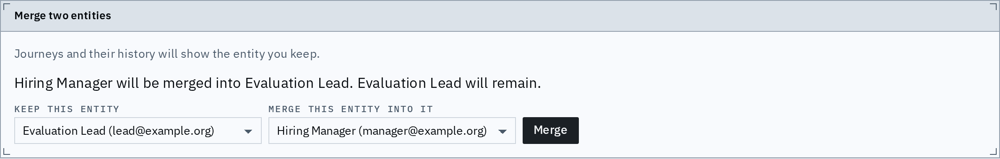
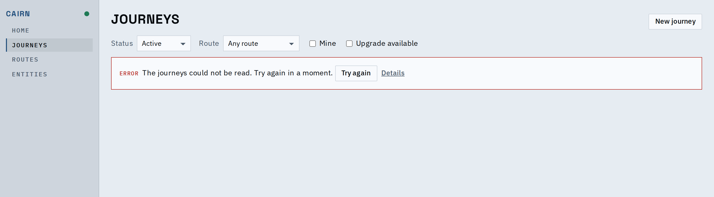

# Proof: one failure component, the leading action, the merge panel's head

A failed save or read says what happened in a sentence, Try again leads and Details follows,
and the merge form is a panel with a header band like the others.

The merge form under the Panel rule: header band with a bottom hairline, then the form.

Try again first, then the quiet Details button; the server's own message is behind it.

| | Before | After |
|---|---|---|
| A refused save | "Not saved: <server message>." | "Not saved. Try again in a moment." and Details |
| The assistant's failed message | "The message was not answered: <server message>." | "The message could not be answered." and Details |
| Merge failure, preview failure, start failure | the raw message | a sentence and Details |
| Journey that could not be read (Home, index) | "Could not be read." and a Why disclosure | the same component as every other failure |

## Known limits

- Engine rule messages (violations) still show in the engine's own words; they name titles,
  not ids.
