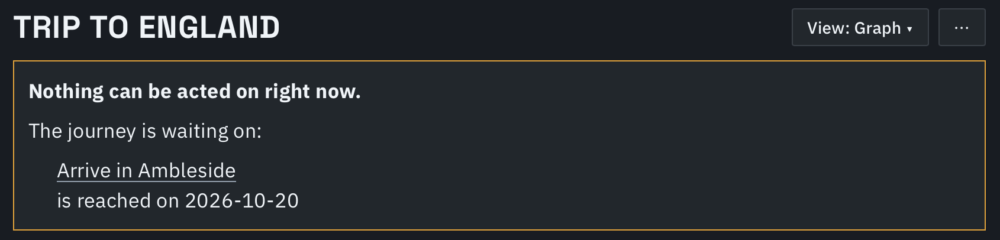
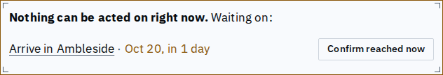
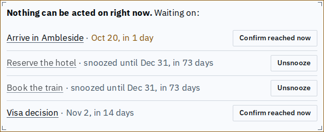
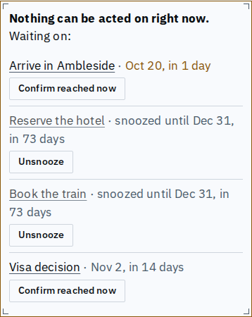

# The stalled panel: one panel, shorter, plain dates

A stalled journey now shows the same compact panel on the graph, the list, the walkthrough and the Summary. The graph gains the Unsnooze and Confirm reached now actions it lacked. A cause is one row: the title, then what it waits on in the app's usual date words, then its action at the row's end. Titles read right whether they are verbs or nouns, since no sentence is built around them.

Before (graph, one auto-reach cause): five lines, a raw ISO date, "is reached on".

After, the same case on the graph: two lines.

A mix of auto-reach and snoozed causes on the list, desktop: one row each.

The same on a phone: a row wraps its action under the title only when the width runs out.

Also in this change: the milestone sentence in a node's detail and the proposal, resolution and chain texts say dates in words instead of ISO dates.

Known limits:
- The Summary's and walkthrough's panels were already this panel; their screenshots are the same shape as the list's.
