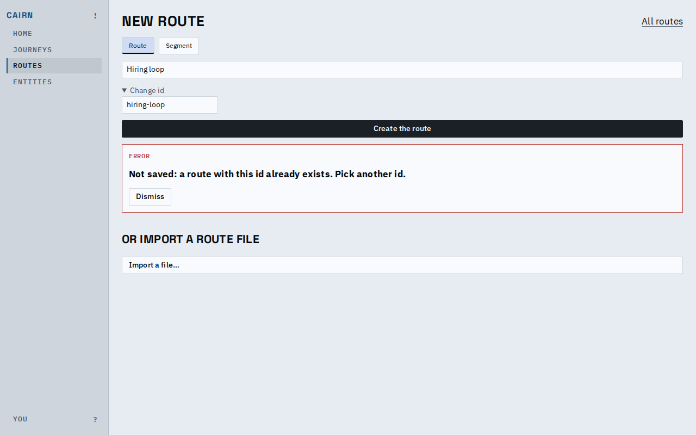
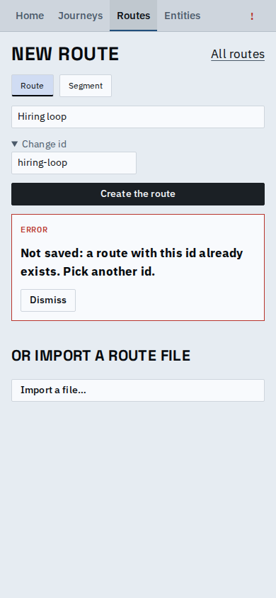
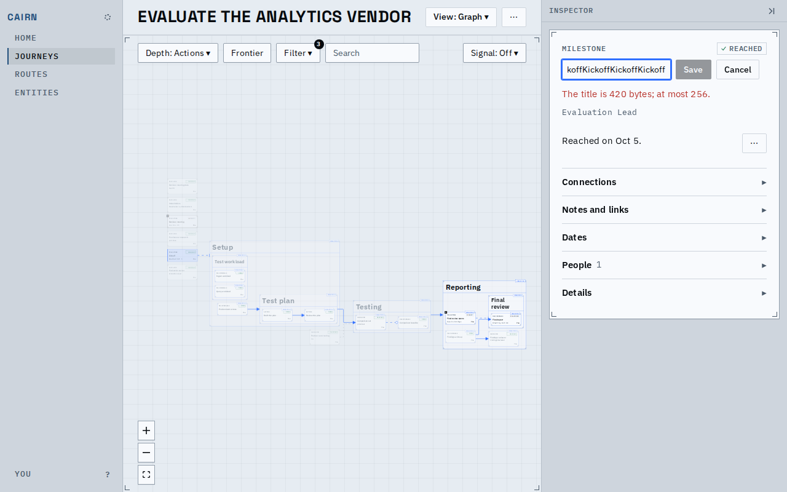
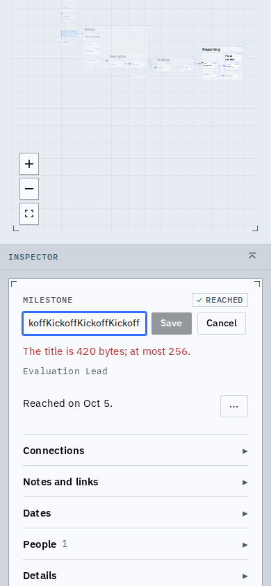

# One refusal, on desktop and phone

A write the engine refuses shows one component everywhere. Here, creating a route whose id is already in use: it says a route with that id exists, opens "Change id" for the fix, and lists what changed only when it has words for it (a journey's node, field, answer or state, by title). Before, it read "someone changed this since you started editing" (nothing was being edited) and listed "other details, an item of the route, role, kind".

A title longer than the limit (256 bytes) is stopped in the rename form with the reason, and Save stays off. The engine already enforced the limit, but the form sent the text and the host answered with a failure instead of a rule.

Known limits:
- A stale refusal over a route draft's records lists none: the tab holds no titles for a route.
