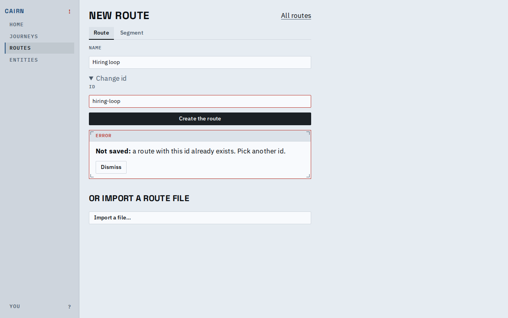
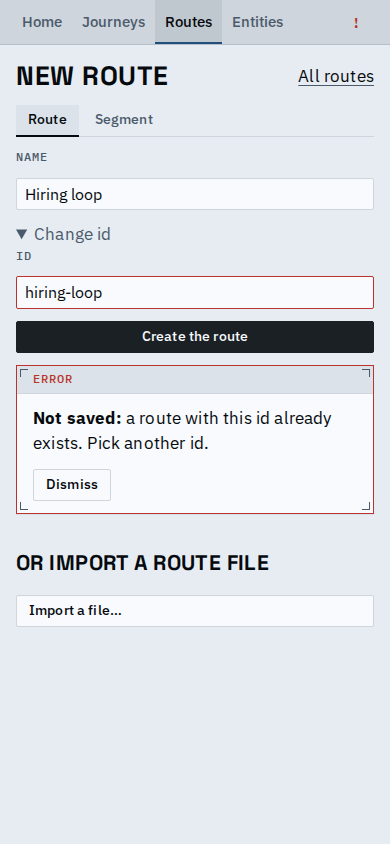

# A refusal in the panel style, and a labelled new-route form

A refusal now reads as a DESIGN panel: four corner ticks, a header band
reading Error, an error-coloured border, and the fact in bold ("Not saved:") before its reason; the id field is marked invalid. The new-route form shows a
Name label above its field, and its kind choice (Route or Segment) is
the shared segmented control.

Desktop: a duplicate route id is refused in the panel, under the form.

Phone: the same panel; fields are 16px, the Change id summary and the
refusal text are above the 15px floor, the Dismiss button stays 14px.

A title past the limit is stopped in the form with a plain sentence.

## Known limits

- The Routes index Type control is a filter select (DESIGN, Index head);
  the new-route kind is a choice, not a filter, so it uses the segmented
  control rather than sharing that select.
