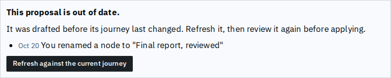
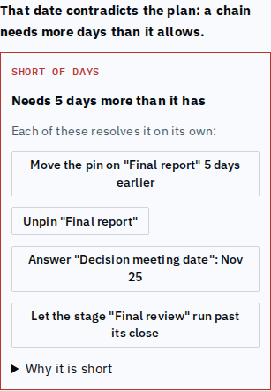
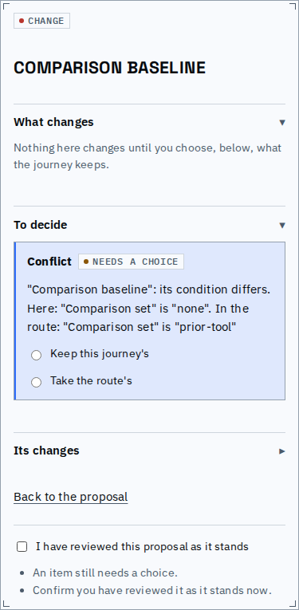
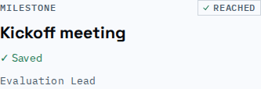
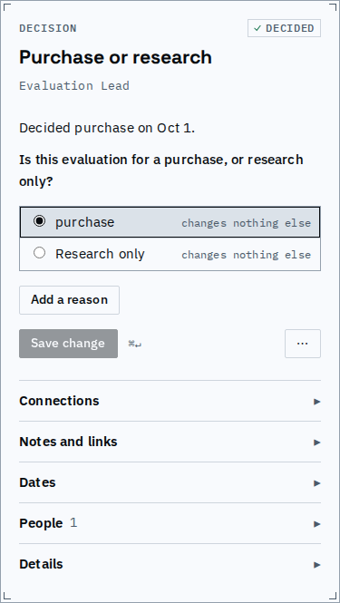

# Changes, conditions and refusals in words

A patch's changes, a mutation, a condition and a refused write are each said by one renderer now, so every screen tells them the same way: nodes by title, choices by label, dates in words, and never an id, a field's internal name or a rule code.

What moved under a proposal. Before, the Stale panel hand-copied History's list: a raw date ("2026-10-20"), a lower-case "you renamed", no agent marker and no note. After, it is History's own list.

A chain short of days. Before, its callout was headed "Error", and its fixes said "Change the due_by rule of ... to an offset of 3 days" or "Pin X to 2026-11-25" with choices by id. After, the callout says "Short of days", the heading says what it needs, each fix is one button that says what it does in words (the mutation renderer proposal review uses), and the chain that explains it folds under "Why it is short" while fixes are offered.

A conflict about a condition in proposal review reads as the decision's title and the choice, as a card or the inspector would say it, here and in the route; before, proposal review printed `is prior-tool` with no quotes and ids for labelled choices. (The fixture's choices have no labels, so the quoted words are their ids.)

A rename now leaves its receipt under the title, as every other write does (before it left none, and none of its consequences). A choice with nothing to bring in or drop says "changes nothing else" instead of "no change".

Refusals: every inline refusal (index, forms, structure editors, the cascade dialog, the inspector's sections, proposal review) is one component; the engine's trailing rule code ("(F5)") is stripped wherever it is shown, not only on the sync chip, and a change sent twice is no longer reported as "the graph changed".

Known limits:
- The chip's Recent keeps its own past-tense summary ("Answered X"); it is a log line, not the renderer above.
- A canvas line's hover for a condition edge names the decision only, not the value the node waits for.
