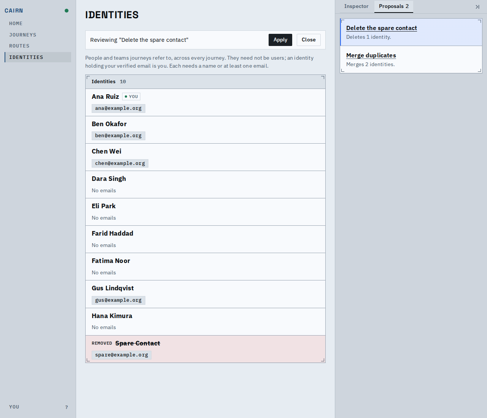
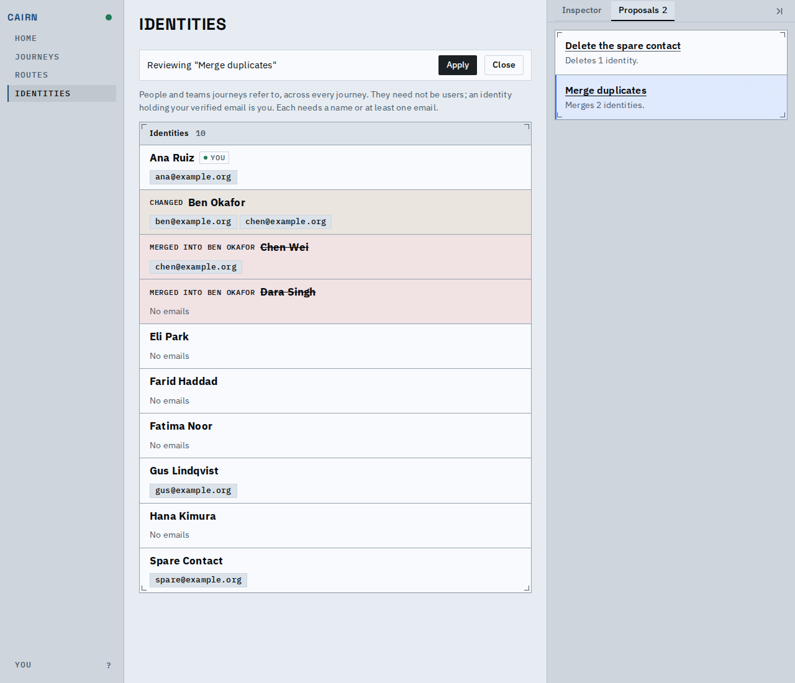
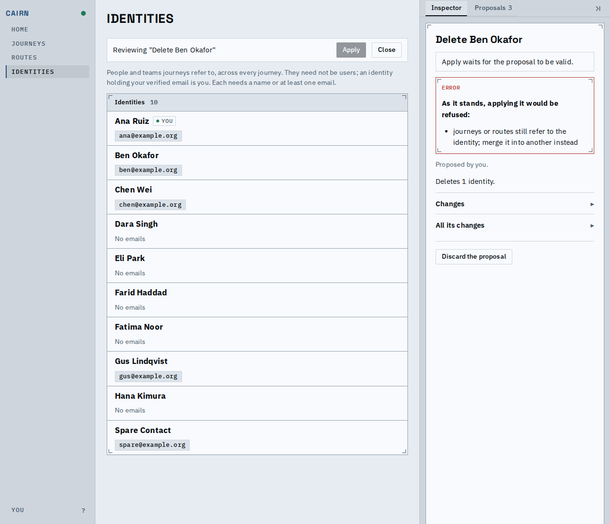
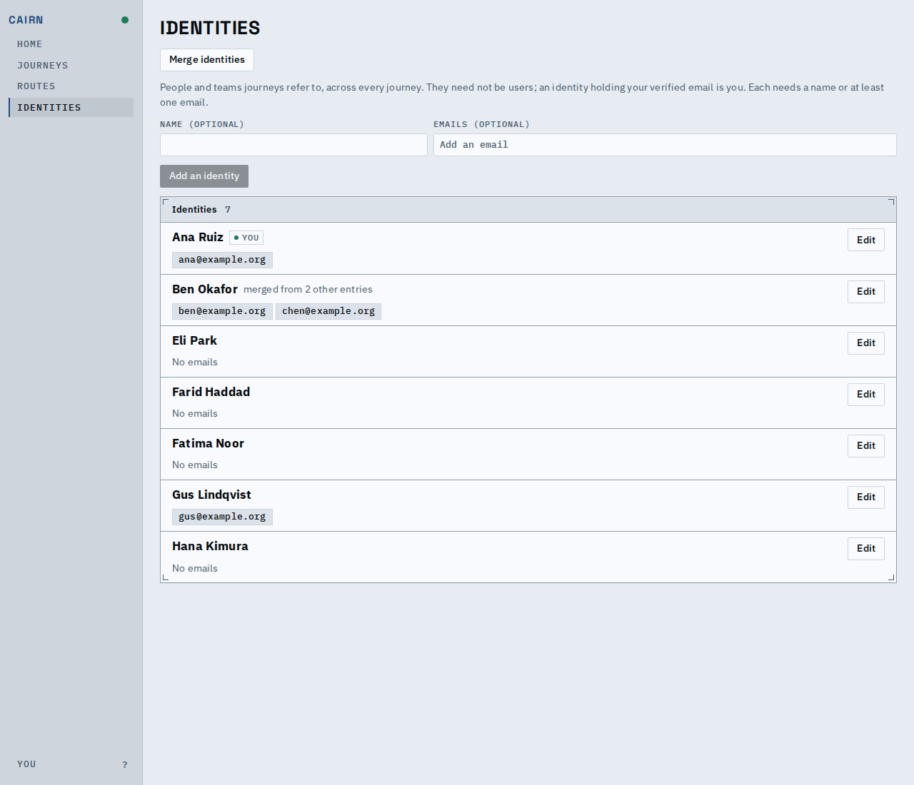
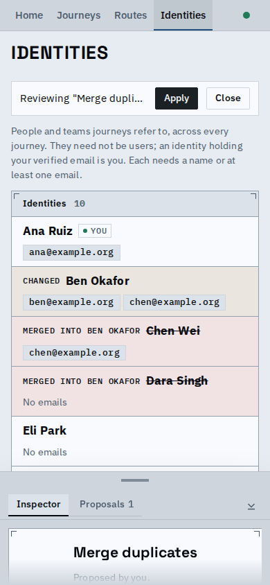

# Delete an identity, merge several at once, and see what refers to one

You can now delete an identity nothing refers to, merge several identities into one
survivor in a single change, ask which journeys and routes refer to an identity, and list
identities or find journeys by the identity they refer to.

An identity that something refers to cannot be deleted; it is merged into the identity that
remains. A merge names every journey that refers to any of its identities, and is checked
against one snapshot of them.

## The proposal layer

A deployment proposal that deletes the spare contact: the row stays in place, struck through
and marked removed, with its email.

A proposal that merges Chen Wei and Dara Singh into Ben Okafor: the survivor is marked
changed and takes the merged emails, and each merged identity says whom it went into.

A proposal to delete Ben Okafor, whom journeys refer to: the inspector says it would be
refused because journeys or routes still refer to the identity, and Apply is disabled; the
merge above is how that identity would go instead.

Both applied: the spare is gone, and the merged identities no longer appear.

The same merge at phone width, the proposal's detail under the page.

## What refers to an identity

The references read (`GET /api/deployment/identities/{key}/references`) and the journey
index filtered by identity (`list_journeys` with `referencing`, `GET /api/journeys?referencing=`),
on the fixture, before and after the two changes:

| Identity | References read | Journeys referencing |
|---|---|---|
| Ben Okafor (survivor), before | j_hiring | j_hiring |
| Chen Wei (merged), before | j_hiring | j_hiring |
| Dara Singh (merged), before | j_vendor_eval | j_vendor_eval |
| Spare Contact, before | none | none |
| Ben Okafor (survivor), after | j_hiring, j_vendor_eval | j_hiring, j_vendor_eval |
| Chen Wei (merged), after | not found (now an alias) | j_hiring, j_vendor_eval |
| Dara Singh (merged), after | not found (now an alias) | j_hiring, j_vendor_eval |
| Spare Contact, after | not found (deleted) | none |

The old keys still reach the survivor's journeys through their aliases.

## Known limits

- A rejected delete says journeys or routes still refer to the identity but does not list
  them yet; the references read does.
- The page offers no delete or references control yet; the changes come from proposals, the
  API, and the MCP tools. The identities page work is a separate piece.
- A rejected delete names at most 16 of the graphs that refer to the identity; the commit
  rechecks all of them.
