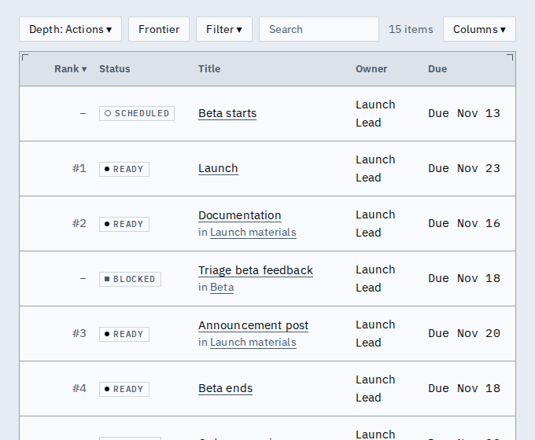
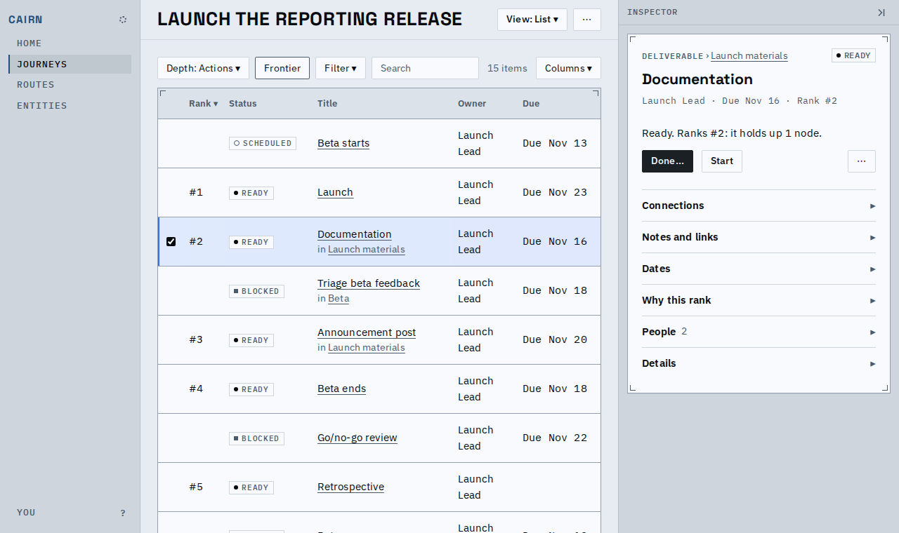
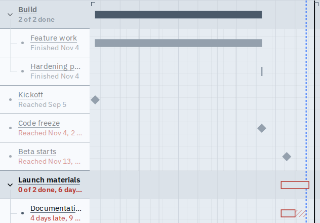
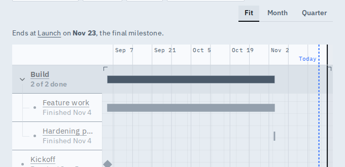

# Derived values come from the engine

The numbers and words a screen shows about a node now come from the engine once, not from a copy in each view. What you can see: one "#N" for a node's place wherever it appears, an auto-reached milestone called "Reached" once its date has passed on every screen, and a "blocked" list filter that no longer lists a group that is only waiting on its own children. Agents also read, in the snapshot, when completing the journey is suggested.

## Rank cells say the place on the acting frontier

The Launch journey on the List, sorted by rank. A node that cannot be acted on has no place, so a blocked node no longer holds a number (before, Triage beta feedback was "#4" and Go/no-go review "#7").

Work that cannot be acted on yet shows a quiet dash (read as "Not on the frontier"), so a blank is never a mystery.

The same journey, Documentation opened: its place in the inspector is the number in its row.

Short video: sort by rank, Frontier on and off, then a row opened.

[rank-place.webm](rank-place.webm)

| Node (Launch, rank sort) | Before | After |
|---|---|---|
| Launch | #2 | #1 |
| Documentation | #5 | #2 |
| Beta ends | #6 | #4 |
| Retrospective | #8 | #5 |
| Triage beta feedback (blocked) | #4 | none |
| Go/no-go review (blocked) | #7 | none |

## "Reached" is said once

A week after Beta starts' date, the Timeline row said "Estimated Nov 13" for a milestone the engine had already reached on its own; it now says "Reached Nov 13", as the card and the list do.

| Beta starts (Timeline, Nov 20) | Before | After |
|---|---|---|
| Row text | Estimated Nov 13, 2 days short | Reached Nov 13, 2 days short |

When Today is a few days from the end, the axis keeps Today's label and gives up the end label (its line stays; hover names it, and the sentence above the chart says it).

## Also changed, with no fixture picture

- A container's progress, its overdue count and its "decision needed" badge are counted by the engine over everything beneath it, so a decision under a collapsed or hidden level still lights the badge.
- The inspector's "waits on", a done button's missing evidence and "started early" read the engine's values, so an ancestor's gate is named as the node's own.
- The "blocked" list filter matches the status shown (a group waiting only on its children is not blocked).

Known limits:
- A blocked node that outranks the top of the frontier shows a dash above "#1"; a place is only for what can be acted on.
- The Summary's "In progress" panel and the canvas badges read the same on these fixtures before and after, so they have no picture; their tests cover the new counts.
