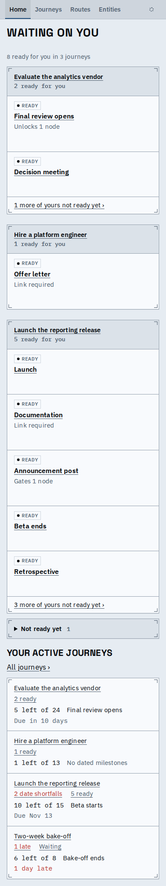
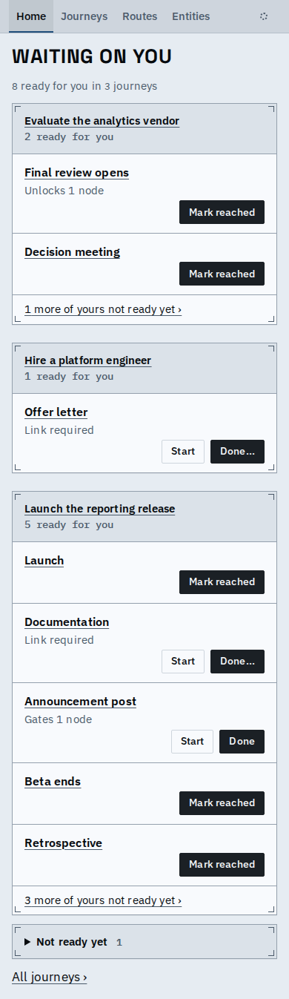
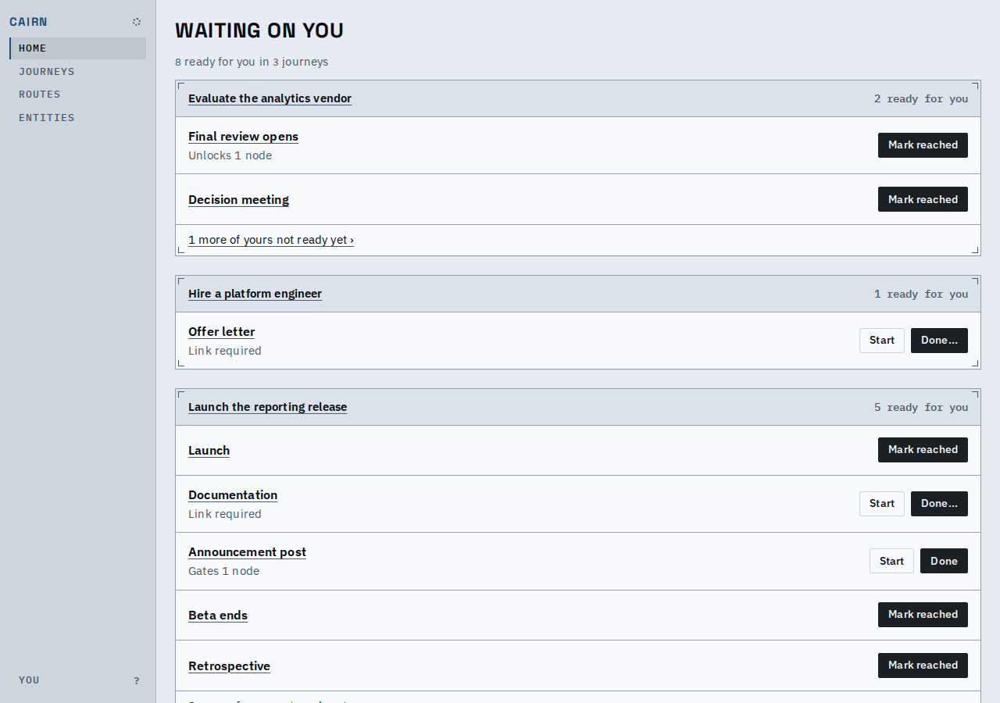
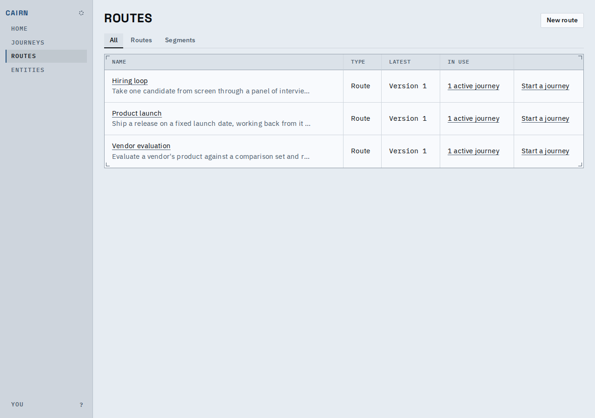
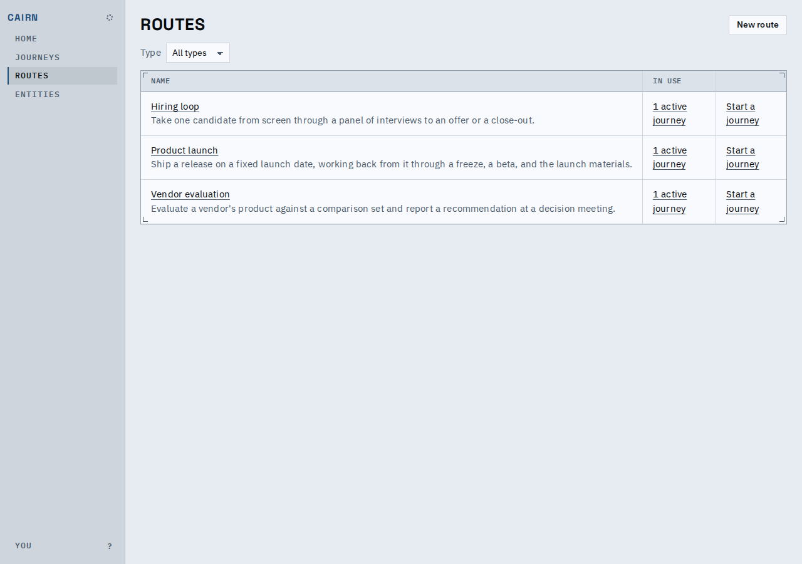
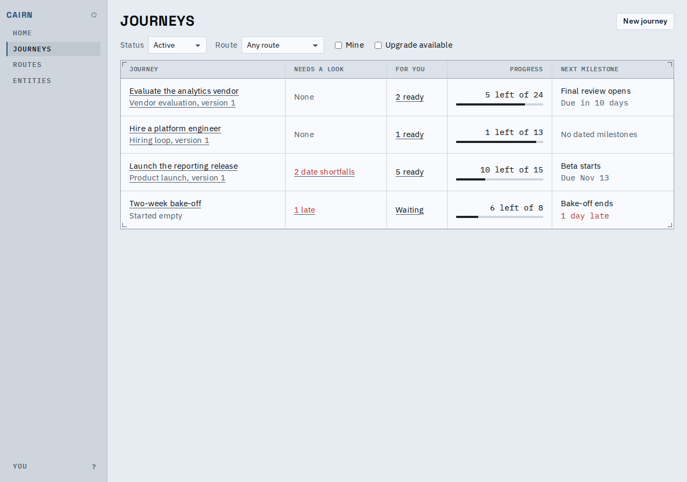
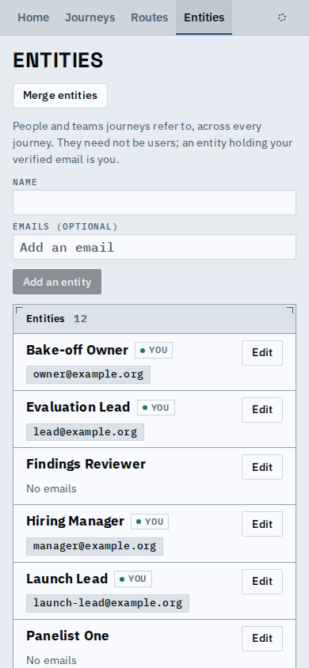
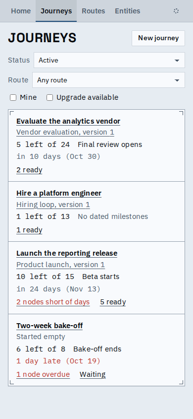
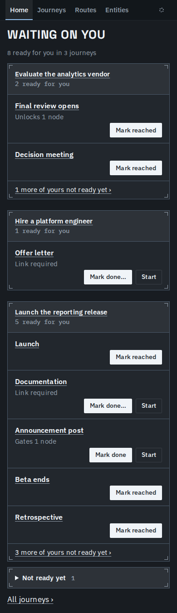

# Home and the three indexes

Home now leads with what is waiting on you and ends with one "All journeys" link instead of repeating the journey table. A row's actions are on the row without a hover, and a ready row no longer repeats a READY chip under a heading that already says "ready for you". Journeys, Routes and Entities share one head: the title with the page's primary action at its right end, and one toolbar row under it.

## Home

Before, the phone page ended with a second copy of the journey index; rows had no visible actions (they appeared on hover) and a READY chip each.

Before: READY chip on every row, no actions, the journey table repeated at the bottom.

After: actions on each row, no chip, "All journeys" at the end.

After, desktop: the actions sit at the row's right end.

## Indexes

Before: a Type column, a Latest column, and an All | Routes | Segments control under the title.

After: Type is a filter in the toolbar row, the New route action is at the title row's right end.

Journeys: the same two positions, with its own filters in the toolbar.

Entities: the title row has the same slot for its action (empty until its own rework), and Merge entities, its one tool, sits in the toolbar row.

A phone's journey row reads name, route and version (and an upgrade notice first when there is one), progress and next milestone, then the attention line.

Dark theme and the empty answer keep the same head and toolbar positions.

## Phone top bar

The phone's top bar already has no "You" tab or "?" key hint: who you are is one tap away in the sync dot's popover, and the keyboard help is for widths with a keyboard. No change was needed.

## Known limits

- Entities has no primary action yet; its add form still sits open under the toolbar.
- Failed reads cannot be induced in the browser host, so their look is not shown here.
