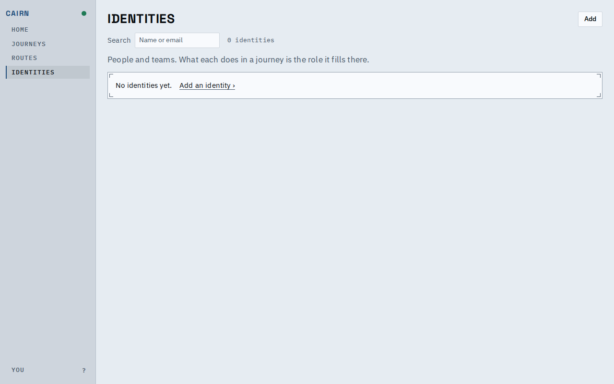
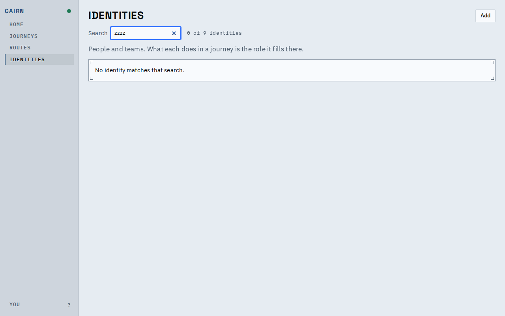
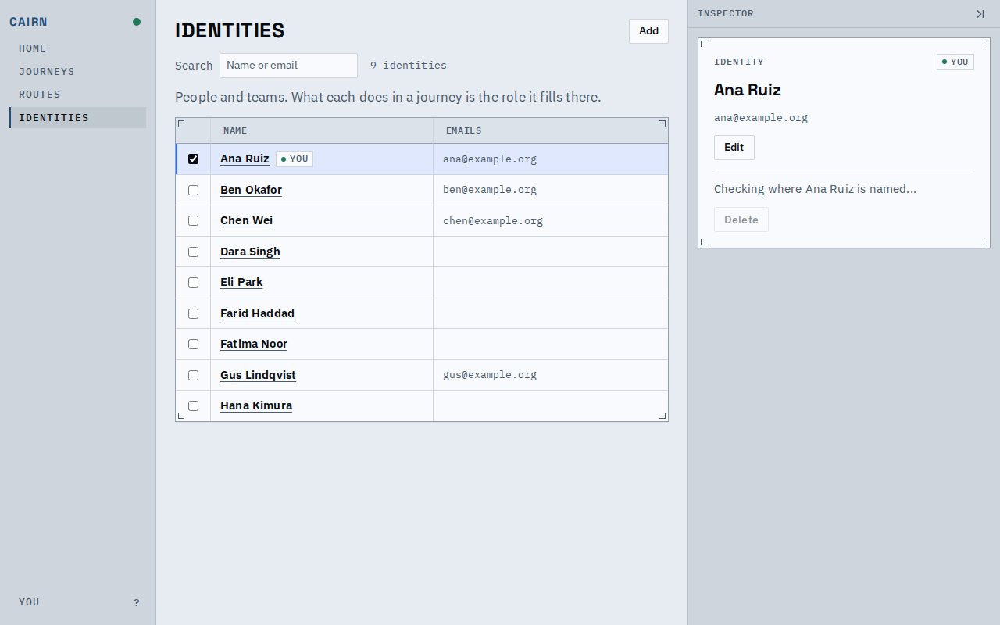
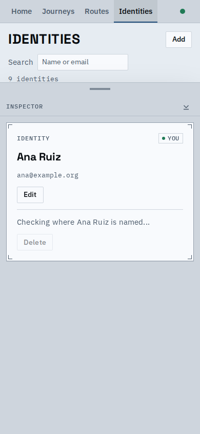
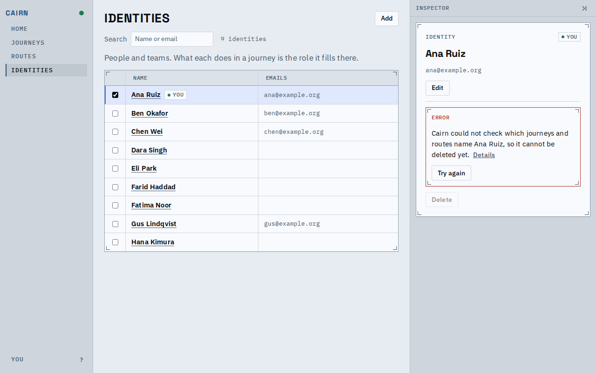
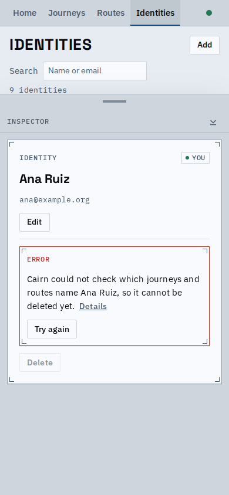
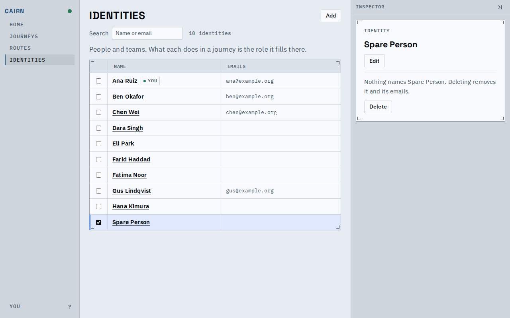
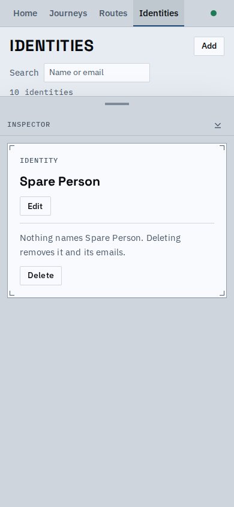
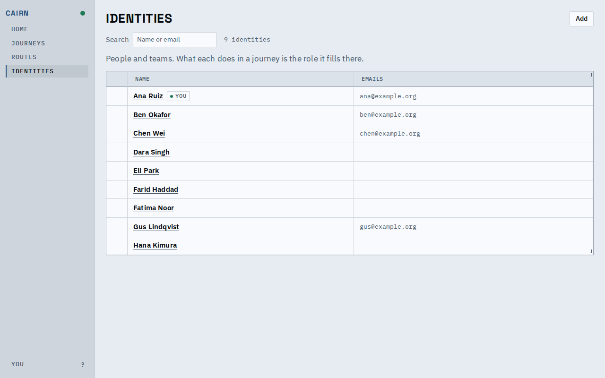
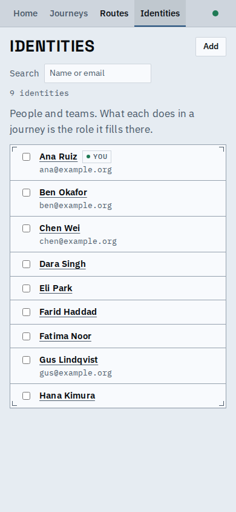

# Identities page: the states in between

Someone can now tell an empty deployment, a search with no match, a references read that is still going and one that failed apart from "nothing refers to this identity". In the last two Delete is off and the inspector says why.

## No identities and no match

| Desktop | Phone |
|---|---|
|  |  |
| An empty index: the count says 0, the panel says so and offers Add. | The same on a phone. |
|  |  |
| A search that keeps nothing says so; the count says "0 of 9". | The count keeps its own line on a phone, so the head does not move as the search narrows. |

## The references read

| State | Desktop | Phone |
|---|---|---|
| Loading: Delete off, "Checking where Ana Ruiz is named..." |  |  |
| Failed: Delete off, a red block with what happened, Details, and Try again on its own row |  |  |
| Nothing refers to it (for contrast): Delete on, "Nothing names ..." |  |  |

## The table as it is

| Desktop | Phone |
|---|---|
|  |  |

A phone row with an email is now one compact block: the email sits under the name in the same column.

## Known limits

- The states with a response held or refused come from request routing in the proof script; the server has no way to be slow or to fail on its own.
- Under the phone's bottom sheet the page behind is partly covered; that is the sheet's peek height, unchanged.
