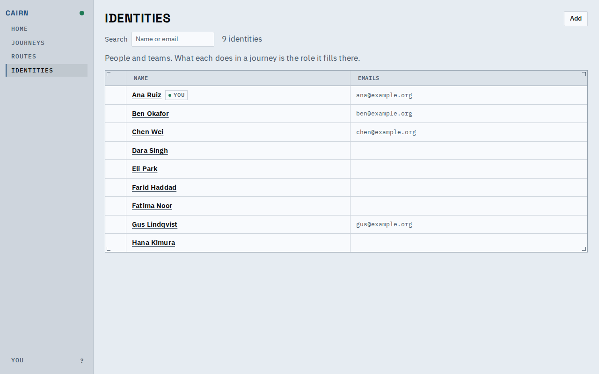
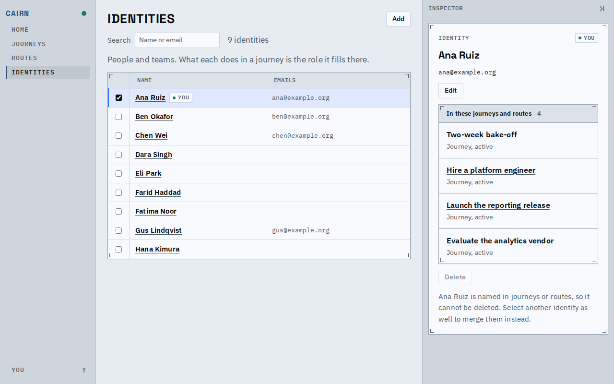
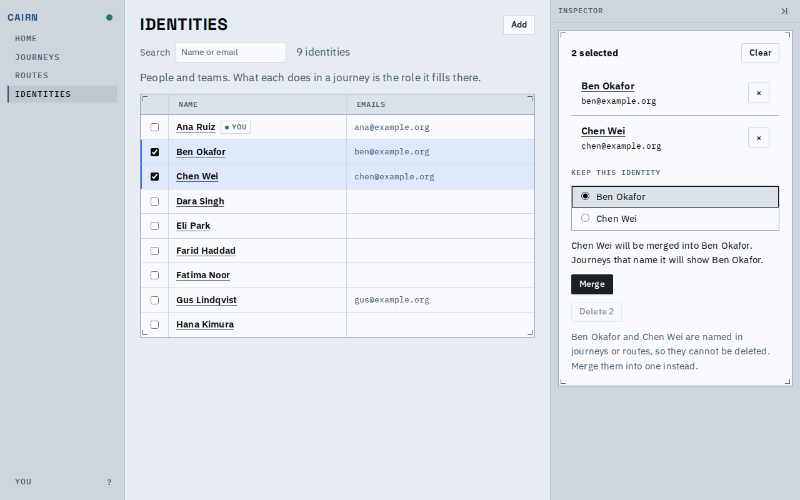
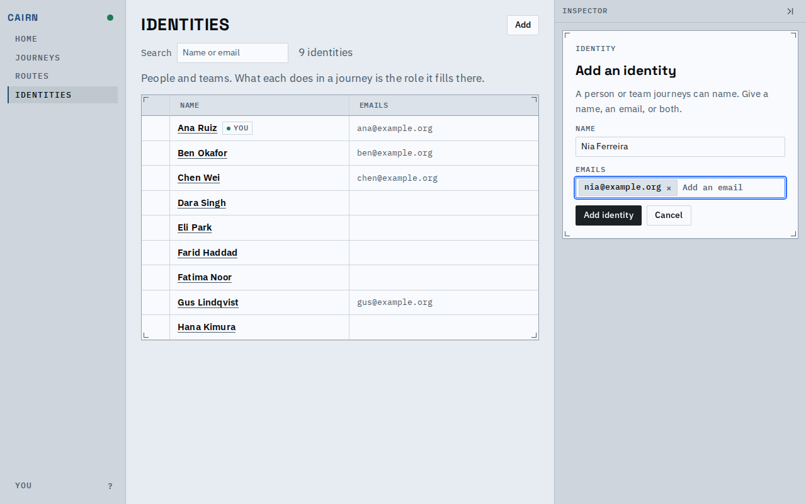
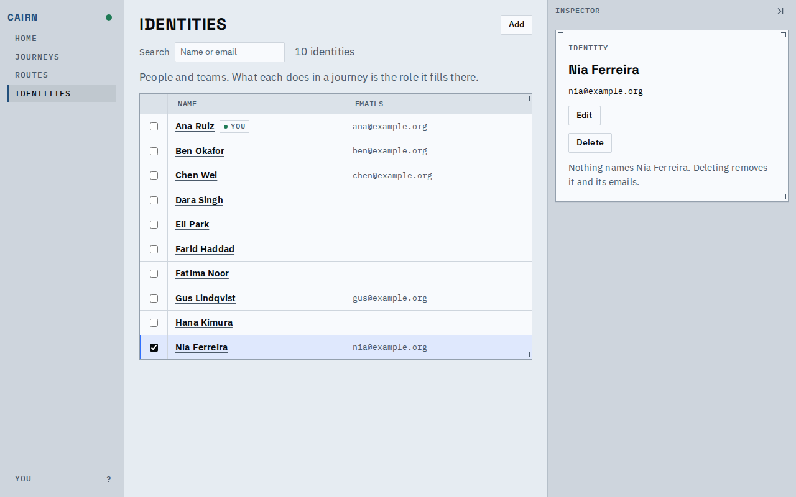
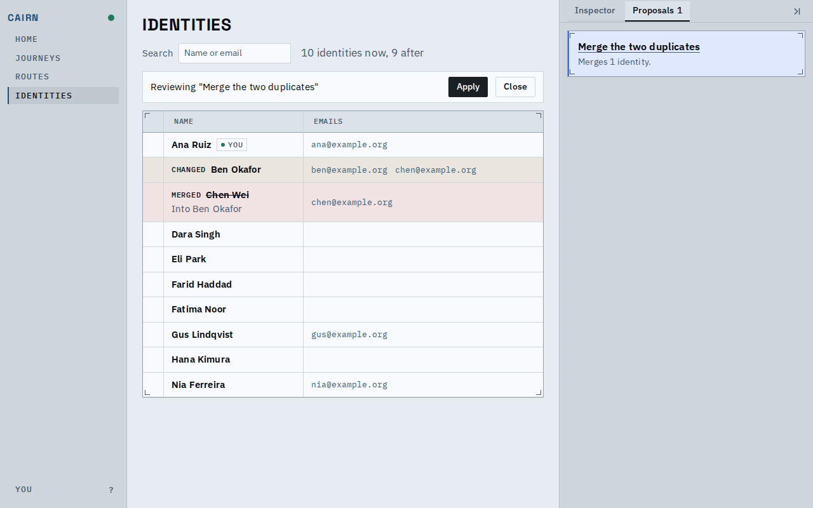
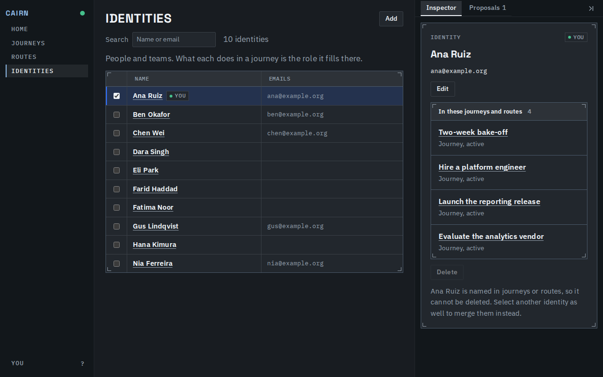
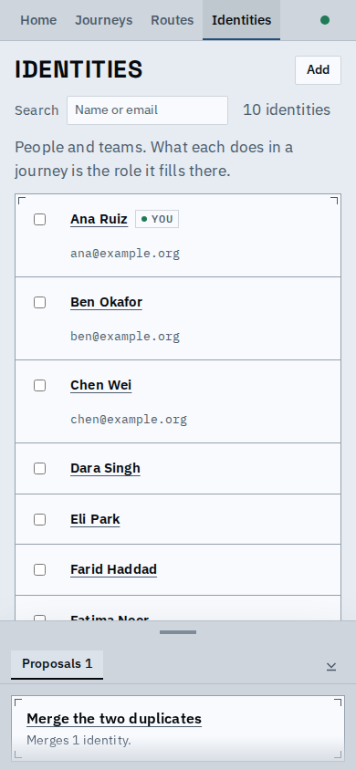
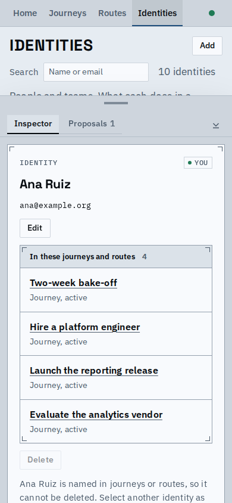
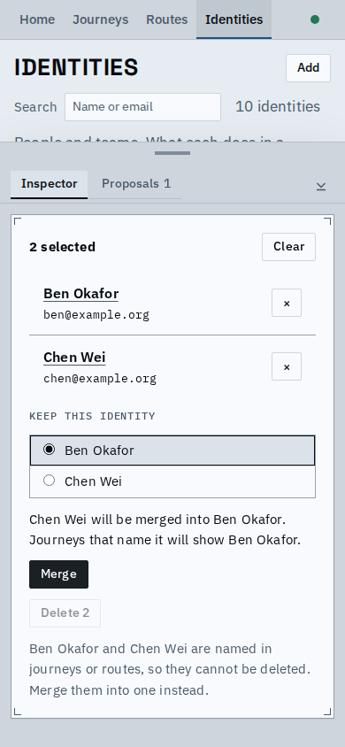

# Identities: Add, select rows, merge and delete from the inspector

You can now add an identity from a button at the right of the title row, select rows (one opens
its identity, the checkboxes make a set), and merge or delete from the inspector instead of a
form on the page. Delete stays off until Cairn has checked where the identity is named.

The page at rest: Add at the right of the title, one toolbar row, one line per identity. The
emails are plain text, and nothing is open until asked for.

One identity: its emails, Edit, the journeys and routes that name it (each a link), and Delete,
off because four journeys name her.

Two rows checked: the inspector lists them, asks which to keep (you, else the first by name),
says what will happen in one sentence, and merges. Delete over both is off while anything names
either.

Add opens the form in the inspector, name and emails stacked.

The new identity is then open at its own address, and Delete is on because nothing names it.

A deployment proposal under the layer: "Merged" and "Into Ben Okafor" beside the merged row, the
count reads "10 identities now, 9 after", and Add and the checkboxes are gone.

Dark theme, with the selected row's checkbox and accent line.

  

On a phone each row stacks (checkbox and name, then emails) and the inspector is the bottom
sheet, opened to half here.

[A short video](add-select-merge-delete.webm): add two identities, select both, merge them, add
another and delete it.

## Known limits

- Merging names journeys only, as before; a route that names a merged identity follows its alias.
- The search is on the identities the deployment read holds, up to the 5,000 the limit allows.
