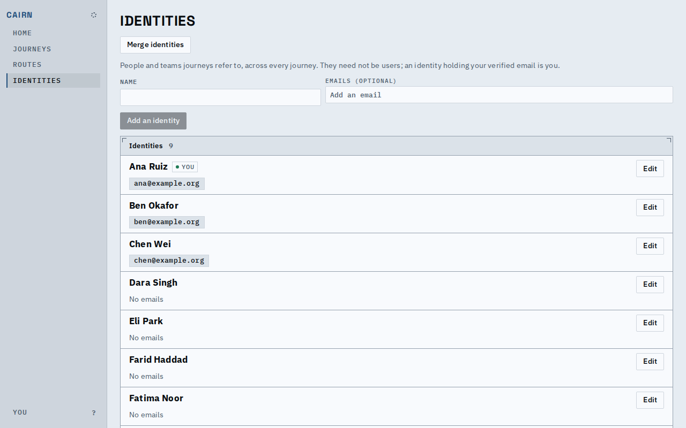
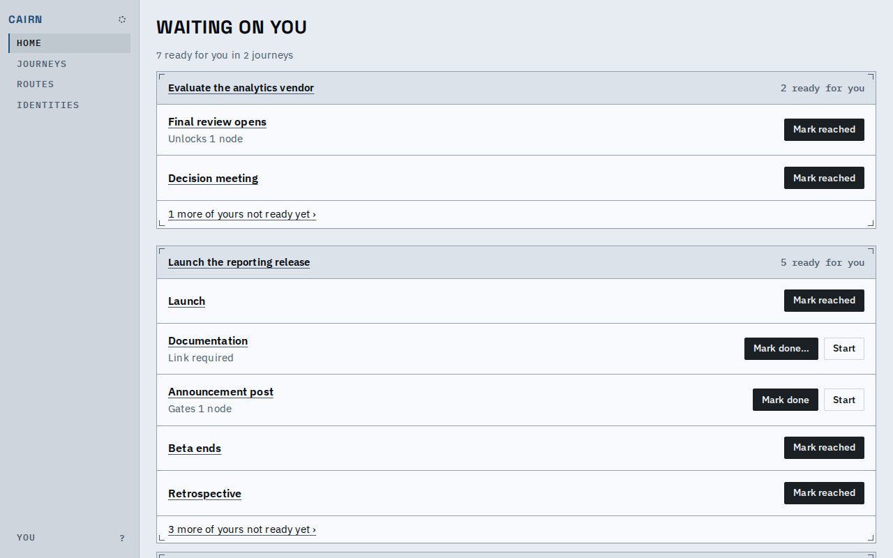

# Proof: identities, and the same people in different roles

- The deployment's people are called identities, everywhere: the Identities page, the answer editor ("Someone new"), history, the API, the MCP tools, the stored data. A sign-in method is a login, so the word "identity" means one thing.
- Every fixture journey now starts from one roster of invented people (`fixtures/people.yaml`), and each journey puts them in its own roles. Ana Ruiz owns the vendor evaluation, sits on the hiring panel, judges the bake-off and leads the product launch; no identity is named after a role.
- The browser host signs in with one login, verified for Ana's email, so the viewer is one identity in every journey.

Who fills each role, read from the fixtures' final state:

| Journey | Role or decision | Filled by |
|---|---|---|
| Evaluate the analytics vendor | evaluation owner | Ana Ruiz |
| Evaluate the analytics vendor | informed stakeholders | Dara Singh, Eli Park |
| Evaluate the analytics vendor | findings reviewer (created in the patch that answers) | Farid Haddad |
| Hire a platform engineer | hiring manager | Ben Okafor |
| Hire a platform engineer | interview panel | Chen Wei, Fatima Noor, Ana Ruiz |
| Two-week bake-off | judges | Gus Lindqvist, Ana Ruiz |
| Launch the reporting release | launch lead | Ana Ruiz |
| Launch the reporting release | writers | Hana Kimura |

An older database moves in one step: keys become `who_` plus 16 random characters, tags and tables are renamed, and text people wrote (an answer that reads like an old key, a choice called "entity") is left as it was.

## Known limits

- Home lists only ready work, so Ana's hiring and bake-off roles show on the Identities and journey pages rather than on Home.
- A name is still required; optional names come with the sign-in change.
