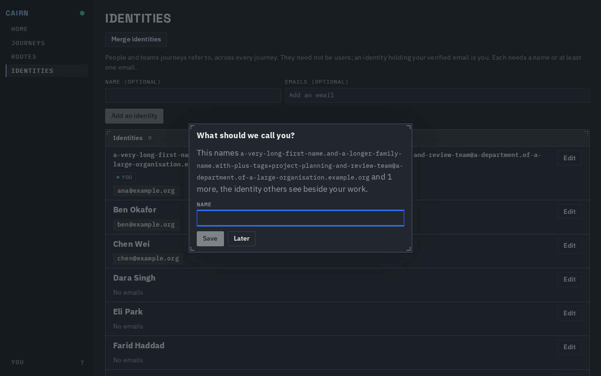
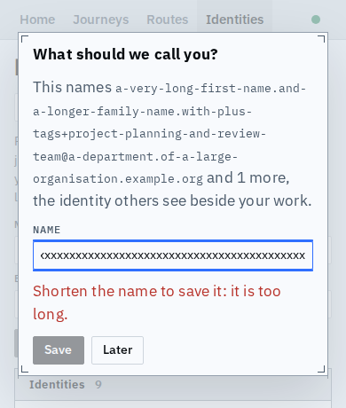
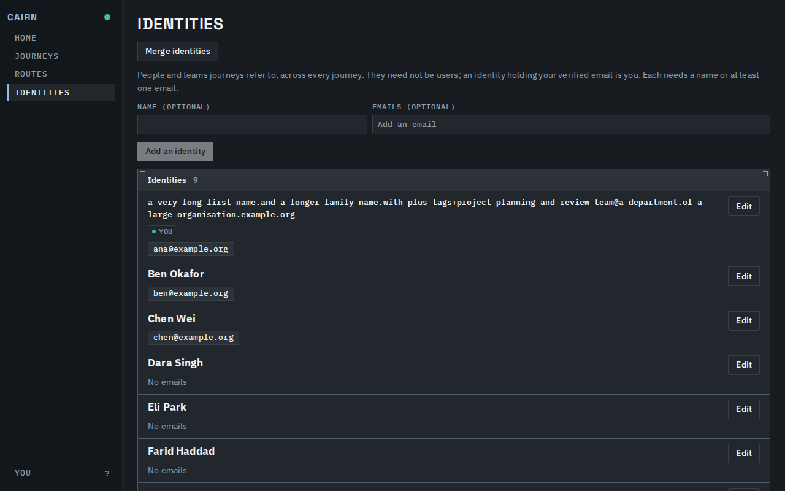
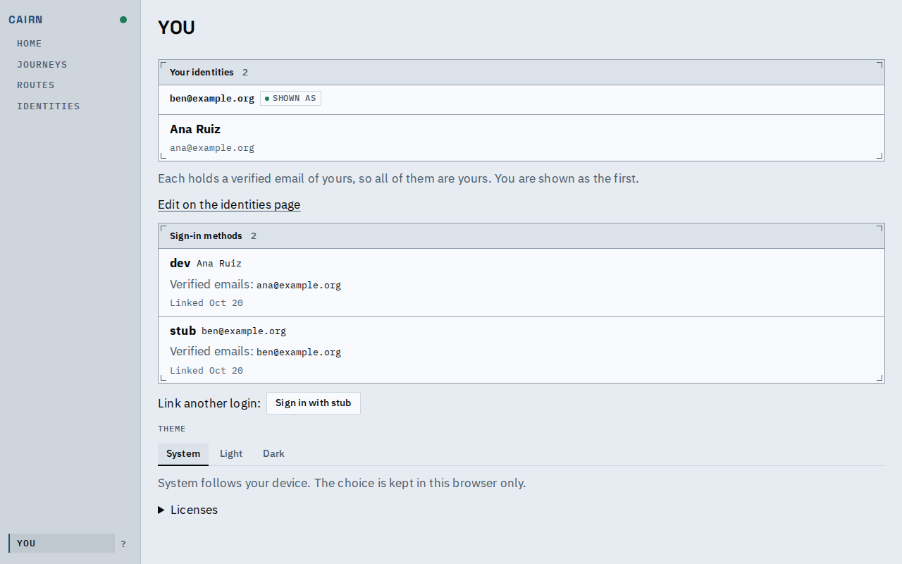

# The name prompt and You in their hard states

A person whose identity is known only by a very long email, on a phone with the keyboard up, or who matches several identities, can still read the prompt, fix a too-long name, and see who they are shown as.

The email is named once, in mono, wrapping anywhere; "and 1 more" stands for the rest.

A name past the limit says what to do ("Shorten the name to save it") and Save stays off; the field is 16px and the buttons stay in view.

An unnamed identity is titled by its first email, which is not listed again beneath it.

Identities and sign-in methods are panels; with several identities the first by key is marked "Shown as", which is also the one the prompt asks about.

## Known limits

- The phone capture shortens the viewport to stand for the keyboard; it is not a real software keyboard.
