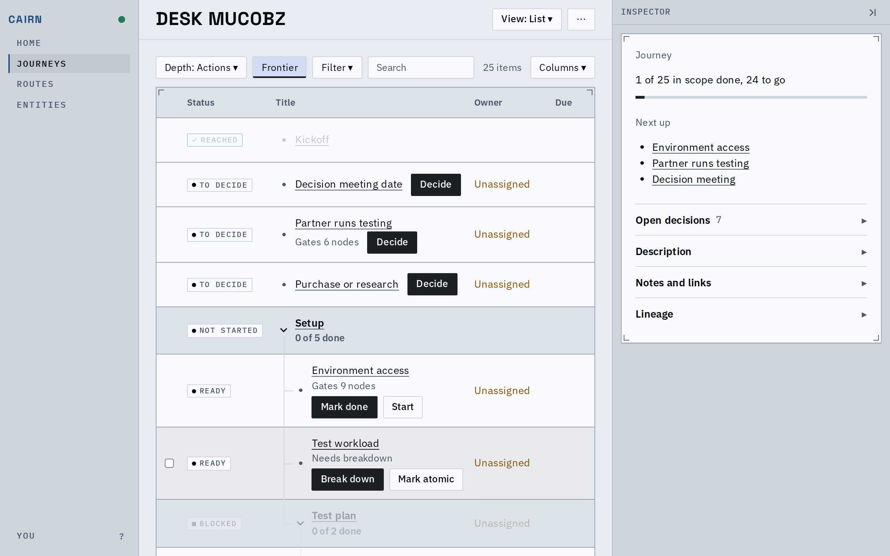
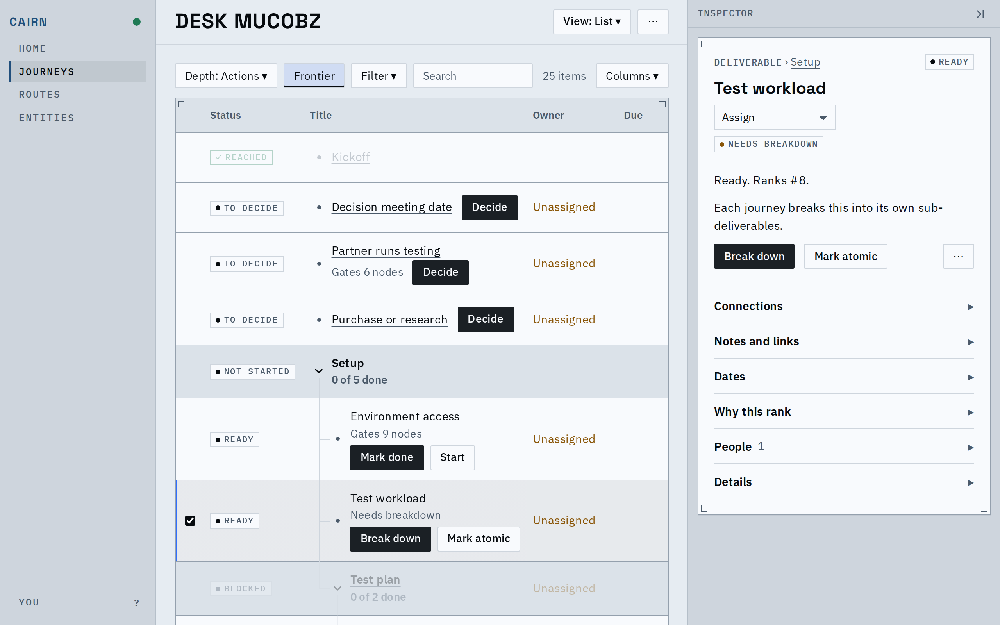
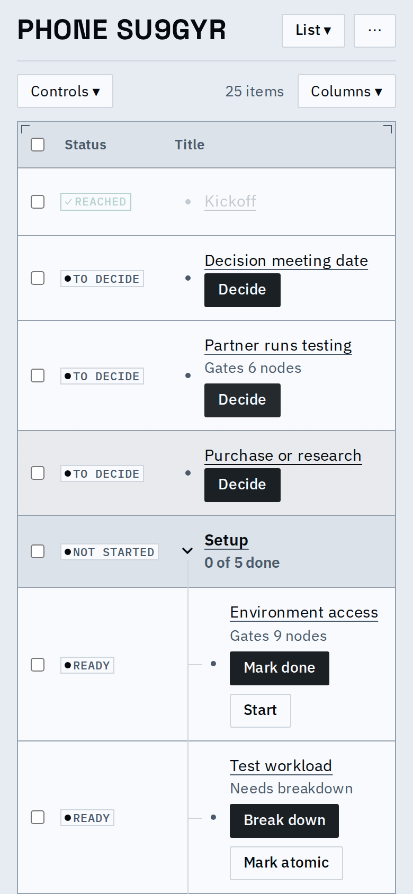
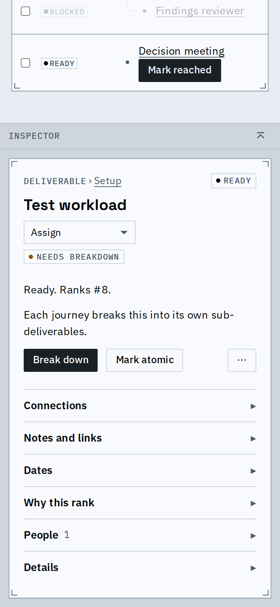

# Proof: row actions and the inspector's owner, at desktop and phone width

- A list row's reason and buttons share a line, and a row with no reason puts its buttons on the title's line.
- The inspector's Assign is the one owner picker (the same as a row's): choosing a person sends it.
- Rank is said once, in the inspector's sentence; a save no longer prints "Saved" under the control (the sync dot says it).
- Bulk Snooze offers the inspector's quick dates (Tomorrow, Next Monday, a date, when something is done).

## Known limits

- On a phone a row's buttons take their own line and stack when two do not fit beside the tree's indent.
