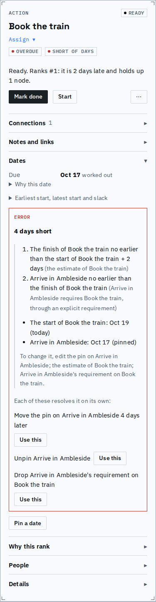
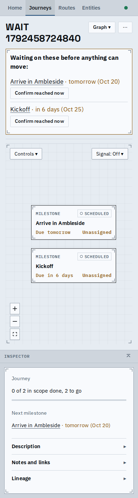
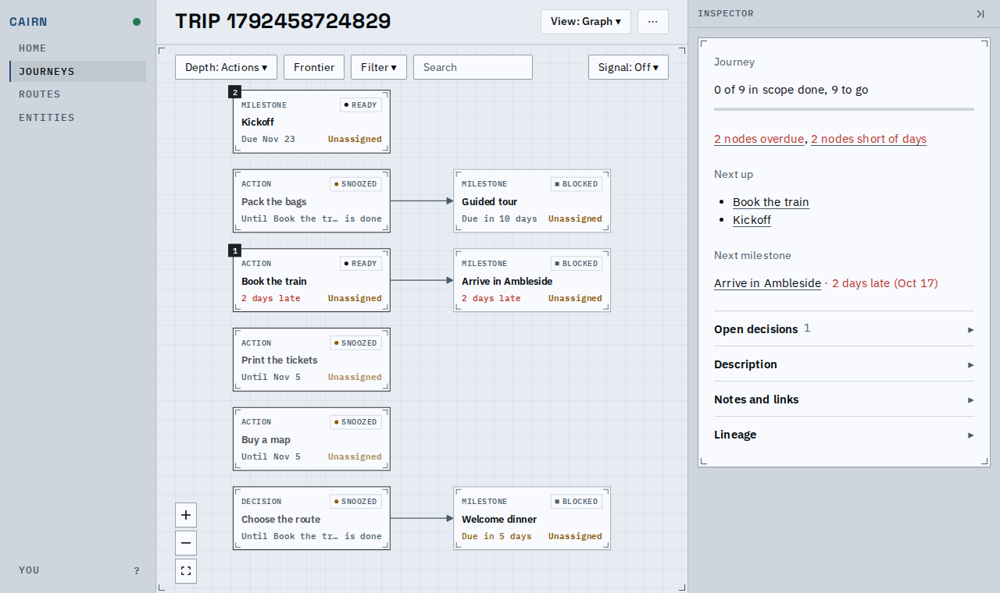
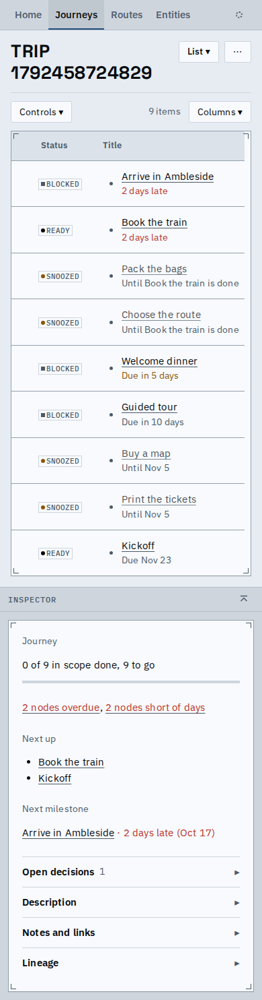
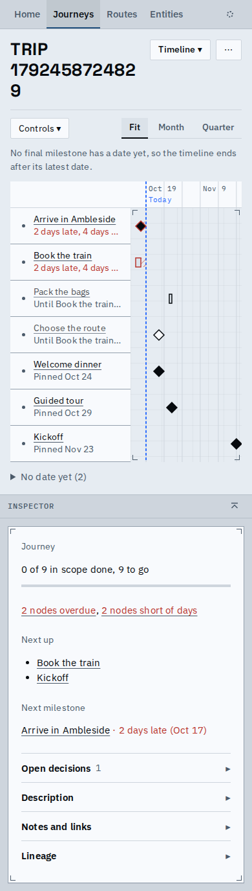
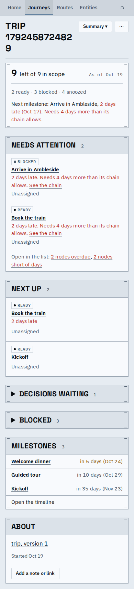

# One voice, second pass: phones, snoozes, and the inspector said once

Follow-up to the one-voice change: what the 390px phone and snoozed nodes look like with the shared words, and the fixes that came out of looking.

The inspector no longer says a fact twice. The header line under the title keeps only the owner; the date lives in the Dates section and the rank in the sentence. The pin editor repeats the pin only when the Due row shows something else (a finished node's due is its recorded date). A finished node's chain and a started node's sentence say the same date and rank as before, and the chain no longer prints the year for this year's dates. The two folds in Dates say what they open ("Why this date", "Earliest start, latest start and slack") and show a marker.

The stalled panel's head says "Waiting on these before anything can move", so it no longer denies the buttons under it. On a phone each action sits under its title.

Snoozed nodes on the graph, on a card, say where the snooze ends: a date ("Until Nov 5") or a node ("Until Book the tr... is done", the tail kept whole).

On a phone the list drops its Due column, so a row with a due date said nothing about it. Each row now says its due words under the title, in the card's ink, and a snoozed row says where it ends; the status and checkbox columns are a little narrower, so the snooze reads on one line.

Also fixed from the phone shots: the timeline axis printed "No final milestone" over "Today" on a narrow screen; the Summary's attention reasons are now sentences ("2 days late. Needs 4 days more than its chain allows.").

 

Known limits:
- The journey index on a phone still shows the second trouble kind as "+1 more".
