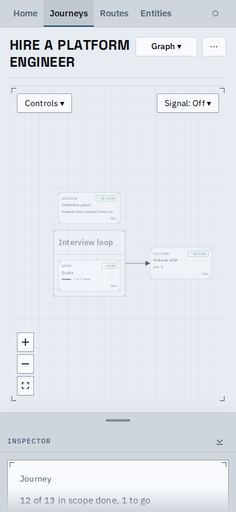
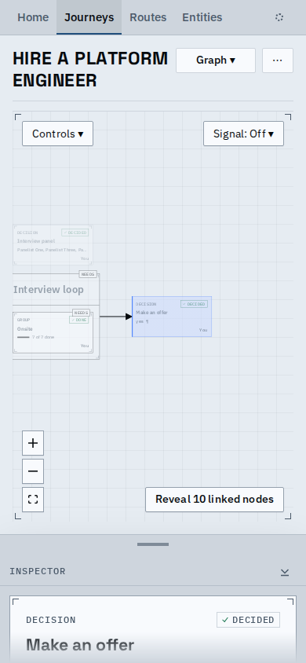
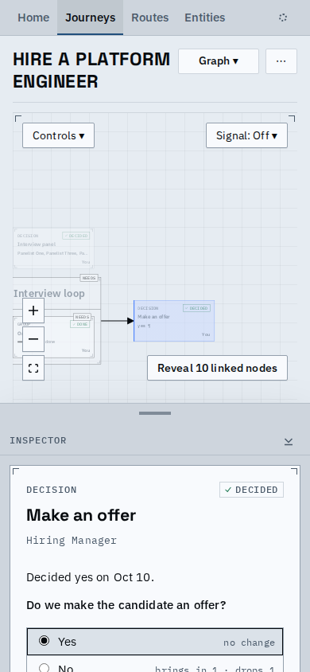
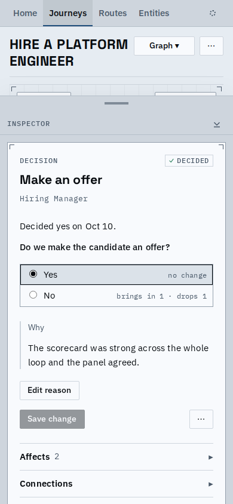
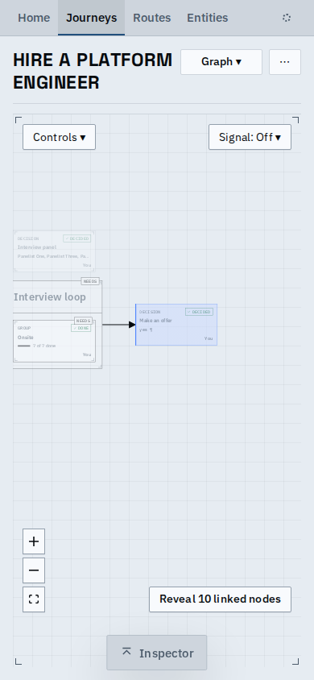
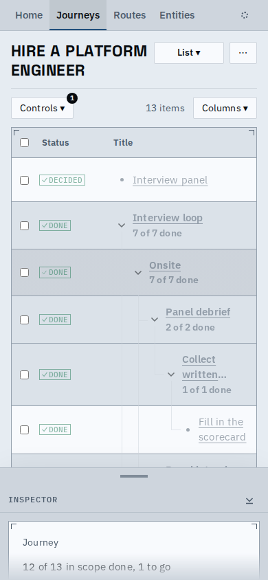
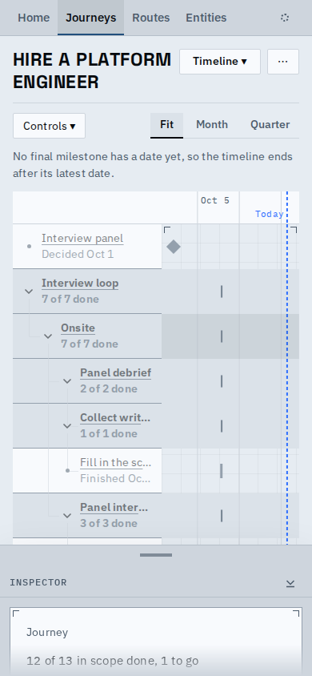
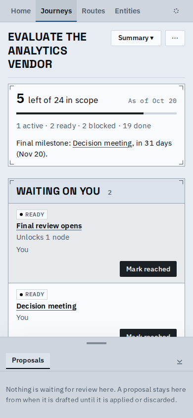
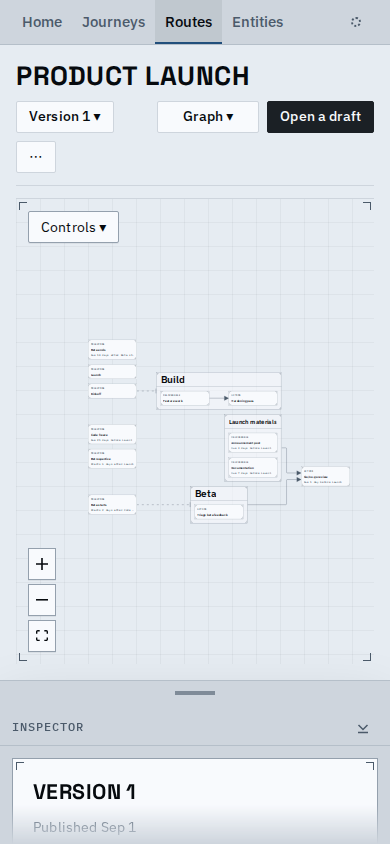

# The inspector on a phone is a bottom sheet

On a phone (and a tablet) the inspector is now a sheet over the page, with a handle that really drags, a real close, and no bar or blank strip left behind when it is closed. It is the same sheet for a journey's graph, list and timeline, a route's page, and the Proposals tab.

The peek: a grip, the tabs, and the top of the pane. The graph ends above it, so the whole graph still pans.

Picking a node opens it at the peek, showing the node's kind, status and title.

Dragged up (finger or pointer) it settles on half; the node's form is in reach and the graph is still above.

Full height, where the sheet's one scroller reads the node; a tap on the grip or the arrow keys step it back.

Dragged down below the peek (or the hide button, or Esc) it closes: one labelled pill, the graph fills the window to its foot, and its bottom controls ride above the pill.

| Sibling views at the peek | |
| --- | --- |
|  |  |
|  |  |

`sheet.webm` is the main flow: pick a node, drag the sheet to half and full, close it, open it from the pill, pan the graph.

Known limits:
- A node opened by address (a link) or a tap lands at the peek, so its form is one drag or tab tap away; that is the design's choice for keeping the graph usable.
- A landscape phone has little room above a 160px peek; the sheet still works but the graph gets short.
