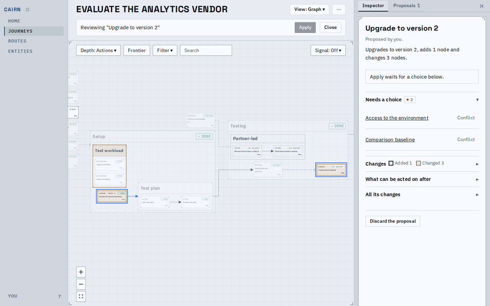
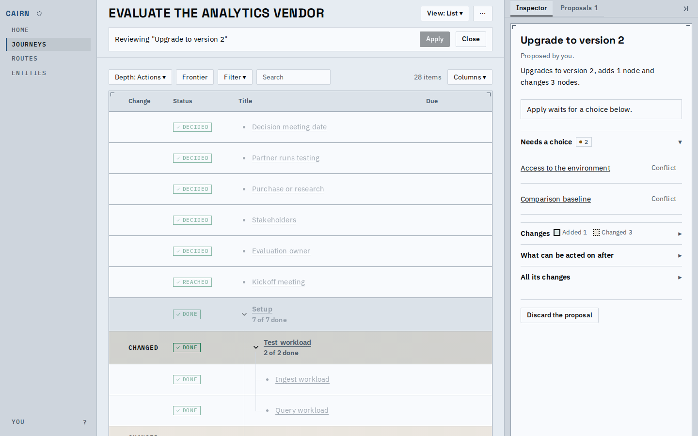
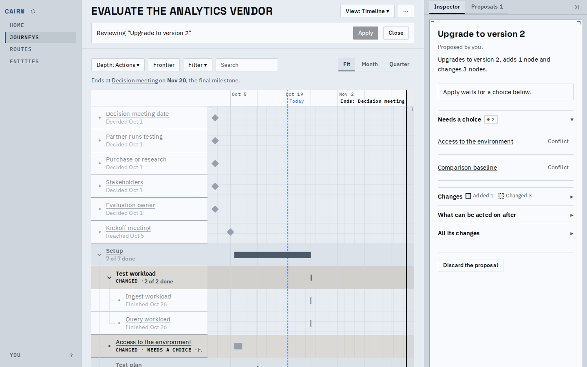
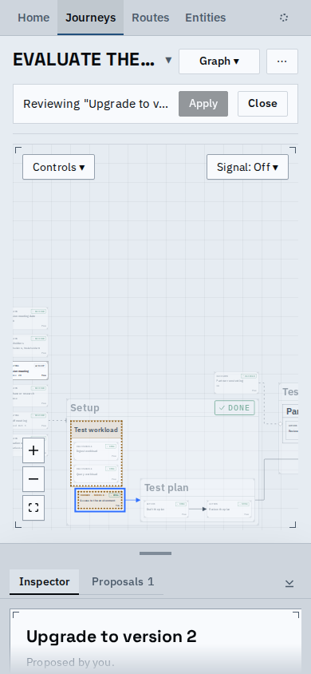
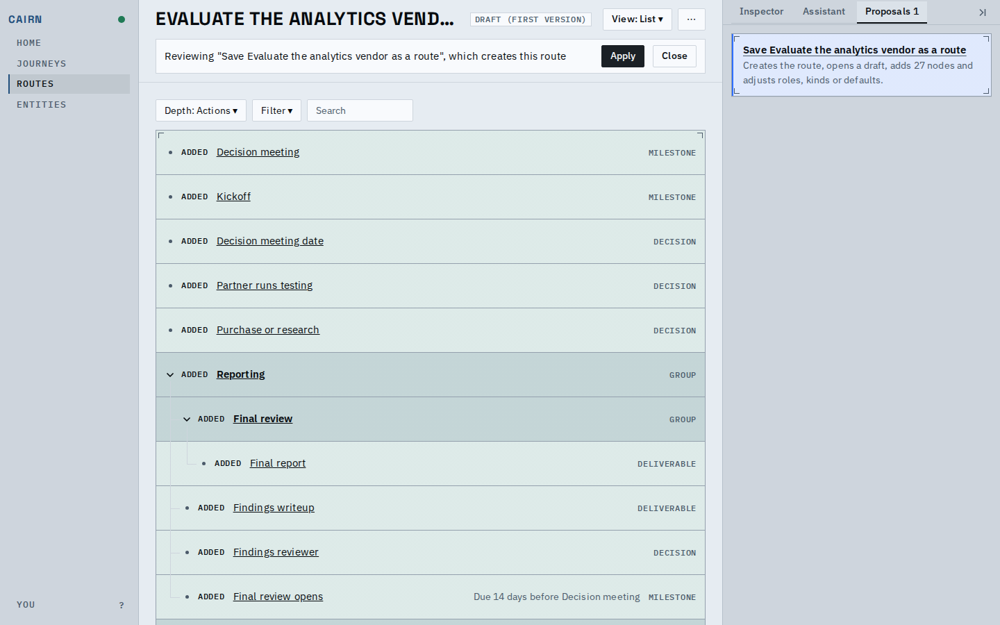
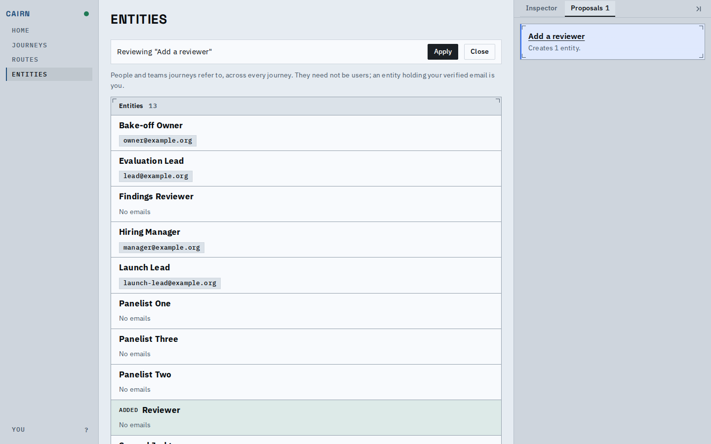

# A proposal is reviewed over its destination's own page

Open a proposal and you are on the journey (or route, or Entities) page itself, with a one-line band under the header: what you are reviewing, Apply, Close. Every view the destination has (Graph, List, Timeline) draws the proposal's changes in place, and the inspector holds one review rail.

The graph: added, changed and removed nodes carry a fill and a constant edge (solid, dotted, dashed); two conflicts wait for a choice in the rail.

The list gains a Change column and the same fills on its rows.

The timeline marks changed rows and tracks, and lists removed nodes in a fold.

On a phone the band stays under the header and the rail is the inspector sheet.

A route page under a layer that creates the route draws the same marks in its own List.

Entities keeps its directory order and rows; the proposed one is filled in place.

The main flow: switch views, resolve both conflicts, save, Apply; the band then says the proposal was applied.

[flow.webm](flow.webm)

Also in this change: the old review screen is gone; Home folds a "Proposals to review" line; the Proposals tab rows say what each proposal changes; Apply is one click at the revision on screen.

Known limits:
- The graph opens fitted to the whole journey, so the changed region can be small until you zoom.
- The list's Frontier panels are hidden under the layer so no live write can start there; no browser test covers that.
- Apply binds to the revision whose preview finished deriving; the views' layout may trail it by a moment, and the server's revision check is the backstop.
