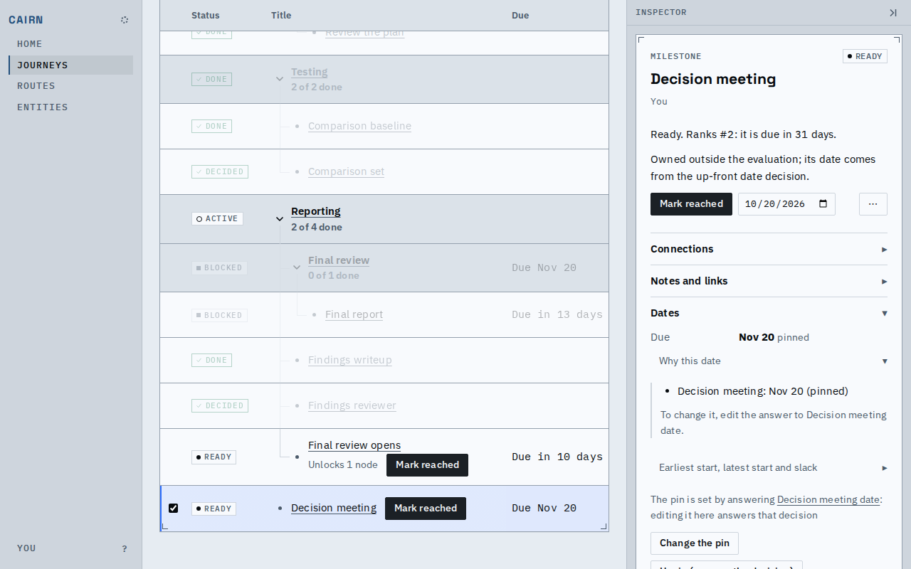
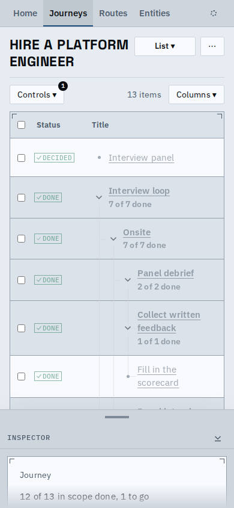

# Proof: one phrase for who has a node, rows that keep their buttons beside the title, a phone list that stays readable

- The inspector says every owner of a node (as the list, cards and Summary do), with the viewer as "You".
- A list row's reason and buttons sit on the title's line even beside an open inspector: the Owner column gives way with the others, so the title keeps about 350px, and a timeline label has 240px.
- On a phone a deep tree stops indenting after two levels, so a fifth-level title still has most of its width.
- The inspector's Dates folds open like its sections (the same 44px row and right-hand chevron, indented under their Due line), and the `⋯` names itself on hover.

## Known limits

- With the inspector open the list no longer shows the Owner column; the inspector says it.
