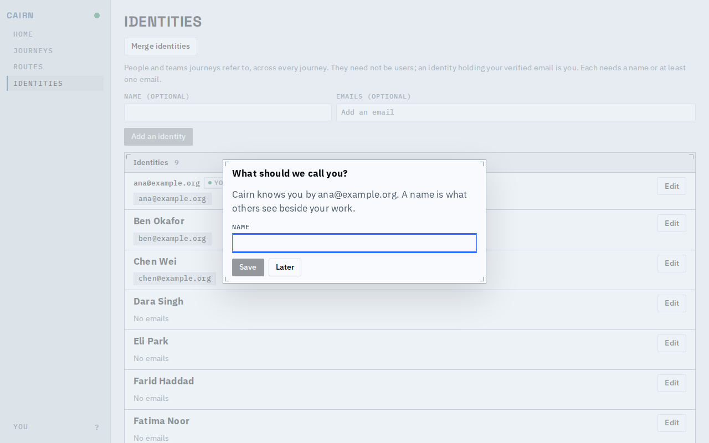
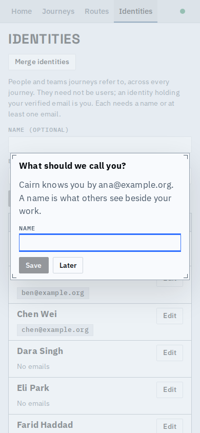
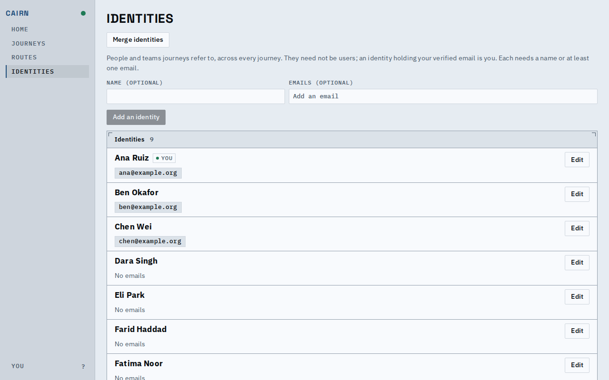
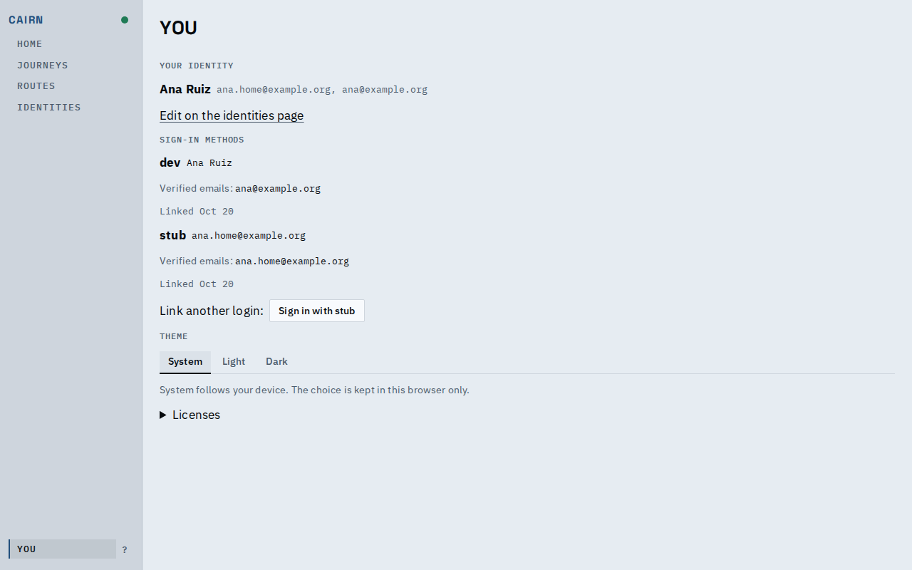
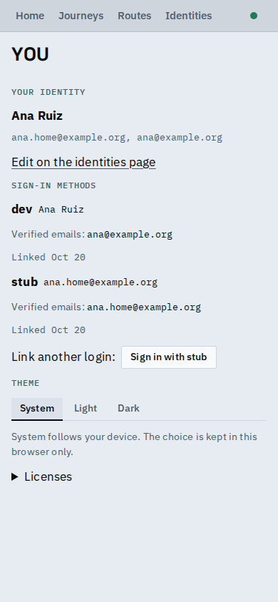

# Signing in matches an identity, and asks for a name

Signing in now creates or matches an identity from the verified email, so "mine" works at once. Cairn asks what to call you when your identity has no name. `/me` shows who you are and the logins that lead to it.

The prompt on load, over the Identities page, where the caller's identity (marked You) shows by its email.

At phone width the prompt fits the screen with its field and both buttons in view.

After Save the identity shows by name; Later would have closed the prompt until the next load.

`/me` names the identity and both its emails, then lists the logins with the date linked in place of a timestamp.

[A short video of the whole flow](asking-for-a-name.webm): clear the name, reload, the prompt, Save, add a second email, link a second login.

## Observed

A roster email (`ana@example.org`) signs in and matches its identity: the deployment held 9 identities before and 9 after. A second email of Ana's (`ana.home@example.org`), signed in on a second login, matched the same identity: still 9 identities, the caller holds the one identity, and `/me` lists two logins.

## Known limits

- The demo's dev provider signs in every request, so the stub sign-in here links to Ana rather than creating a person; creating an identity for an unknown email is covered by the service and API tests.
- The prompt asks for the caller's first identity by key; a caller with several named and unnamed identities is asked only when that first one is unnamed.
